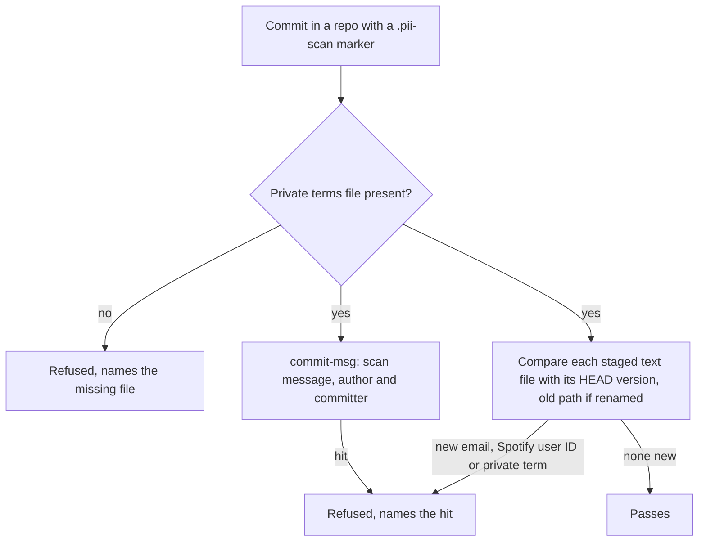

# Refuse a public commit that adds personal data

## Symptom

On 2026-11-08 the `spotify-playlist` skill was pushed to the public `claudence` repo with no check for personal data; the owner asked whether one had run. None existed.

## Reproduce

1. In `~/.claude`, stage a file containing a personal email address.
2. Commit: it lands.

## Expected

| AC | Traces | Given / when | Pass when | Fail when | Test |
|---|---|---|---|---|---|
| AC-1 | - | A staged file adds a personal email or a Spotify user ID (URI, profile or API link, any locale) | It is reported, masked (email local part, term by number); attribution, example and SSH-remote addresses pass | It passes silently, or an attribution line is refused | `tests/test_pii_scan.py` |
| AC-2 | - | It adds a term from the private terms file, in any case or wrapped across lines; or the terms file is missing or empty | The term is reported; a missing or empty file refuses the commit and names the file | It passes, or the scan runs half-way without the terms | `tests/test_pii_scan.py` |
| AC-3 | - | A real commit in a marked repo carries personal data in a file, its message, or its author or committer identity | The hook exits 1 and names where | It exits 0 | `tests/test_pii_scan.py` |

## Actual

The commit landed; the only check afterwards was a manual grep.

## Must not change

| ID | Must not change | Test |
|---|---|---|
| MNC-1 | A repo without the `.pii-scan` marker is not scanned, and data already at HEAD never blocks unrelated work, including when its file is renamed | `tests/test_pii_scan.py` |

## Probe

[evidence/probe.md](evidence/probe.md)

## Root cause

claudence's hook config checked file names, decision ids and the spec trailer, but nothing checked content before a push to a public repo. Scope is claudence only: the fleet installer copies `git-hooks/fleet-pre-commit-config.yaml`, which does not carry this hook (rolling it out to the other public repos is backlog). Out of scope, backlog (security review 2026-11-08): a pre-push scan of each outgoing commit, the guard bypasses `git commit -n`, `-c core.hooksPath` and `SKIP=`, binary and UTF-16 files (`types: [text]`), encoded emails and split terms, and cherry-picked commits made without the hook. The author emails already published in this repo's history are an owner decision (rewriting public history). The private terms live in `~/.claude/private/pii_terms.txt`, gitignored, because the terms themselves are personal data.
