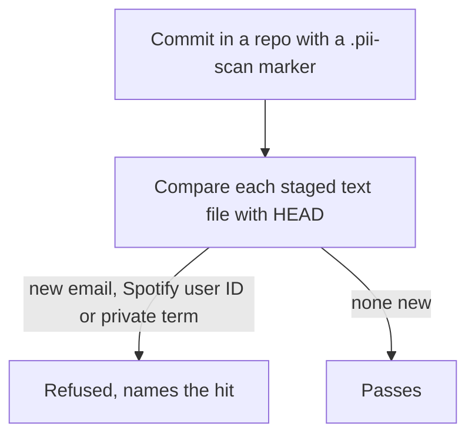

# Refuse a public commit that adds personal data

## Symptom

On 2026-11-08 the `spotify-playlist` skill was pushed to the public `claudence` repo with no check for personal data; the owner asked whether one had run. None existed.

## Reproduce

In `~/.claude`, stage a file containing a personal email address and commit.

## Expected

| AC | Traces | Given / when | Pass when | Fail when | Test |
|---|---|---|---|---|---|
| AC-1 | - | A staged file adds a personal email or a `spotify:user:` URI | It is reported; attribution and example addresses pass | It passes silently, or an attribution line is refused | `tests/test_pii_scan.py` |
| AC-2 | - | It adds a term from the private terms file, in any case | The term is reported; with the file missing, emails and IDs are still checked and the missing file is named | It passes, or the check is skipped silently | `tests/test_pii_scan.py` |
| AC-3 | - | A real commit in a marked repo carries personal data | The hook exits 1 and names it | It exits 0 | `tests/test_pii_scan.py` |

## Actual

The commit landed; the only check afterwards was a manual grep.

## Must not change

| ID | Must not change | Test |
|---|---|---|
| MNC-1 | A repo without the `.pii-scan` marker (every private fleet repo the shared config is copied into) is not scanned, and data already at HEAD never blocks unrelated work | `tests/test_pii_scan.py` |

## Root cause

The shared hook config checked file names, decision ids and the spec trailer, but nothing checked content before a push to a public repo. The private terms live in `~/.claude/private/pii_terms.txt`, gitignored, because the terms themselves are personal data.
