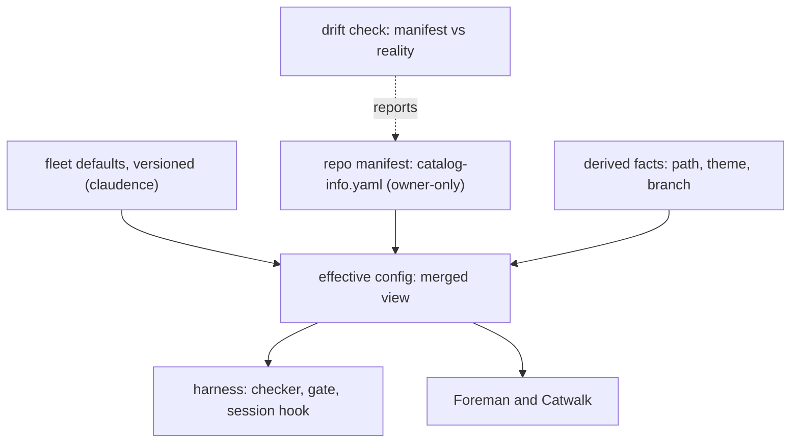
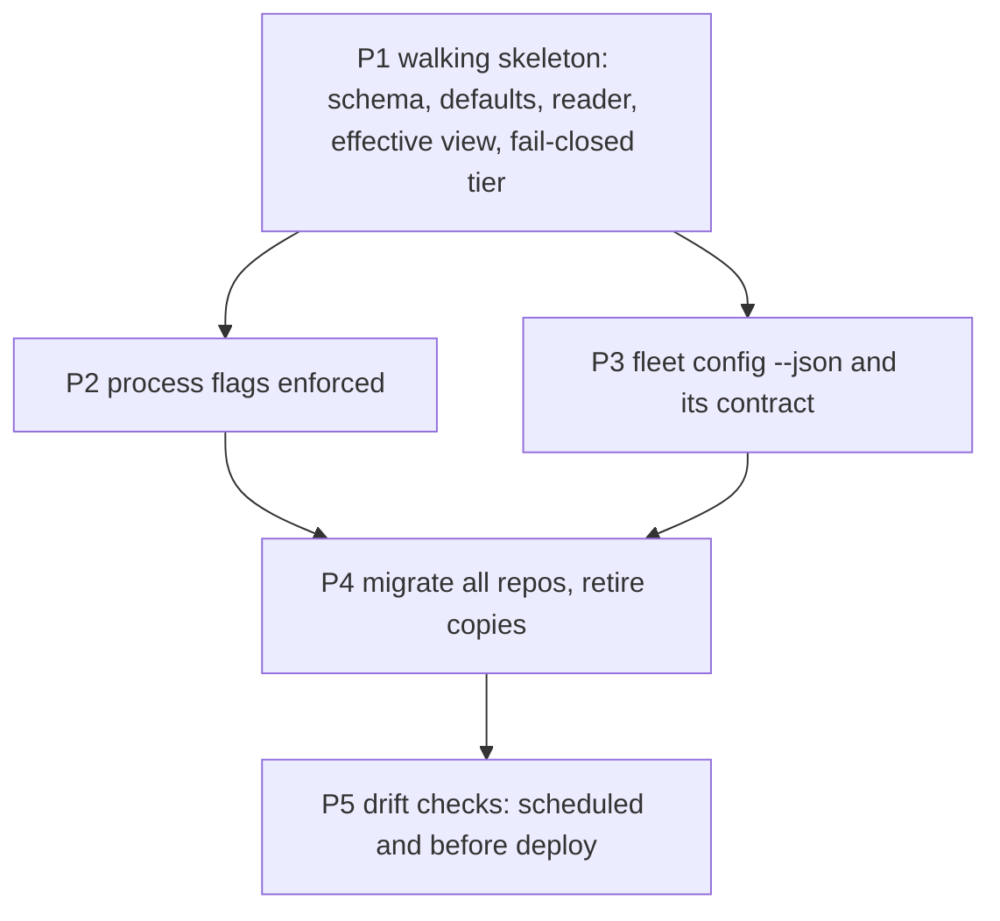

# Project manifest: one source of truth per fact, process flags, and a checked update cycle

## Decisions (one-way doors)

| # | Decision | Status | Choice | Alternatives | Why it is hard to reverse |
|---|---|---|---|---|---|
| D-B | One source of truth for config | **confirmed** (owner 2026-11-03, D45) | every fact has exactly one writable home; other places read through or are generated | facts copied wherever needed (today) | every reader in the harness, Foreman and Catwalk moves to it |
| D-I | The repo file | open, recommended | `catalog-info.yaml` at the repo root, Backstage-shaped, with the fleet's keys in one `fleet:` block; it `extends` a pinned fleet-defaults version | a `.claude/` file; keys in CLAUDE.md | 28 repos carry it; Foreman, Catwalk and the gate parse it |
| D-J | Process flags | open, recommended | `processes: {v2, v3, loop}`, each `on`, `frozen` or `off`; fleet default v2 `on`, v3 `on`, loop `off`; a repo overrides | one global switch | the checker, the gate and dispatch read them |
| D-K | Who may change the manifest | open, recommended | owner only: the guard refuses agent edits to `catalog-info.yaml` and the fleet defaults; a staged profile below HEAD's also needs an owner `owner-decision` record (agentic-loop D-L) | any agent with review | a manifest edit can lower a repo's caution |
| D-M | Tier source (PM-1) | open, recommended | the **profile is stored**; `deploymentTier` and Foreman autonomy are **derived** by the map in [INDEX](../../capabilities/INDEX.md) (`yolo` pre-traffic and full; `public` and `revenue` live and label-gated), whose source is the `profiles:` block of `fleet-defaults.v1.yaml`; once HEAD has a manifest, a missing or invalid one refuses (fail closed) | store the tier too; fall back to CLAUDE.md | P4 strips the CLAUDE.md and STATE.md tier lines in 28 repos |

## Purpose

Per-project facts live in many copies that already disagree: the tier in CLAUDE.md and in STATE.md, read by five
parsers; three of six Foreman gate commands differ from their repos; `repos.json` has two writers and two schemas
(config inventory, `evidence/probe.md`). The owner wants one source of truth for every config and core fact, a known
creation and update cycle, and feature flags that cut a process version off from the harness (owner, 2026-11-03).

## Goals and non-goals

- Goal: every fact is classified (per repo, fleet default with override, by reference, derived, or state) and has
  one writable home.
- Goal: one effective-config view that agents and humans read instead of raw files.
- Goal: process flags (`v2`, `v3`, `loop`) that the checker, the gate and dispatch obey.
- Goal: the manifest stays true: it is created at intake, changed only by the owner, schema-checked on every commit
  that touches it, and compared with reality on a schedule and before every deploy.
- Non-goal: secrets (env var names only, never values); state such as `reviewQueue` and `backlogItems` (stays in
  STATE.md); Catwalk UI changes (owner-gated).

## Background

- **Single source of truth**: each fact has one writable place; every other appearance reads from it or is generated.
- **Defaults plus override**: a repo file points to a pinned shared base and holds only what differs.
- **Effective config**: a command that prints the merged result, so nobody "fixes" a value set upstream.
- **Schema gate and drift gate**: a schema check on every change, and a separate check of the file against reality.

Detail and sources

- Defaults plus override: Renovate presets (`extends`, pinned by version), ESLint shareable configs, Kustomize
  bases and overlays; each tool merges arrays differently, so merge rules are stated per field.
- Effective config: Renovate `printConfig`, ESLint `--print-config`, `kustomize build`, `nx show project`.
- Schema and drift: RoadieHQ Backstage entity validator, `renovate-config-validator --strict`, `cue vet`;
  `terraform plan -refresh-only`, OpenSSF Scorecard. Backstage keeps the last good descriptor when a new one fails,
  so a broken edit stays invisible unless the commit is checked.
- Catalog rot: a descriptor stays true only when an existing gate reads it; derive what code can tell, hand-write
  only human facts (owner, lifecycle, tier, purpose).
- Notes: `D:/repo/docs/research_notes/Project manifest/` (web_config_sot.md, config_inventory.md).

### Where each fact lives

| Class | Facts | Home | Changed when |
|---|---|---|---|
| Per repo (1:1) | profile (`yolo`, `public`, `revenue`), gate command, archived, depends-on, post-merge steps, deploy target and URL, notification source | `catalog-info.yaml` `fleet:` block | intake; a profile change (first public user, first payment); archive; deploy setup |
| Fleet default, repo may override | process flags, package manager, docs root, state-doc path, owner, size limits | `~/.claude/contracts/fleet-defaults.v1.yaml`, pinned by version; override in the repo file | fleet decision (owner); a repo's exception |
| By reference (pointed to, never copied) | spec standard, contracts, theme rules, `.env.example`, settings and hooks, TeleFi commands | a path or contract id in the manifest | when the referenced file changes, nothing in the manifest does |
| Derived (computed, never written) | repo path, theme, remote, default branch, `deploymentTier` and autonomy (from the stored profile, D-M) | the effective-config view | never stored |
| State (not config) | `reviewQueue`, `backlogItems`, phase | `docs/STATE.md` | as work moves |

## Approach

Baseline: today's copies (CLAUDE.md tier line, STATE.md, `~/.foreman/repos.json`, `.pre-commit-config.yaml`).

| Dimension | A: keep copies, add a sync check | B: recommended (one manifest, defaults by reference, effective view) | C: a central registry only (`repos.json`) |
|---|---|---|---|
| Disagreement between copies | 0 detected, still possible | + impossible: one writable home | + |
| Lives with the repo | 0 | + in git, reviewed with the code | - outside the repo |
| Readers to change | + none | - five parsers move to one reader | - |
| Owner control | 0 | + guard-protected file | 0 |
| Reversibility | + | 0 the old copies become generated | - |
| Build complexity | + | - schema, two readers, migration, drift check | 0 |

Chosen: **B**.

## Milestones

The table is the plan only (no Status column, no color classes; progress is generated, agentic-loop AL-M2). Build
order across specs and file owners: [INDEX](../../capabilities/INDEX.md).

| Milestone | Slice (what works after it) | Depends on | Owns | Outer test (red first) | Unblocks |
|---|---|---|---|---|---|
| P1 | the schema, fleet defaults and Python reader exist; `fleet config <repo>` prints the effective config with each value's source; the profile is stored and `deploymentTier` derived; `spec_v3` and the gate read the tier from the manifest and refuse when a repo that had one loses it; claudence and cashcow have manifests | - | `contracts/project-manifest.v1.json`, `contracts/fleet-defaults.v1.yaml`, `scripts/manifest.py`, `scripts/fleet_config.py`, `scripts/spec_v3.py`, `scripts/spec_gate.py` | AC-1 | AL-M1, AL-M2 (profiles) |
| P2 | the checker and gate obey `processes`; dispatch drafts only in an `on` version; the session hook shows the flags; the guard protects the manifest and the fleet defaults | P1 | `scripts/spec_check.py`, `scripts/spec_gate.py`, `hooks/session_context.py`, `hooks/guard.py` | AC-4 | process versions cut off by flag |
| P3 | claudence publishes `fleet config --json`, the effective-config contract and its fixtures; Foreman and Catwalk adopt them through child items in their own repos (INDEX), and `repos.json` stays a generated cache | P1 | `scripts/fleet_config.py`, `contracts/effective-config.v1.json` | AC-6 | one tier for every reader, tested in each repo |
| P4 | every repo has a manifest generated from today's copies and reviewed by the owner; the CLAUDE.md tier line is removed or generated, the STATE.md tier line only after the Catwalk child item ships; the three gate-command mismatches are fixed | P2, P3 | `scripts/manifest_migrate.py` | AC-8 | the copies stop drifting |
| P5 | a scheduled drift check compares each manifest with reality and reports through TeleFi, including a host that auto-deploys on push for a `public` or `revenue` repo; a deploy for such a repo is refused while its drift report is not clean | P4 | `scripts/manifest_drift.py` | AC-10 | the manifest stays true |

## Contracts

| Name | Version | Schema | Fixtures |
|---|---|---|---|
| repo manifest (`catalog-info.yaml` `fleet:` block) | v1 | `contracts/project-manifest.v1.json` | `contracts/fixtures/manifest-*.yaml` |
| fleet defaults and merge rules per field | v1 | `contracts/fleet-defaults.v1.yaml` | `contracts/fixtures/defaults-*.yaml` |
| effective config (the merged view, each value with its source; `fleet config --json`) | v1 | `contracts/effective-config.v1.json` | `contracts/fixtures/effective-*.json` |
| drift report | v1 | `contracts/manifest-drift.v1.json` | `contracts/fixtures/drift-*.json` |

## Behaviour

| AC | Traces | Given / when | Pass when | Fail when | Test |
|---|---|---|---|---|---|
| AC-1 | P1 | `fleet config` on a repo with a manifest that overrides one default | prints every fact with its value and source (default, override, derived) | a value or its source is wrong | tests/test_project_manifest.py |
| AC-2 | P1, D-I | manifests: valid; an unknown key; a wrong type; a profile outside the enum; an `extends` naming no pinned version | valid read; each other refused by name | a bad manifest is read | tests/test_project_manifest.py |
| AC-3 | P1, D-B, D-M | each profile; a repo with a manifest and a stale CLAUDE.md tier line; a repo that never had a manifest (CLAUDE.md `pre-traffic`, then `live`) | the stored profile derives tier and autonomy as in the INDEX map (equal to the `profiles:` block); every converted reader (P1: `spec_v3` and the gate) takes the manifest's value; a never-had repo reads CLAUDE.md as today | a value differs from the map, a reader uses the copy when a manifest exists, or the INDEX table drifts | tests/test_project_manifest.py |
| AC-4 | P2, D-J | each process at `on`, `frozen` and `off`: a new item, a status move of an existing item, a dispatch | `on` allows all; `frozen` refuses only the new item; `off` refuses new items and moves and dispatch names the flag | a flag is ignored | tests/test_project_manifest.py |
| AC-5 | P2, D-K | an agent edit to `catalog-info.yaml` or the fleet defaults | the guard refuses it | it lands | tests/test_project_manifest.py |
| AC-6 | P3, PM-2 | `fleet config --json` on the fixture repos | the JSON validates against `contracts/effective-config.v1.json` and equals the fixtures `effective-*.json` | it does not validate or differs | tests/test_project_manifest.py |
| AC-7 | P1, D-M, PM-1 | a repo whose HEAD has a manifest: it is deleted, unparseable or schema-invalid at HEAD, and the same staged; a lock and a ship (P1) and the deploy promote step (once agentic-loop AL-M3 adds `final_gate.py`, which reads the same reader) | each refused naming the manifest, never a fallback to CLAUDE.md or `yolo` | any of them lands, or a fallback is used | tests/test_project_manifest.py |
| AC-8 | P4 | the migration on a temp copy of every repo, run twice | each manifest is valid, every fact has one home, the second run changes nothing, the diff is shown for owner review, nothing is committed without it | a fact is lost or a copy left writable | tests/test_project_manifest.py |
| AC-9 | P4, compatibility | every v2 and v3 item in the fleet after migration | judged exactly as before | any result changes | tests/test_project_manifest.py |
| AC-10 | P5 | drift fixtures: a lockfile for a package manager other than the manifest's; a gate command missing from `package.json`; a `yolo` repo with live payment keys named in its env example; a `revenue` repo whose host auto-deploys on push; a clean repo | each mismatch reported by name; the clean one silent | a mismatch is missed | tests/test_project_manifest.py |
| AC-11 | P5 | a deploy of a `revenue` repo with an open drift report, then a clean one | refused, then allowed | otherwise | tests/test_project_manifest.py |
| AC-12 | docs | SPEC-STANDARD-V3.md, the dispatch playbook, DEVELOPMENT_LIFECYCLE.md | each names the manifest as the source of every per-project fact | a doc names a copy | tests/test_project_manifest.py |
| AC-13 | P1, D-K, PM-1 | a staged manifest whose profile is below HEAD's (`revenue` to `yolo`, `public` to `yolo`, `revenue` to `public`): without a record; with an owner `owner-decision` record for the current content; with one written by an agent tool call; a raise | the lowering is refused naming the profile; it lands with the owner record; the agent-written record is denied (agentic-loop AC-5); a raise lands | a lowering lands without the owner's record | tests/test_project_manifest.py |
| AC-14 | P4, PM-1 | the migration on a temp copy of every repo, cashcow named (CLAUDE.md `live`) | each repo's old tier is at most its migrated profile's derived tier (pre-traffic < live); cashcow becomes `revenue`; a lower profile is refused | any repo's tier falls | tests/test_project_manifest.py |

## Outcomes

| Dimension | Level | Row or n/a reason | AC |
|---|---|---|---|
| success | L3 | every reader gets one value with its source | AC-1 |
| invalid input | L3 | malformed manifests are refused by name | AC-2 |
| dependency fails | L3 | a repo that never had a manifest reads its CLAUDE.md tier; one that had it and lost it is refused, never loosened | AC-7 |
| timeout | L1 | the reader is a file parse with no network or waits | |
| crash mid-step | L3 | the migration writes nothing until the owner accepts its diff | AC-8 |
| concurrent actor | L3 | only the owner may edit the manifest | AC-5 |
| duplicate or replay | L1 | re-running the reader or the migration on the same files gives the same result | |
| arrival channel | L3 | flags apply to commits, merges and dispatches alike | AC-4 |
| performance or cost | L1 | a single small file per repo is parsed on demand | |
| security | L3 | a repo cannot lower its own caution: owner-only edits, and a profile lowering needs an owner record | AC-13 |
| data and compatibility | L3 | existing items are judged unchanged and no repo's tier falls in the migration | AC-9 |
| operability | L3 | drift, host auto-deploy included, is reported and blocks deploys of `public` and `revenue` repos | AC-11 |

## Assumptions

| Assumption | Observed | If violated |
|---|---|---|
| Backstage allows a custom `fleet:` block in `catalog-info.yaml` | `D:/repo/docs/research_notes/Project manifest/web_config_sot.md:1` | flag: if not, the block moves under `metadata.annotations` or a sibling file named in the descriptor |
| The guard can protect a file outside `.claude/` | `C:/Users/Michael/.claude/hooks/guard.py:1` | refuse: P2 does not ship until AC-5 passes |
| Foreman and Catwalk adopt `fleet config --json` through child items in their own repos | `C:/Users/Michael/.claude/docs/capabilities/INDEX.md:75` | defer: `repos.json` stays a generated cache and P4 keeps the STATE.md tier line |

## Design fix round 1

Fixed (record `reviews/2026-11-03-design-4c7e55c8.md`): PM-1 (D-M, AC-3, AC-7, AC-13, AC-14, outcomes), PM-2 (P3, AC-6,
assumption). In passing: PM-8 (P4 order, idempotence), PM-9 (host auto-deploy), PM-10 (AL-M2 consumes P1), AL-3 (no Status column).

## Probe

[Probe](evidence/probe.md): the owner's D-B answer verbatim, the config inventory and the web practice.
