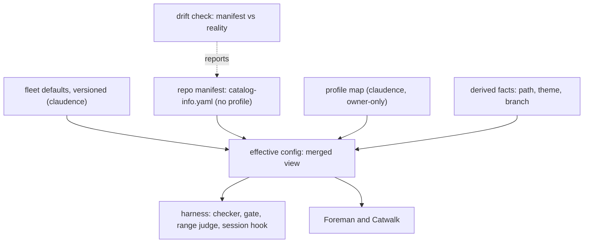
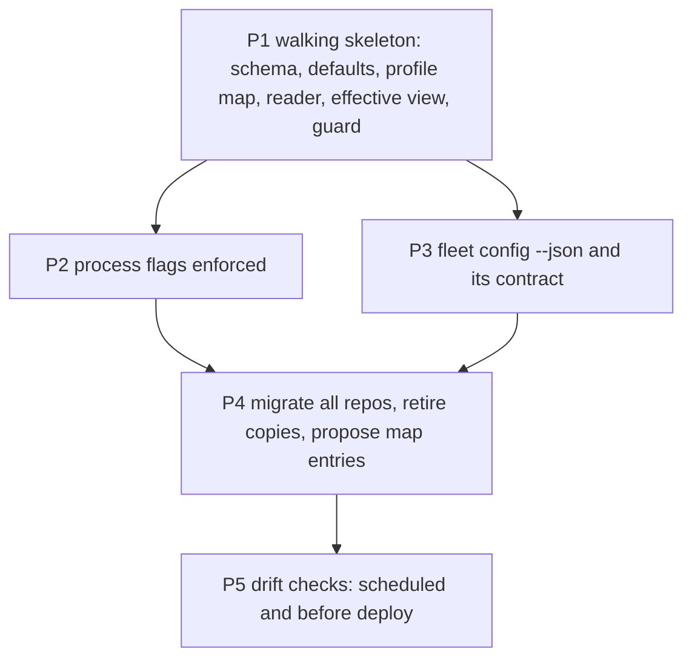

# Project manifest: one source of truth per fact, process flags, and a checked update cycle

## Decisions (one-way doors)

| # | Decision | Status | Choice | Alternatives | Why it is hard to reverse |
|---|---|---|---|---|---|
| D-B | One source of truth for config | **confirmed** (owner 2026-11-03, D45) | every fact has exactly one writable home; other places read through or are generated | facts copied wherever needed (today) | every reader in the harness, Foreman and Catwalk moves to it |
| D-I | The repo file and the profile's home | open, recommended (ADR 0002, D47) | `catalog-info.yaml` at the repo root, Backstage-shaped, with the fleet's keys in one `fleet:` block; it `extends` a pinned fleet-defaults version and holds **no `profile` key** (refused as unknown). The profile lives in the owner-only profile map in claudence (`contracts/profile-map.v1.yaml`), read from claudence's HEAD commit, never from the judged repo and never a pinned version | the profile in the repo file (the first manifest has no baseline and every channel into the repo can rewrite it); an owner floor beside an in-repo profile (two homes for one fact, against D-B); a `.claude/` file; keys in CLAUDE.md | 28 repos carry the file and Foreman, Catwalk and the gate parse it; the map becomes the one place a profile is read |
| D-J | Process flags | open, recommended | `processes: {v2, v3, loop}`, each `on`, `frozen` or `off`; fleet default v2 `on`, v3 `on`, loop `off`; a repo overrides | one global switch | the checker, the gate and dispatch read them |
| D-K | Who may change the manifest and the map | open, recommended | owner only: the guard (P1) denies every agent tool call, subagent and main session, that writes the profile map, `catalog-info.yaml` or the fleet defaults; a profile change is the owner's own edit of the map, so no `owner-decision` record is needed and P1 does not depend on agentic-loop AL-M2 | any agent with review; a staged profile below HEAD's allowed with an owner record (a cycle with AL-M2, and defeated by fast-forward and squash) | a manifest or map edit can lower a repo's caution |
| D-M | Tier source (PM-1) | open, recommended | the **profile is stored in the map**; `deploymentTier` and Foreman autonomy are **derived** by the map in [INDEX](../../capabilities/INDEX.md) (`yolo` pre-traffic and full; `public` and `revenue` live and label-gated), whose source is the `profiles:` block of `fleet-defaults.v1.yaml`. A repo missing from the map takes the profile from its CLAUDE.md tier (`pre-traffic` gives `yolo`, `live` gives `revenue`, the highest caution, until the owner classifies it) until the owner sets the map's `complete: true` after P4, and is refused after | store the tier too; fall back to CLAUDE.md for good | P4 strips the CLAUDE.md and STATE.md tier lines in 28 repos |
| D-N | The profile floor (ADR 0002 Q4, replaced by D55) | **confirmed** (owner 2026-11-03, D55; supersedes D44's floor) | a `live` repo (`public` or `revenue`) can never drop below `public`. The map holds it as an absolute floor: every `public` or `revenue` entry carries `floor: public` and `floor_by: D55`, and the reader refuses a profile below its floor; to lower a repo further the owner removes the floor in the same edit as a DECISIONS row superseding D55. cashcow is `public` (publicly used, no revenue yet) and becomes `revenue` when it takes money; D44's "never below `revenue`" and D51's `revenue` are superseded | D44's floor at `revenue` (forbade `public` itself); an owner-decision record per lowering (the AL-M2 cycle); an owner edit plus a 72 h cooling-off with a TeleFi notice (the upgrade if a guard bypass is observed) | the floor is the owner's confirmed rule; moving it again needs a new DECISIONS row |

## Purpose

Per-project facts live in many copies that already disagree: the tier in CLAUDE.md and in STATE.md, read by five
parsers; three of six Foreman gate commands differ from their repos; `repos.json` has two writers and two schemas
(config inventory, `evidence/probe.md`). The owner wants one source of truth for every config and core fact, a known
creation and update cycle, and feature flags that cut a process version off from the harness (owner, 2026-11-03).
The second verify (2026-11-04) showed the one fact whose authority must survive every channel into a repo, the
profile, cannot live inside that repo; ADR 0002 moves it to an owner-only map.

## Goals and non-goals

- Goal: every fact is classified (per repo, fleet default with override, by reference, derived, or state) and has
  one writable home.
- Goal: one effective-config view that agents and humans read instead of raw files.
- Goal: process flags (`v2`, `v3`, `loop`) that the checker, the gate and dispatch obey.
- Goal: the manifest stays true: it is created at intake, changed only by the owner, schema-checked on every commit
  that touches it, and compared with reality on a schedule and before every deploy.
- Goal: no channel into a repo (commit, merge, fast-forward, squash, force push, import) can change that repo's profile.
- Non-goal: secrets (env var names only, never values); state such as `reviewQueue` and `backlogItems` (stays in
  STATE.md); Catwalk UI changes (owner-gated); the range judge itself (`gate-ci` GC-G1 owns it; this spec owns the
  predicate it calls for config integrity).

## Background

- **Single source of truth**: each fact has one writable place; every other appearance reads from it or is generated.
- **Defaults plus override**: a repo file points to a pinned shared base and holds only what differs.
- **Effective config**: a command that prints the merged result, so nobody "fixes" a value set upstream.
- **Schema gate and drift gate**: a schema check on every change, and a separate check of the file against reality.
- **Policy versus descriptor**: central policy (the profile map) is separate from the repo's own descriptor, so the
  governed repo cannot rewrite the policy that governs it (Allstar, rulesets).

Detail and sources

- Defaults plus override: Renovate presets (`extends`, pinned by version), ESLint shareable configs, Kustomize
  bases and overlays; each tool merges arrays differently, so merge rules are stated per field.
- Effective config: Renovate `printConfig`, ESLint `--print-config`, `kustomize build`, `nx show project`.
- Schema and drift: RoadieHQ Backstage entity validator, `renovate-config-validator --strict`, `cue vet`;
  `terraform plan -refresh-only`, OpenSSF Scorecard. Backstage keeps the last good descriptor when a new one fails,
  so a broken edit stays invisible unless the commit is checked.
- Catalog rot: a descriptor stays true only when an existing gate reads it; derive what code can tell, hand-write
  only human facts (owner, lifecycle, tier, purpose).
- Policy versus descriptor: `D:/repo/docs/research_notes/project-manifest/web_config_sot.md:185`.
- Notes: `D:/repo/docs/research_notes/project-manifest/` (web_config_sot.md, config_inventory.md).
- Reuse: searched `contracts/` and `D:/repo/Factory/foreman` for a per-repo policy map; none fits (`repos.json` is a
  generated cache with two writers and no owner-only guarantee), so the map is new and `repos.json` reads it through
  `fleet config --json`.

### Where each fact lives

| Class | Facts | Home | Changed when |
|---|---|---|---|
| Per repo, owner policy | **profile** (`yolo`, `public`, `revenue`), and its floor (`floor`, `floor_by`) | the profile map `contracts/profile-map.v1.yaml` in claudence (owner-only; the guard denies every agent write) | intake; a profile change (first public user, first payment), always the owner's own edit |
| Per repo (1:1) | gate command, archived, depends-on, post-merge steps, deploy target and URL, notification source | `catalog-info.yaml` `fleet:` block (no `profile` key) | intake; archive; deploy setup |
| Fleet default, repo may override | process flags, package manager, docs root, state-doc path, owner, size limits | `~/.claude/contracts/fleet-defaults.v1.yaml`, pinned by version; override in the repo file | fleet decision (owner); a repo's exception |
| By reference (pointed to, never copied) | spec standard, contracts, theme rules, `.env.example`, settings and hooks, TeleFi commands | a path or contract id in the manifest | when the referenced file changes, nothing in the manifest does |
| Derived (computed, never written) | repo path, theme, remote, default branch, `deploymentTier` and autonomy (from the profile, D-M) | the effective-config view | never stored |
| State (not config) | `reviewQueue`, `backlogItems`, phase | `docs/STATE.md` | as work moves |

## Approach

Baseline: today's copies (CLAUDE.md tier line, STATE.md, `~/.foreman/repos.json`, `.pre-commit-config.yaml`).

| Dimension | A: keep copies, add a sync check | B: recommended (one manifest, owner-only profile map, defaults by reference, effective view) | C: a central registry only (`repos.json`) |
|---|---|---|---|
| Disagreement between copies | 0 detected, still possible | + impossible: one writable home | + |
| Lives with the repo | 0 | 0 the descriptor does; the profile policy lives in claudence, public | - outside the repo |
| Readers to change | + none | - five parsers move to one reader; every reader needs claudence | - |
| Owner control | 0 | + guard-protected map and file; no channel into a repo changes the profile | 0 |
| Reversibility | + | 0 the old copies become generated; map cheap before P4, costly after | - |
| Build complexity | + | - schema, two readers, a map, migration, drift check | 0 |

Chosen: **B**.

## Milestones

The table is the plan only (no Status column, no color classes; progress is generated, agentic-loop AL-M2). Build
order across specs and file owners: [INDEX](../../capabilities/INDEX.md).

| Milestone | Slice (what works after it) | Depends on | Owns | Outer test (red first) | Unblocks |
|---|---|---|---|---|---|
| P1 | the schema, fleet defaults, profile map and Python reader exist; `fleet config <repo>` prints the effective config with each value's source; the profile comes from the map (cashcow `public`, floored by D55; claudence `yolo`) and `deploymentTier` is derived; `spec_v3` and the gate read the tier from the reader; a `profile` key in a manifest is refused; the guard denies every agent write to the map, `catalog-info.yaml` and the fleet defaults; a profile change needs no record | - | `contracts/project-manifest.v1.json`, `contracts/fleet-defaults.v1.yaml`, `contracts/profile-map.v1.yaml`, `contracts/profile-map.v1.json`, `scripts/manifest.py`, `scripts/fleet_config.py`, `scripts/spec_v3.py`, `scripts/spec_gate.py`, `hooks/guard.py` | AC-1 | AL-M1, AL-M2 (profiles) |
| P2 | the checker and gate obey `processes`; dispatch drafts only in an `on` version; the session hook shows the flags and the map's last commit | P1 | `scripts/spec_check.py`, `scripts/spec_gate.py`, `hooks/session_context.py` | AC-4 | process versions cut off by flag |
| P3 | claudence publishes `fleet config --json`, the effective-config contract and its fixtures; Foreman and Catwalk adopt them through child items in their own repos (INDEX), and `repos.json` stays a generated cache | P1 | `scripts/fleet_config.py`, `contracts/effective-config.v1.json` | AC-6 | one tier for every reader, tested in each repo |
| P4 | every repo has a manifest generated from today's copies and a proposed profile-map entry, all reviewed by the owner, who commits the entries with their own `!` command and then sets `complete: true`; the CLAUDE.md tier line is removed or generated, the STATE.md tier line only after the Catwalk child item ships; the three gate-command mismatches are fixed | P2, P3 | `scripts/manifest_migrate.py` | AC-8 | the copies stop drifting |
| P5 | a scheduled drift check compares each manifest with reality and reports through TeleFi: a listed repo with no manifest, a production deploy with no final-gate pass, and a host that auto-deploys on push for a `public` or `revenue` repo; a deploy for such a repo is refused while its drift report is not clean | P4, and agentic-loop AL-M3 (creates `scripts/final_gate.py`) | `scripts/manifest_drift.py`, `scripts/final_gate.py`, `skills/deploy-web/SKILL.md` | AC-10 | the manifest stays true |

## Contracts

| Name | Version | Schema | Fixtures |
|---|---|---|---|
| repo manifest (`catalog-info.yaml` `fleet:` block, no `profile` key) | v1 | `contracts/project-manifest.v1.json` | `contracts/fixtures/manifest-*.yaml` |
| profile map (owner-only; per repo: `profile`, `floor`, `floor_by`; top level `complete`) | v1 | `contracts/profile-map.v1.json` | `contracts/fixtures/profile-map-*.yaml` |
| fleet defaults and merge rules per field | v1 | `contracts/fleet-defaults.v1.yaml` | `contracts/fixtures/defaults-*.yaml` |
| effective config (the merged view, each value with its source: default, override, derived or map; `fleet config --json`) | v1 | `contracts/effective-config.v1.json` | `contracts/fixtures/effective-*.json` |
| drift report | v1 | `contracts/manifest-drift.v1.json` | `contracts/fixtures/drift-*.json` |

Profile map shape. Writer of every field: the owner only (the guard denies each agent tool call). Repos are keyed by
the origin remote slug (`owner/name`, derived, never typed into a repo); a repo with no origin remote is unlisted.

| Field | Type | Required | Meaning |
|---|---|---|---|
| `schema` | const `profile-map.v1` | yes | version |
| `complete` | boolean | yes | `false` until the owner finishes P4; when `true`, a repo missing from `repos` is refused (not read from CLAUDE.md) |
| `repos.<slug>.profile` | enum `yolo`, `public`, `revenue` | yes | the repo's profile |
| `repos.<slug>.floor` | enum `public`, `revenue` | required when `profile` is `public` or `revenue`; absent for `yolo` | the lowest profile the reader accepts for this repo (D-N, D55): a `live` repo is never below `public` |
| `repos.<slug>.floor_by` | a decision id such as `D55` | required with `floor` | the owner decision that holds the floor |

Signatures (pseudocode):
`manifest.read_profile_map(claudence: Path) -> ProfileMap`, reading `contracts/profile-map.v1.yaml` as committed at
claudence's HEAD (`git show`), raising `MapUnreadable(reason)` on a git failure, a schema error or a floor breach;
`manifest.profile_for(repo: RepoRef, claudence: Path, claude_md: str | None) -> ResolvedProfile(profile, source)` with
`source` in `map`, `claude-md`, raising `ManifestRefusal(reason)` for an unlisted repo once `complete` is true or when
the map is unreadable; `manifest.integrity_problem(view: HistoryView, config: EffectiveConfig) -> str | None`, the pure
predicate the range judge and commit-msg call (GC-G1 defines `HistoryView`; this predicate reads the manifest file at the
base and the tip of the span only); `guard.protected_config_problem(event) -> str | None`.

## Behaviour

| AC | Traces | Given / when | Pass when | Fail when | Test |
|---|---|---|---|---|---|
| AC-1 | P1 | `fleet config` on a repo with a manifest that overrides one default, and on a listed repo | prints every fact with its value and source (default, override, derived, map) | a value or its source is wrong | tests/test_project_manifest.py |
| AC-2 | P1, D-I | manifests: valid; an unknown key; a wrong type; a `profile` key; an `extends` naming no pinned version. Map files: valid; an unknown key; a profile outside the enum; a missing `complete`; a `public` entry with no `floor` | valid read; each other refused by name; the `profile` key is refused as unknown and the message names the map | a bad manifest or map is read, or an in-repo profile is accepted | tests/test_project_manifest.py |
| AC-3 | P1, D-B, D-M | each profile in the map; a repo with a stale CLAUDE.md tier line; an unlisted repo before `complete` (CLAUDE.md `pre-traffic`, then `live`); an unlisted repo after `complete: true`; claudence HEAD unreadable | the map's profile derives tier and autonomy as in the INDEX map (equal to the `profiles:` block); every converted reader (P1: `spec_v3` and the gate) takes the reader's value; unlisted before `complete` gives `yolo` or `revenue` by tier; unlisted after, and an unreadable map, are refused naming the cause | a value differs from the map, a reader uses the copy for a listed repo, or an unlisted repo passes after `complete` | tests/test_project_manifest.py |
| AC-4 | P2, D-J | each process at `on`, `frozen` and `off`: a new item, a status move of an existing item, a dispatch; the session hook | `on` allows all; `frozen` refuses only the new item; `off` refuses new items and moves and dispatch names the flag; the hook shows the flags and the map's last commit (hash, date) | a flag is ignored or the hook omits either | tests/test_project_manifest.py |
| AC-5 | P1, D-K | guard events from a subagent (with `agent_id`) and from the main session (without): Edit/Write and a shell write (redirect, `sed -i`, `cp`, a copy over it) on the profile map, `catalog-info.yaml` and the fleet defaults; the owner's own direct edit; look-alikes that must not match (a read of the map, a file `docs/catalog-info.yaml.md`, the string only in an `echo`) | each agent write denied; the owner's direct edit lands (it passes no PreToolUse); each look-alike allowed | an agent write lands, or a look-alike is denied | tests/test_project_manifest.py |
| AC-6 | P3, PM-2 | `fleet config --json` on the fixture repos | the JSON validates against `contracts/effective-config.v1.json` and equals the fixtures `effective-*.json` | it does not validate or differs | tests/test_project_manifest.py |
| AC-7 | P1, D-M, PM-1 | config integrity: a repo whose base span has a manifest, deleted, unparseable or schema-invalid at the tip, delivered by a staged commit, a fast-forward, a squash and a rebase; a listed repo with no manifest at the tip; an unlisted repo before `complete` with none; a lock, a ship (P1) and the deploy promote step (once agentic-loop AL-M3 adds `final_gate.py`) | a staged breach is refused at commit-msg; a span whose tip breaches is refused by `integrity_problem` (the range judge and the final gate call it); a listed repo with no valid manifest at the tip refuses lock, ship and deploy, naming the manifest, never a fallback to CLAUDE.md or `yolo`; the unlisted repo is not refused for it; the profile read is the map's in every case | a breach lands by any channel, a listed repo falls back, or the profile changes | tests/test_project_manifest.py |
| AC-8 | P4 | the migration on a temp copy of every repo, run twice | each manifest is valid, every fact has one home, the proposed map entries and the diff are shown for owner review, the second run changes nothing, nothing is committed without the owner | a fact is lost or a copy left writable | tests/test_project_manifest.py |
| AC-9 | P4, compatibility | every v2 and v3 item in the fleet after migration | judged exactly as before | any result changes | tests/test_project_manifest.py |
| AC-10 | P5 | drift fixtures: a lockfile for a package manager other than the manifest's; a gate command missing from `package.json`; a `yolo` repo with live payment keys named in its env example; a `revenue` and a `public` repo whose host auto-deploys on push; a listed repo with no manifest; a production deployment whose commit has no final-gate pass in the pass log; a clean repo | each mismatch reported by name; the clean one silent | a mismatch is missed | tests/test_project_manifest.py |
| AC-11 | P5 | a deploy of a `public` repo (cashcow's real entry) and of a `revenue` repo, each with an open drift report, then a clean one | refused, then allowed | otherwise | tests/test_project_manifest.py |
| AC-12 | docs | SPEC-STANDARD-V3.md, the dispatch playbook, DEVELOPMENT_LIFECYCLE.md | each names the manifest as the source of every per-project fact and the map as the profile's home | a doc names a copy | tests/test_project_manifest.py |
| AC-13 | P1, D-N, PM-1 | the shipped map and a fixture map: cashcow `public` with `floor: public`, `floor_by: D55`; the same entry set to `yolo`; a `revenue` entry set to `public`; the floor removed with `yolo`; a `public` entry with no floor; a raise to `revenue` | the entry below its floor is refused by the reader naming D55; `revenue` to `public` reads (the floor is `public`); an entry without its required floor is refused by the schema; with the floor removed the lower value reads (the owner's edit plus its DECISIONS row is procedure, not code); a raise reads; cashcow is `public` with its floor in the real file | an entry reads below its floor, or a `live` entry carries no floor | tests/test_project_manifest.py |
| AC-14 | P4, PM-1 | the migration on a temp copy of every repo, cashcow named (CLAUDE.md `live`); then the map with `complete: true` and one repo left out | each repo's old tier is at most its proposed profile's derived tier (pre-traffic < live); cashcow is proposed `public` with its D55 floor and every proposed `public` or `revenue` entry carries one; a lower proposal is refused; `complete` is never set by the migration; a left-out repo is refused after `complete` | any repo's tier falls | tests/test_project_manifest.py |
| AC-15 | P1, D-I, D-K | arrival channels for the profile: a repo whose manifest carries `profile: yolo` against a `public` map entry (cashcow's); a history rewritten by a force push; a squash that deletes the manifest; a fast-forward that adds one; an uncommitted edit of the map in claudence's working tree; a claudence checkout where the map file is missing | the effective profile is the map's committed value in every case; the working-tree edit does not apply; the missing file is refused naming the map | a repo-side change moves the profile, or an uncommitted edit applies | tests/test_project_manifest.py |

## Outcomes

| Dimension | Level | Row or n/a reason | AC |
|---|---|---|---|
| success | L3 | every reader gets one value with its source | AC-1 |
| invalid input | L3 | malformed manifests and maps are refused by name, an in-repo `profile` included | AC-2 |
| dependency fails | L3 | an unlisted repo reads its CLAUDE.md tier before `complete`; an unreadable map and a listed repo that lost its manifest are refused, never loosened | AC-7 |
| timeout | L1 | the reader is a file parse and one local `git show` with no network or waits | |
| crash mid-step | L3 | the migration writes nothing until the owner accepts its diff | AC-8 |
| concurrent actor | L3 | only the owner may edit the manifest or the map | AC-5 |
| duplicate or replay | L1 | re-running the reader or the migration on the same files gives the same result | |
| arrival channel | L3 | flags apply to commits, merges and dispatches alike; the profile is read from the map, so no channel into a repo moves it, and config integrity is judged over the span (ADR 0002 arrival-channel table, rows rename or delete, import, force push) | AC-15 |
| performance or cost | L1 | a single small file per repo plus one map file is parsed on demand | |
| security | L3 | a repo cannot lower its own caution: the profile is in the owner-only map, and a `live` entry has an absolute floor at `public` (D55) | AC-13 |
| data and compatibility | L3 | existing items are judged unchanged and no repo's tier falls in the migration | AC-9 |
| operability | L3 | drift, host auto-deploy and a deploy with no final-gate pass included, is reported and blocks deploys of `public` and `revenue` repos | AC-11 |

## Assumptions

| Assumption | Observed | If violated |
|---|---|---|
| Backstage allows a custom `fleet:` block in `catalog-info.yaml` | `D:/repo/docs/research_notes/project-manifest/web_config_sot.md:1` | flag: if not, the block moves under `metadata.annotations` or a sibling file named in the descriptor |
| The guard can protect files outside `.claude/` for subagents and the main session, as it protects governance paths for subagents today | `C:/Users/Michael/.claude/hooks/guard.py:33`, `:352`, `:397` | refuse: P1 does not ship until AC-5 passes |
| The owner's `!` commands do not pass through PreToolUse, so the owner can edit the map | `C:/Users/Michael/.claude/hooks/guard.py:397` | refuse: P1 does not ship; map edits then need a signed-owner alternative |
| The guard sees only the command string: a helper script or an import that writes the map is not seen | `C:/Users/Michael/.claude/hooks/guard.py:352` | refuse: not closed by this design; detector: the map's history is public and the session hook shows its last commit (AC-4), and a profile read from a committed HEAD ignores an uncommitted write (AC-15) |
| The map is read from claudence's committed HEAD, narrower than ADR 0002's "current tree" (an uncommitted edit by a bypassed guard does not apply) | `C:/Users/Michael/.claude/docs/adr/0002-loop-gate-enforcement-layer.md:148` | flag: if the owner wants working-tree reads, the reader changes one call and AC-15 loses its uncommitted case |
| Every reader reaches claudence at judgment time; Foreman and Catwalk consume `fleet config --json`, never the map | `C:/Users/Michael/.claude/docs/adr/0002-loop-gate-enforcement-layer.md:123` | refuse: a reader that cannot read the map refuses by name; defer: a consumer outside the fleet waits for a map move to `$FLEET_DOCS` |
| The `processes` flags, `loop` included, stay in the repo manifest and can be lowered by the same channels as any manifest edit; this round judges only integrity (a listed repo needs a valid manifest at the tip), not a flag lowering | `C:/Users/Michael/.claude/docs/adr/0002-loop-gate-enforcement-layer.md:153` | flag: logged for the owner; a flag lowering is judged in a later round if the owner treats `loop` as caution-bearing |
| cashcow (`public`, D55) host auto-deploys on push, so the final gate cannot protect its production until it is off (D49); P5 drift reports it | `D:/repo/SaaS/cashcow/vercel.json:1` | flag: P5 reports it every run; the owner turns it off before the first paying user |
| The Vercel deployments list names each production deployment's commit, and `final_gate.py` (AL-M3) logs each pass with its tip commit in a pass log; P5 compares the two | `C:/Users/Michael/.claude/docs/adr/0002-loop-gate-enforcement-layer.md:79` | defer: with no pass log, P5 reports "no final-gate record" for every production deployment; AL-M3 names the log path |
| `HistoryView` is defined by gate-ci GC-G1, which is not yet drafted; `integrity_problem` reads only the manifest at the base and the tip | `C:/Users/Michael/.claude/docs/capabilities/INDEX.md:51` | defer: the predicate is finished when GC-G1 is drafted; P1 tests it on a fixture view |
| Foreman and Catwalk adopt `fleet config --json` through child items in their own repos | `C:/Users/Michael/.claude/docs/capabilities/INDEX.md:96` | defer: `repos.json` stays a generated cache and P4 keeps the STATE.md tier line |

## Design fix round 1

Fixed (record `reviews/2026-11-03-design-4c7e55c8.md`): PM-1 (D-M, AC-3, AC-7, AC-13, AC-14, outcomes), PM-2 (P3, AC-6,
assumption). In passing: PM-8 (P4 order, idempotence), PM-9 (host auto-deploy), PM-10 (AL-M2 consumes P1), AL-3 (no Status column).

## Design fix round 2

Applies ADR 0002 (D47) to the second `fix-first` (record `reviews/2026-11-04-verify-202e01f8.md`). Fixed: 1A (first
manifest has no baseline: the profile moves to the map, unlisted repos read the CLAUDE.md tier until `complete`), 1B
("had one" from HEAD: the profile no longer depends on it; integrity is judged over the span, AC-7, AC-15), 2 (the
ordering cycle: no record kind, P1 no longer depends on AL-M2, D-K), 3 (D44 silently superseded: D-N, decided by D55, AC-13), and the
two stale INDEX citations (now INDEX.md:96 and :51). Added from the ADR: P5 reports a listed repo with no manifest, a
production deploy with no final-gate pass and host auto-deploy; P2 drops guard ownership; AC-15 (arrival channels). Owner decision D55 applied in the same round: the floor is `public`, cashcow is `public`, D-N is decided.

## Probe

[Probe](evidence/probe.md): the owner's D-B answer verbatim, the config inventory and the web practice.
