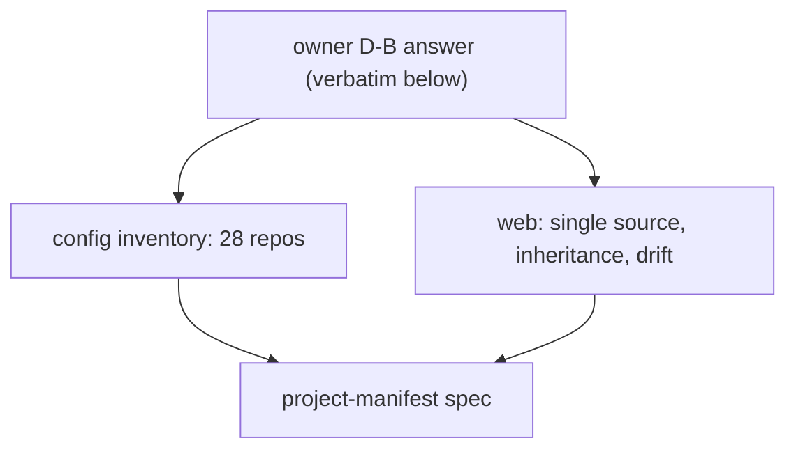

# Probe: project manifest (2026-11-03)

Research: `D:/repo/docs/research_notes/project-manifest/config_inventory.md` (every fact, its copies, readers,
writers and cardinality across 28 repos) and `D:/repo/docs/research_notes/project-manifest/web_config_sot.md`
(Backstage, Renovate, ESLint, Kustomize, Nx, drift and validation gates).

## The owner's words (verbatim, 2026-11-03)

> For DB, let's make sure we consolidate to single source or true for any configs as well as core level details that
> are appropriate Check in order of understanding what context needs to be on a one-to-one ratio for the repository
> Versus some can be many to one or perhaps by reference And likewise, let's ensure we understand the update as well
> as the creation cycle as well to understand that this needs to if anything needs to be a living documentation that
> needs to be updated over time and if so, where in the development lifecycle should it be interjected to make sure
> that it passes the bar.

> I'm mistaken. When I meant circuit breaker, I actually meant feature flag. So let's make sure that V2 as well as V3
> or our current version can be feature flag or cut off on the remainder of the implementation in terms of its access
> from the harness itself.

## Facts that shape the design

| Fact | Where |
|---|---|
| The tier has two sources (CLAUDE.md in 13 of 28 repos, STATE.md in 6) and five parsers | `D:/repo/docs/research_notes/project-manifest/config_inventory.md:1` |
| Cashcow, the only `live` repo, has no STATE.md, so Foreman sees no tier for it | config_inventory.md |
| Three of six Foreman gate commands differ from their repos (cortex, catwalk, pocket-agent) | config_inventory.md |
| `repos.json` has two writers and two schemas; autonomy values are never validated | config_inventory.md |
| `catalog-info.yaml` is approved but exists in no repo | `D:/repo/docs/ARCHITECTURE_PLATFORM_SPLIT.md:58` |
| Every layered config tool ships a merged-view command; validation and drift are separate gates | `D:/repo/docs/research_notes/project-manifest/web_config_sot.md:1` |

## Found along the way, for the owner

- Cashcow is `live`, but its CLAUDE.md says Vercel auto-deploys on push to main, which bypasses the live deploy gate.
- Nuwa is `archived: true` in `repos.json` but listed as an active product in `D:/repo/SaaS/CLAUDE.md:3`.
