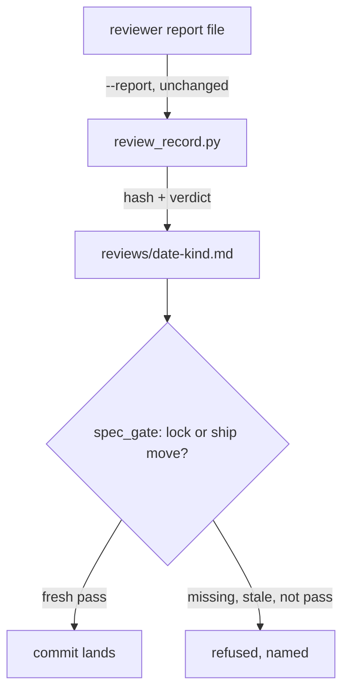

# Review records gate the lock and the ship moves

## Overview

Owner decisions D23 (grilling 2026-11-02, rounds 1-2) and ADR
`C:/Users/Michael/.claude/docs/adr/0001-review-records-gate-lock-and-ship.md:1`. Today a spec can be locked or shipped with
no independent review, or with a review of content that changed afterwards (2026-10-31: three redesigns after the
only review, locked by their author). This item makes the review a file whose hash binds it to the exact content
reviewed, and makes the commit gate demand a fresh `pass` at the two moves that matter.

## References

### Local

| Source (file:line) | Status (working / partial / broken) | What it shows | Decision (extract / wrap / replace / ignore) + reason |
|---|---|---|---|
| C:/Users/Michael/.claude/scripts/spec_gate.py:132-156 | working | `lifecycle_problem` already sees every staged README's move (HEAD status to staged status) on every branch, with merge and rename handling | wrap: the freshness check attaches to its lock and ship moves |
| C:/Users/Michael/.claude/scripts/spec_check.py:102-130 | working | `IndexTree` reads the staged content and lists the staged files | extract: the gate hashes the staged item through it |
| C:/Users/Michael/.claude/scripts/spec_check.py:87-100 | partial | `DiskTree` reads the working tree with universal newlines, so its text differs from the index for lone CR bytes | ignore: hashing uses byte trees only (FR-14); a new `HeadTree` joins `IndexTree` |
| C:/Users/Michael/.claude/contracts/work-item.lifecycle.v1.json:1 | working | the lifecycle is data the gate reads | extract: the record schema follows the same pattern, `contracts/review-record.v1.json` |
| C:/Users/Michael/.claude/playbooks/agent-dispatch.md:21-30 | working | the interim record format and hash rule the parent writes by hand until this ships | replace: the script becomes the only writer; the playbook points to it |
| C:/Users/Michael/.claude/scripts/spec_gate.py:116-129 | partial | `staged_readmes` lists added, copied, modified and renamed READMEs only (`--diff-filter=ACMR`): a deleted README reaches no check | wrap: add staged deletions, renames out and type changes for FR-12 |
| C:/Users/Michael/.claude/workflows/cycle.js:34-47 | working | the FINDING schema: class (design / implementation / test / spec / approach) and rating R/F/H | extract: the kind of record body a code review produces; the enums stay in the glossary vocabulary |
| C:/Users/Michael/.claude/workflows/cycle.js:160 | partial | the workflow forces the verdict to `pass` when no R finding remains, whatever the reviewer wrote | ignore: cycle.js is suspended; the record copies the reviewer's own `VERDICT:` line (assumed, DECISIONS D26) and work item `stage-trace` aligns the workflow |
| D:/repo/Factory/foreman/core/spec-verdict.js:43 | working | Foreman picks `docs/review-records/<slug>-round-N.md` by branch slug | replace: the record path becomes `docs/work/<id>/reviews/`; Foreman follows on the roadmap |
| D:/repo/Factory/foreman/core/spec-verdict.js:63 | working | Foreman reads the lock from `docs/STATE.md` status, a second lock source the gate never sees | ignore: here; queued on the roadmap to read the gated README status instead |
| D:/repo/SaaS/nuwa/docs/review-records/design-variants-round-12.md:1-6 | working | the only existing record with YAML frontmatter (`verdict: GO`) | extract: frontmatter first, body after; replace the value set |
| D:/repo/Finance/crucible/docs/review-records/stat-arb-pairs-round-3.md:1-21 | partial | a record that keeps the reviewer's brief verbatim, verdict as free text | extract: the verbatim body; replace the free-text verdict with frontmatter |
| D:/repo/Lib/contracts/docs/work/boundary-contracts/README.md:55 | partial | the planned shared-enums file `contracts/common/enums.v1.schema.json` (CAP-1), not built | ignore: here; the enum ships in claudence `contracts/` now and `boundary-contracts` consumes it (assumed, DECISIONS D27) |

### Web

| Source (URL) | Date checked | What it shows | Decision |
|---|---|---|---|
| https://docs.github.com/en/repositories/configuring-branches-and-merges-in-your-repository/managing-protected-branches/about-protected-branches | 2026-11-02 | "GitHub records the state of the diff at the point when a pull request is approved"; stale approvals can be dismissed when pushes change that diff | extract: an approval binds to a snapshot of the reviewed content |
| https://docs.gitlab.com/user/project/merge_requests/approvals/settings/ | 2026-11-02 | approvals can be removed when commits are added; `git patch-id` keeps an approval when the diff is unchanged | extract: content identity, not commit identity, decides freshness |
| https://gerrit-review.googlesource.com/Documentation/config-labels.html | 2026-11-02 | `copyCondition` names when a vote survives a new patch set; others become outdated | extract: an explicit survival rule, here the removed `status:` line |
| https://github.com/in-toto/attestation/blob/main/spec/README.md | 2026-11-02 | a statement binds a predicate to a subject by digest | extract: subject digest, verdict and reviewer as one typed record; ignore: signing (independence is by process, D23) |

## Operating envelope

| Assumption | How it is observed (not hoped) | If violated |
|---|---|---|
| Local hooks run on the commits that make the lock and ship moves | the commit-msg gate, `spec_gate.py`, AC-5 and AC-7 | defer: commits the hook cannot judge (an amend of the lock or ship commit, `--no-verify`, server squash, cherry-pick, rebase, revert) are re-checked per commit against its parent by work item `gate-ci` after the push |
| The reviewer named in a record is independent of the author | the record's `reviewer` field, refused when empty, `self` or a look-alike (AC-2, AC-6) | flag: independence is trusted by process until Weaver run traces exist (D23 revisit trigger) |
| A record's body is the reviewer's report, unchanged, and the reviewer saw the hash it echoes | the frontmatter verdict must equal the body's last `VERDICT:` line and the report's `REVIEWED:` hash must equal the content at write time (AC-2, AC-6) | refuse: a mismatch is never a fresh pass |
| An item's content is every file in its folder outside `reviews/`, `evidence/`, `cycles/`, `trace.jsonl` and `drift.md`; its code is bound by the record's reviewed `commit` | `content_hash` (AC-3); the commit is stored by `write` (AC-2) | defer: code changed after its code review is caught by work item `gate-ci` over pushed history (D32); AC-7 pins that the local gate does not judge it |

## Purpose

Make "an independent review saw exactly this content" a fact the commit gate checks, at lock and at ship, so a
redesign or a fix round can never ride on an older review.

## Non-goals

- Proving who the reviewer was (Weaver run traces, later).
- Re-checking commits that skipped local hooks (work item `gate-ci`).
- Checking freshness while an item stays at one status (owner decision: only at the two moves).
- Writing or running the review itself; this item only records it and enforces it.

## Capabilities

| CAP | Statement |
|---|---|
| CAP-1 | The user can turn a reviewer's report into a review record with one command, the hash, reviewed commit and verdict taken from the report and the index |
| CAP-2 | The service must refuse the `draft` → `spec-locked` move unless a fresh `pass` design or verify record exists |
| CAP-3 | The service must refuse the `building` → `shipped` move unless a fresh `pass` code or verify record exists |
| CAP-4 | The service must not count a record whose verdict differs from its report, whose reviewer is empty or `self`, or whose frontmatter does not parse |
| CAP-5 | The service must refuse deleting the README of an item past `draft` |
| CAP-6 | The user can list every record in a repo with its freshness against the committed content |

## Non-functional requirements

| NFR | Target | Method | Evidence |
|---|---|---|---|
| NFR-1 | hashing an item of 20 files adds under 1 s to a commit | latency-bench: time `content_hash` over a 20-file staged item | AC-12 |
| NFR-2 | zero verdict or kind lists outside `contracts/review-record.v1.json` | fitness: both modules load their enums from `contracts/review-record.v1.json` | AC-13 + config:contracts/review-record.v1.json |

## Trade-offs

| Option | Latency | Cost | Maintenance | Extensibility | Refactorability | Verdict |
|---|---|---|---|---|---|---|
| A file per review in `reviews/`, hash of the item's spec files, checked at the move | one hash per lock or ship commit | none | one script and one gate rule | a new review kind is one enum value | the record format is versioned by its schema | chosen |
| A `Design-Review:` trailer on the lock commit | none | none | none | none | none | rejected: a trailer is a claim with no evidence behind it |
| A reviews table inside the README | none | none | low | low | low | rejected: it changes the very content being hashed |
| Freshness checked at rest, on every commit | a hash on every commit | none | higher | same | same | rejected: every edit would force a new review (owner decision) |

## Patterns applied

| Pattern | Where | Why |
|---|---|---|
| content addressing | `content_hash` | an approval is bound to the exact content it judged, as stale-approval dismissal does |
| guard on a state-machine transition | `spec_gate.lifecycle_problem` | the check runs only on the lock and ship moves, the lifecycle stays data |
| single source enum | `contracts/review-record.v1.json` | the gate and the script cannot disagree on a verdict |

## Components chosen

| Need | Chosen (off the shelf) | Rejected | Why rejected |
|---|---|---|---|
| hashing | Python `hashlib.sha256` | a git tree hash of the folder | a git tree hash includes `reviews/` and the status line, so the lock commit would void its own record |
| frontmatter parse | PyYAML `safe_load` (already used by the checker) | a hand-written parser | the checker's existing loader is the authoritative reading |
| record schema | `jsonschema` against `contracts/review-record.v1.json` (already used for work items) | pydantic models | the enums must be data both sides load, as the lifecycle file is |

## Gate plan

| Risk | Kind (deterministic / qualitative) | Check | Blocking / advisory |
|---|---|---|---|
| a lock or ship lands without a fresh pass, or a legitimate one is refused | deterministic | python -m pytest tests/test_review_records.py -q (real commits in a temp repo) | blocking |
| the existing gate and lifecycle behaviour regresses | deterministic | python -m pytest tests/test_spec_gate.py tests/test_spec_gate_review.py tests/test_spec_gate_lifecycle.py -q | blocking |
| this item breaks its own rule | deterministic | the lock of this item itself carries a hand-written design record that `review_record.py --verify` accepts | blocking |

## Build amendments

| Change | Why (what the test exposed) | Test |
|---|---|---|
| FR-10: in a merge, an item whose hashed files equal HEAD's or MERGE_HEAD's version at the same status derives no edges | a correct `git merge main` (or diverged pull) after main locked, built and refined the item was refused as stale, because the chain from the branch's status needs a record for content that changed after the lock | tests/test_review_records.py::test_ac8_merging_main_into_a_branch_after_main_locked_built_and_refined_lands, test_ac8_merging_main_into_a_branch_that_lacks_the_item_lands, test_ac8_a_merge_whose_item_equals_neither_side_is_still_checked |
| FR-12: a README with no frontmatter block is not a work item and may be deleted; replaces the part of D35 that treated an unreadable status as past draft for such files | deleting a legacy README such as `# Legacy plan` was refused as `(unreadable)`; eleven such files exist in the fleet | tests/test_review_records.py::test_ac10_deleting_a_legacy_readme_without_frontmatter_lands, test_ac10_deleting_a_readme_with_frontmatter_but_no_draft_status_is_refused |
