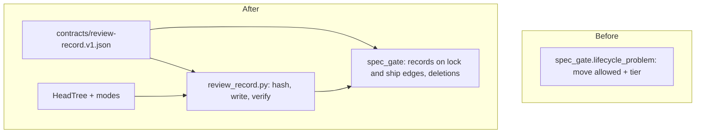

# review-records: L2 component specs



| Component | Owned files | Public interface |
|---|---|---|
| review-record | `scripts/review_record.py`, `contracts/review-record.v1.json`, `playbooks/agent-dispatch.md` (§ Review records) | `hash --item <dir>`; `write --item <dir> --kind <k> --reviewer <r> --report <file> [--verifies <record>]`; `verify [--tree head\|index] [--root <repo>]`; `content_hash(tree, item_dir) -> str`; `required_records(tree, item_dir, edges) -> str \| None` |
| gate rule | `scripts/spec_gate.py` (lifecycle_problem, staged_readmes, deletions) | unchanged CLI; new rejection reasons |
| trees | `scripts/spec_check.py` (`HeadTree`, `Tree.entries`) | `HeadTree(root)`; `Tree.entries(prefix) -> list[(mode, path)]`; `Tree.read_many(paths) -> dict` |

Searched `C:/Users/Michael/.claude/scripts` and `D:/repo` for the role "bind a review to the content it judged": found
none (References); extending `spec_gate.lifecycle_problem` and the `Tree` classes. Adversary pass 2026-11-02: 32
distinct outcomes and 8 counter-scenarios, each dispositioned in `D:/repo/docs/reports/2026-11-02 Adversary
dispositions.md`; design review round 1 (fix-first, 11 R) is folded into this revision.

## review-record

### Interface

```text
RECORD_SCHEMA = contracts/review-record.v1.json   # kinds, verdicts, required keys; loaded lazily, only by the commands below
content_hash(tree, item_dir) -> "sha256:<64 lowercase hex>"   # FR-1; raises HashError(reason) on FR-2
hash   (CLI): prints content_hash of the staged item (refuses unstaged or untracked changes in the item folder)
write  (CLI): reads --report <file>, writes reviews/<YYYY-MM-DD>-<kind>-<hash8>.md, prints its path
verify (CLI): every reviews/*.md under docs/work/*/ : fresh / stale / invalid against the chosen tree (default head)
required_records(tree, item_dir, edges) -> None | reason   # FR-8: the gate's single entry point
```

### Functional requirements

| FR | Requirement |
|---|---|
| FR-1 | `content_hash` over a tree (the index for `hash`, `write` and the gate; HEAD for `verify --tree head`). **Inputs:** every entry under the item folder except a path whose first segment is exactly `reviews`, `evidence` or `cycles`, and except the generated files `trace.jsonl` and `drift.md` at the item root. **Bytes:** `\r\n` to `\n`, then lone `\r` to `\n`; then strict UTF-8 decode. **README:** after normalising, line 1 must be exactly `---` and the frontmatter ends at the next line exactly `---`; within it exactly one line matches `^status:` (column 0, the key followed by a colon), and that whole line including its `\n` is removed; nothing else in any file is changed. **Serialise:** files sorted by the UTF-8 bytes of their path relative to the item folder (POSIX separators); each contributes `<byte length of path>:<path>\n<byte length of text>:<text>\n`. **Digest:** `sha256:` plus lowercase hex of the sha256 of the concatenation. A golden vector (a fixed fixture folder and its digest) pins it. |
| FR-2 | `content_hash` refuses (HashError, named): an entry of mode `120000` (symlink) or `160000` (gitlink); a subfolder holding a `README.md` (nested item); a first segment equal to `reviews`, `evidence` or `cycles` in another letter case; a file that is not strict UTF-8 or starts with a BOM; a README whose frontmatter delimiters are not exact or that has zero or several `^status:` lines. |
| FR-3 | `hash` and `write` refuse when the item folder has unstaged or untracked changes ("stage the item first"), so the hash in the reviewer's brief is the hash the gate will see. `--item` is resolved through `git ls-files` to the exact indexed path `docs/work/<id>/` (backslashes, a trailing slash and Windows letter case normalised); anything else is refused. |
| FR-4 | `write` reads the report file (at most 1 MB) as strict UTF-8 and refuses unless: its last non-blank line, stripped of trailing spaces, is exactly `VERDICT: pass`, `VERDICT: fix-first` or `VERDICT: block`; it has exactly one line matching `^REVIEWED: sha256:[0-9a-f]{64}$` (outside code fences) equal to the current `content_hash`; a `code` report, and a `verify` report whose `--verifies` names a code-class record, has exactly one `^REVIEWED-COMMIT: <sha>$` line naming an existing commit, stored as its full sha; a `design` report and a verify of a design record have none. The verdict comes from the report only. |
| FR-5 | The reviewer rule (shared by `write` and record validity): case-folded and stripped, the reviewer must not be empty, `self`, `me`, `-`, `n/a`, `none`, in angle brackets, or equal to the item's `owner`. `write` also refuses a kind outside the schema and a `verify` record whose `--verifies` does not name an existing `fix-first` record of the same item and class. |
| FR-6 | `write` builds the record in a temp file named `.<name>.<pid>.tmp` (never `.md`), then links it to the final name exclusively (fails if the name exists); on a clash it retries with `-2`, `-3`, so two concurrent writers both land. A writer removes only its own temp file (try/finally); a leftover temp file is never read as a record and never deleted by another writer. If a record of the same kind, content and report body already exists under any date, the write is a no-op that prints its path. Frontmatter written: `kind`, `reviewer`, `verdict`, `content`, `commit` (code, and verify of code), `verifies` (verify), `recorded` (UTC, ISO 8601 to the second, by the script's clock). |
| FR-7 | A record is valid when: the file is under 1 MB; `yaml.safe_load` of its frontmatter block validates against the schema; the reviewer passes FR-5; and `verdict` equals the body's last non-blank `VERDICT:` line. |
| FR-8 | `required_records(tree, item, edges)`: each edge into `spec-locked` needs the **design class** (kind `design`, or `verify` of a `design` record); each edge into `shipped` needs the **code class** (kind `code`, or `verify` of a `code` record), except `research` and `experiment` items, which need the design class (a results re-review). In each class the newest valid record decides, ordered by `recorded`, then by the integer suffix of the file name (no suffix = 1, `-<n>` = n), never by the bytes of the name: it must have verdict `pass` and `content` equal to `content_hash(tree, item)`. A code-class record stores the reviewed `commit` as evidence; the local gate does not judge code freshness (architect decision D32: "no code of this item changed after its code record" is a question about history, enforced over pushed commits by work item `gate-ci`). Returns None or the reason. |
| FR-9 | `verify` reports each record as fresh, stale or invalid against `--tree head` (default) or `--tree index`, lists leftover temp files as information, and exits 1 when any record is invalid or git cannot read the chosen tree; stale is information. An unborn HEAD is an empty tree (every record stale). |

### Data

The record: the frontmatter keys above, then the report verbatim. The schema `contracts/review-record.v1.json` (JSON
Schema 2020-12) holds the `kind` and `verdict` enums, the only lists of them (NFR-2). Authoritative sources: the
report for the verdict, the reviewed hash and the reviewed commit; the tree for the current hash and the source diff;
the script's clock for `recorded`.

### Failure modes

- Every refusal: exit 1 with the reason; nothing written.
- A crash before the link leaves only `.<name>.<pid>.tmp`, which is never a record; `verify` lists it as information.
- An invalid record counts as absent for the gate and as invalid for `verify`.

### Budget

- `content_hash` reads the item through one `git cat-file --batch` call (`Tree.read_many`): a 20-file item under 1 s (NFR-1).
- Report and record files capped at 1 MB; git calls keep the gate's 10 s bound.

## gate rule

### Interface

No new CLI. New rejection reasons, each naming the item and cause: `needs a fresh design review`, `needs a fresh code
review`, `record is stale (reviewed <hash8>, committing <hash8>)`, `newest <class> record is <verdict>`, `record invalid: <reason>`, `cannot hash item: <reason>`, `deleting or moving
a <status> work item: set status: killed instead (it stays as history)`, `review records cannot be deleted: <file>`.

### Functional requirements

| FR | Requirement |
|---|---|
| FR-10 | For every staged README, the gate derives the edges its move traverses: the single edge for a plain commit; for a merge, squash, import (no HEAD version) or repair (HEAD status unreadable), the shortest chain of lifecycle edges from the HEAD status (or `draft` when absent or unreadable) to the staged status. It calls `required_records(IndexTree, item, edges)` and refuses with its reason. A move into `promoted` or `killed` needs no record. An amend of a lock or ship commit cannot be seen by the hook (HEAD already holds the new status): it is escalated to work item `gate-ci`, which re-checks each pushed commit against its parent. |
| FR-11 | `review_record` and the contract are imported only when an edge into `spec-locked` or `shipped` is present, so a broken contract or record never blocks any other commit. |
| FR-12 | Refused: a staged README of an item past `draft` (the later of the HEAD and MERGE_HEAD statuses) that is deleted, renamed to a path outside `docs/work/<id>/README.md`, or changed in type (symlink), with the `T` filter added to `staged_readmes`; and the deletion of any `reviews/*.md` file present at HEAD, unless the same commit deletes the item's README and the item is at `draft` by both HEAD and MERGE_HEAD. A deletion that git paired as delete plus add because of heavy edits gets the hint "rename in its own commit with the README unchanged". |
| FR-13 | No other commit checks freshness: edits while an item stays at a status never need a record (owner decision Q2; the ship check judges the final spec and code). |

### Data

Reads the staged index, the HEAD and MERGE_HEAD versions, and the staged diff with renames and type changes.
Writes nothing.

### Failure modes

- Any git error or timeout: refused (fails closed), as today.
- A record that does not parse: treated as absent; the reason is named.

### Budget

- Hashing runs only on commits with an edge into `spec-locked` or `shipped`.

## trees

### Interface

`HeadTree(root)` with the `Tree` interface over the HEAD commit; `Tree.entries(prefix)` returns `(mode, path)` pairs
from `git ls-files -s` (index) or `git ls-tree -r` (HEAD); `Tree.read_many(paths)` reads all bytes in one
`git cat-file --batch` call.

### Functional requirements

| FR | Requirement |
|---|---|
| FR-14 | `HeadTree` and `IndexTree` return committed or staged **bytes** with their modes, so `content_hash` is the same function on both; `DiskTree` is not used for hashing. |

### Data

Reads git objects only.

### Failure modes

- No HEAD (unborn branch): an empty tree.

### Budget

- One `ls-tree` or `ls-files` and one `cat-file --batch` per hash.
