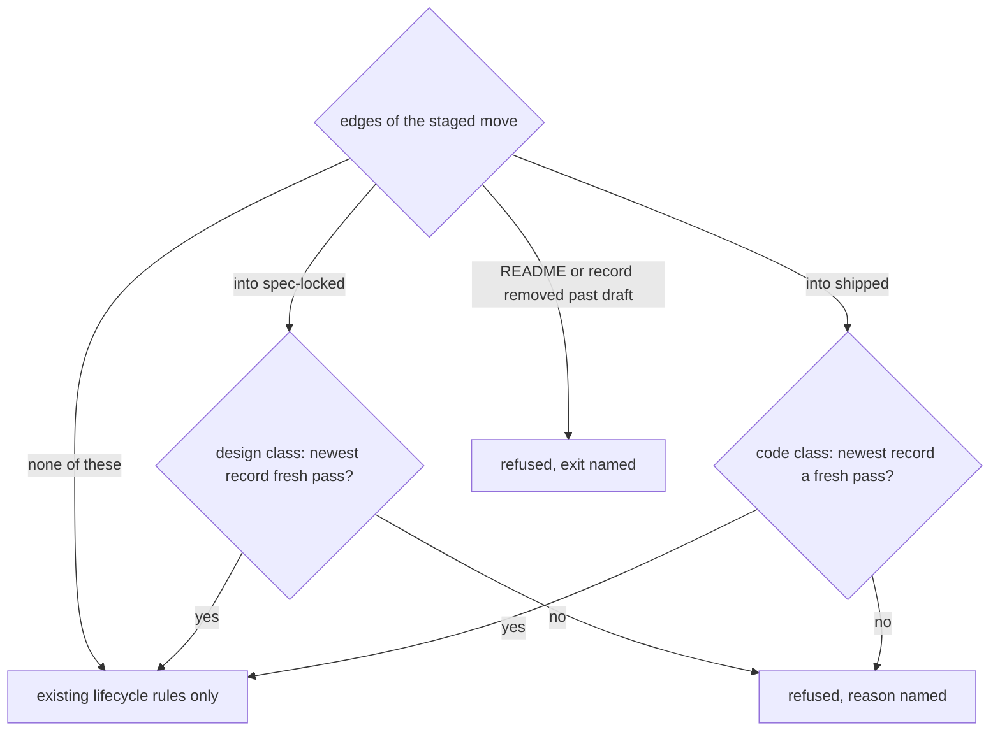

# review-records: L3 functional and acceptance criteria

## FR/NFR delta

| ID | Change | Note |
|---|---|---|
| FR-1 | added | content hash over a tree, byte-exact |
| FR-2 | added | hash refusals |
| FR-3 | added | stage the item first; exact item path |
| FR-4 | added | report checks, reviewed hash and commit |
| FR-5 | added | reviewer rule, kind, verifies |
| FR-6 | added | exclusive, idempotent write |
| FR-7 | added | record validity |
| FR-8 | added | required records per edge, newest decides; code freshness is gate-ci's (D32) |
| FR-9 | added | verify listing |
| FR-10 | added | edges of a move; amend escalated |
| FR-11 | added | lazy load |
| FR-12 | added | no removal of items or records past draft |
| FR-13 | added | no freshness at rest |
| FR-14 | added | byte trees with modes |
| NFR-1 | added | hash latency |
| NFR-2 | added | one enum source |

## Acceptance criteria

Every refusal is asserted by its named reason, not only by the exit code.

| AC | Traces | Given / when | Pass when | Fail when | Test |
|---|---|---|---|---|---|
| AC-1 | CAP-1, FR-4, FR-6 | `write` with a valid design report; the same call again, also on a later date; a different report of the same kind and content; a target name pre-created to simulate a concurrent writer; a leftover `.x.123.tmp` in `reviews/` | the first writes `reviews/<date>-design-<hash8>.md` with `recorded`; the repeats are no-ops printing the same path; the different report and the simulated clash each get the next suffix; the leftover temp file is left in place and never counted as a record | a file is overwritten, duplicated or mis-hashed, or the temp file counts or is deleted | tests/test_review_records.py |
| AC-2 | CAP-4, FR-3, FR-4, FR-5 | `write` with each of: an empty report; a 2 MB report; last lines `**VERDICT: pass**`, `VERDICT: passed`, the template `VERDICT: pass \| fix-first \| block`; `VERDICT: pass` inside a fence followed by prose; no `REVIEWED:` line, two of them, one inside a fence, one with upper-case hex; a `REVIEWED:` hash from before an edit; a code report with no `REVIEWED-COMMIT:`, or naming a commit that does not exist; a verify of a code record with no `REVIEWED-COMMIT:`; a design report carrying `REVIEWED-COMMIT:`; non-UTF-8 bytes; reviewer `Self`, `n/a`, `<reviewer>` or the item owner; `--item` outside `docs/work/`; an untracked file in the item; `--verifies` naming a `pass` record or a code-class record for a design verify | each exits 1 naming its reason and writes nothing | any writes a record | tests/test_review_records.py |
| AC-3 | FR-1, FR-14 | the golden fixture folder; then each of: CRLF endings; lone CR endings; only the status line changed; a file added under `reviews/`, `evidence/` or `cycles/`; `trace.jsonl` or `drift.md` appended; a file under `reviews-old/`, `evidence2/` or `sub/reviews/` changed; one byte changed in a `.json` file; text moved from one file to the end of another | the golden digest is exact on IndexTree and HeadTree; the next five keep the hash; the last three change it | any behaves otherwise | tests/test_review_records.py |
| AC-4 | FR-2 | an item with each of: a symlinked file; a nested `README.md`; a `Reviews/` folder; a BOM on README; two `^status:` lines; a README whose only status key is indented, `statusX:` or `"status":` (zero `^status:` lines); a closing `--- ` with a trailing space | `hash` exits 1 naming each reason | any hashes | tests/test_review_records.py |
| AC-5 | CAP-2, FR-8, FR-10 | a lock commit staging a fresh `pass` design record; another staging a fresh `pass` verify record whose `verifies` names a `fix-first` design record | both land | either is refused | tests/test_review_records.py |
| AC-6 | CAP-2, CAP-4, FR-7, FR-8 | a lock commit with each of: no record; a record whose content was edited after; the item folder renamed after the review; an older `pass` and a newer `fix-first`; same-second ties between the base name and `-2`, and between `-2` and `-10` (the larger suffix decides); only a `code` record; a verify record of a code-class record; a record whose frontmatter says `pass` and body says `fix-first`; a record with `reviewer: self`; a record whose frontmatter does not parse; a 2 MB record | each is refused with its named reason (the tie cases follow the larger suffix) | any lands | tests/test_review_records.py |
| AC-7 | CAP-3, FR-8 | a ship commit with a fresh `pass` code record; with only a fresh design record; a `research` item shipping with a fresh design record; a ship after a source change made after the code record | the first, third and fourth land (the fourth pins that code freshness is `gate-ci`'s, D32); the second is refused with its reason | otherwise | tests/test_review_records.py |
| AC-8 | FR-10 | a branch moving `draft` to `spec-locked` to `building`, squash-merged without a design record and then with one; an item imported at `shipped` by a merge with both records; a commit repairing an unreadable HEAD status to `spec-locked` with no record; two branches that lock the same item with different content, merged with the conflict resolved | the first is refused, the second and third land, the fourth is refused, the last is refused unless a record fresh for the merged content is staged | otherwise | tests/test_review_records.py |
| AC-9 | FR-13 | commits that edit an item at `draft`, at `spec-locked` and at `building`, and moves into `killed` and `promoted`, all with no record | all land | any is refused for a record | tests/test_review_records.py |
| AC-10 | CAP-5, FR-12 | commits that: delete a `building` README; rename it to `README.old.md`; replace it with a symlink; delete it in a merge whose other side moved it to `building`; heavily edit and move the folder so git pairs delete plus add; delete a `reviews/*.md` present at HEAD; delete a `draft` README; delete a whole `draft` item that holds a `fix-first` record | the first six are refused with their named reasons (the fifth with the rename hint); the last two land | otherwise | tests/test_review_records.py |
| AC-11 | CAP-6, FR-9 | a repo with one fresh, one stale and one invalid record; `verify --tree head`, then `--tree index` after staging an edit; `verify` on an unborn branch | each record shows its state per tree; exit 1 because of the invalid record; the unborn branch reports every record stale | a state is wrong or the exit is 0 | tests/test_review_records.py |
| AC-12 | NFR-1 | `content_hash` over a staged 20-file item | it returns in under 1 s | it takes 1 s or more | tests/test_review_records.py |
| AC-13 | NFR-2 | a temp copy of the contract with an extra verdict value, used by the script and the gate | both accept the new value and reject one absent from the file | either has its own list | tests/test_review_records.py |
| AC-14 | FR-11 | a corrupt contract file and a corrupt record in a repo: a commit with no lock or ship edge; a lock commit; a lock commit with `GIT_INDEX_FILE` pointing at a missing file; `required_records` over a tree whose read raises a timeout; `verify --tree index` with `GIT_INDEX_FILE` pointing at a missing file | the first commit lands; the gate cases are refused naming the corrupt file, the git failure and the timeout; `verify` exits 1 naming the git failure | the first is blocked, a gate case lands, or `verify` exits 0 | tests/test_review_records.py |
| AC-15 | FR-4, FR-1 | `agents/reviewer.md` and `playbooks/agent-dispatch.md` | both require the report to echo `REVIEWED: sha256:<hex>` (and `REVIEWED-COMMIT:` for code reviews) from the brief; the playbook names `review_record.py hash` and this item's FR-1 as the only hash rule | either omits it or restates a different rule | tests/test_review_records.py |

Tests cite `review-records/AC-<n>` verbatim.

## Outcome inventory

### Record a review (`review_record.py hash` and `write`)

| Stage | Outcome | Kind | Class | Handled by |
|---|---|---|---|---|
| write | record written with the hash the reviewer was briefed with | success | nominal | AC-1 |
| write | malformed or look-alike verdict and REVIEWED lines, non-UTF-8, oversize, bad reviewer, kind, item or verifies target | invalid input | closed: refused | AC-2 |
| write | the item is not staged, or the reviewed commit does not exist | dependency fails | closed: refused | AC-2 |
| write | n/a: the report is a capped file, never an open stream, and git calls keep their 10 s bound | timeout | nominal | AC-12 |
| write | killed before the final link, leaving a temp file | crash mid-step | closed: recovered | AC-1 |
| write | two writers record different reports for the same kind and content | concurrent actor | closed: recovered | AC-1 |
| write | a report saved before a later edit is recorded now | duplicate or replay | closed: refused | AC-2 |
| write | the same report recorded twice, on the same or a later date | duplicate or replay | nominal | AC-1 |
| write | the report arrives as a UTF-8 file the parent wrote, never through a shell pipe | arrival channel | nominal | AC-2 |

### Hash the item (`content_hash`)

| Stage | Outcome | Kind | Class | Handled by |
|---|---|---|---|---|
| hash | the same content in any line-ending form, on either tree, gives the golden digest | success | nominal | AC-3 |
| hash | symlink, nested item, case look-alike of an excluded folder, BOM, status-line look-alikes, inexact delimiters | invalid input | closed: refused | AC-4 |
| hash | git cannot read the index | dependency fails | closed: refused | AC-14 |
| hash | n/a: one bounded batch read | timeout | nominal | AC-12 |
| hash | n/a: a pure function of git objects | crash mid-step | nominal | AC-3 |
| hash | n/a: the index is git's own locked file | concurrent actor | nominal | AC-3 |
| hash | text moved between files, a structured file edited, a look-alike folder changed | duplicate or replay | closed: refused | AC-3 |
| hash | a trace line or drift report appended after the review | arrival channel | nominal | AC-3 |
| hash | the item folder renamed (its `id` changes, so the review must be redone) | arrival channel | closed: refused | AC-6 |

### Lock and ship edges (`spec_gate` and `required_records`)

| Stage | Outcome | Kind | Class | Handled by |
|---|---|---|---|---|
| edge | the newest record of the needed class is a fresh pass | success | nominal | AC-5 |
| edge | missing, stale, wrong class, self-contradicting, self-reviewed, unparseable or oversize record; a newer fix-first over an older pass | invalid input | closed: refused | AC-6 |
| edge | source changed after the code review, in a later commit or in the ship commit | invalid input | closed: escalated | AC-7 |
| edge | a corrupt contract or record file, or an unreadable index | dependency fails | closed: refused | AC-14 |
| edge | a git read exceeds its bound | timeout | closed: refused | AC-14 |
| edge | n/a: git aborts the commit when the hook is killed; nothing is written | crash mid-step | nominal | AC-14 |
| edge | two branches lock the same item differently and merge | concurrent actor | closed: refused | AC-8 |
| edge | an old pass record copied in after later edits | duplicate or replay | closed: refused | AC-6 |
| edge | the move arrives by commit, merge, squash, import or repair | arrival channel | nominal | AC-8 |
| edge | a squash-merge makes the reviewed commit a non-ancestor | arrival channel | nominal | AC-5 |
| edge | the move arrives by amend, `--no-verify`, cherry-pick, rebase, revert, fast-forward or a server-side squash | arrival channel | closed: escalated | FR-10 |
| edge | a research item ships on a results re-review | success | nominal | AC-7 |

### At rest (no lock or ship edge)

| Stage | Outcome | Kind | Class | Handled by |
|---|---|---|---|---|
| at rest | an item edited while it stays at its status, or moved into `killed` or `promoted` | success | nominal | AC-9 |
| at rest | a corrupt contract or record is present | invalid input | nominal | AC-14 |
| at rest | n/a: nothing is read beyond the existing lifecycle checks | dependency fails | nominal | AC-9 |
| at rest | n/a: no new reads | timeout | nominal | AC-9 |
| at rest | n/a: no new state | crash mid-step | nominal | AC-9 |
| at rest | n/a: no new state | concurrent actor | nominal | AC-9 |
| at rest | n/a: no new state | duplicate or replay | nominal | AC-9 |
| at rest | an edit arrives by any channel | arrival channel | nominal | AC-9 |

### Delete or move an item or record out

| Stage | Outcome | Kind | Class | Handled by |
|---|---|---|---|---|
| delete | a draft README deleted | success | nominal | AC-10 |
| delete | a README past draft deleted, renamed out of the pattern or retyped; a committed review record deleted | invalid input | closed: refused | AC-10 |
| delete | n/a: read from the staged diff, HEAD and MERGE_HEAD only | dependency fails | nominal | AC-10 |
| delete | n/a: one bounded git diff call | timeout | nominal | AC-10 |
| delete | n/a: a refused commit leaves the repo unchanged | crash mid-step | nominal | AC-10 |
| delete | a merge whose other side advanced the item | concurrent actor | closed: refused | AC-10 |
| delete | n/a: a second deletion stages nothing | duplicate or replay | nominal | AC-10 |
| delete | the removal arrives by commit, merge or squash, including a heavily edited rename paired as delete plus add | arrival channel | closed: refused | AC-10 |
| delete | the removal arrives by amend, `--no-verify`, cherry-pick, rebase or revert | arrival channel | closed: escalated | FR-10 |

### Verify (`review_record.py verify`)

| Stage | Outcome | Kind | Class | Handled by |
|---|---|---|---|---|
| verify | each record listed as fresh, stale or invalid | success | nominal | AC-11 |
| verify | a record with a corrupt body or frontmatter | invalid input | closed: refused | AC-11 |
| verify | git cannot read HEAD or the index | dependency fails | closed: refused | AC-14 |
| verify | a leftover temp file from a crashed writer | invalid input | nominal | AC-1 |
| verify | n/a: bounded git reads only | timeout | nominal | AC-12 |
| verify | n/a: read-only | crash mid-step | nominal | AC-11 |
| verify | n/a: read-only | concurrent actor | nominal | AC-11 |
| verify | n/a: read-only, idempotent | duplicate or replay | nominal | AC-11 |
| verify | run on an unborn branch | arrival channel | nominal | AC-11 |

### Rejected outcomes

| Outcome | Reason |
|---|---|
| a forged record (an author writes a plausible reviewer and a matching hash) | accepted risk: independence is trusted by process until Weaver run traces exist (D23); named in the Operating envelope |
| a record edited after its move | flag only: git history is the audit trail; deleting a committed record is refused (FR-12) |
| a whole spec rewritten at `spec-locked` or `building` after the lock | owner decision Q2: edits during the build are free; the ship check judges the final spec and code |
