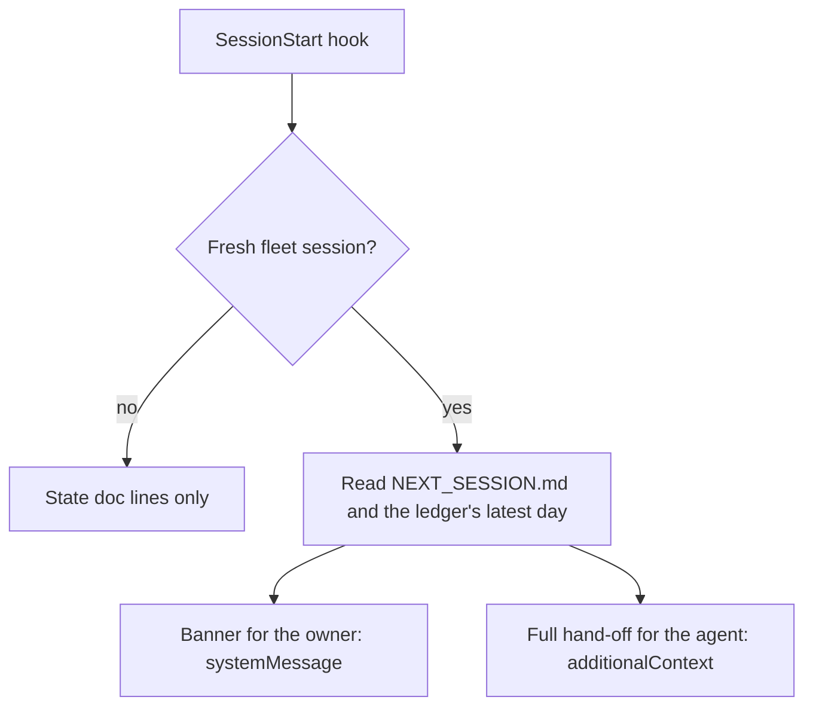

# Hand-off brief at fleet session start

## Purpose

The owner had to ask what the last session did, and each agent had to go and read the hand-off. The SessionStart hook
now brings both to the first screen of a fresh fleet session, with no model turn and no Read. It reads two local docs
and prints JSON, so it adds no new actor, store or outward action, and it carries no risk flag.

## Goals and non-goals

- Goals: one short banner for the owner; the full hand-off and latest ledger day for the agent; silent in project repos, on resume and after compaction.
- Non-goal: a brief for project repos, which already get their state doc line.
- Non-goal: checking the monitors live; the hook only reports what the last session wrote, and has to stay fast.

## Behaviour

| AC | Traces | Given / when | Pass when | Fail when | Test |
|---|---|---|---|---|---|
| AC-1 | owner 2026-11-07 | a fresh session in a non-repo folder of the fleet | the banner shows last session's changes, incident count, checks, first pick-up and owner items, from the latest day only | any part is missing or an older day shows | `tests/test_session_context.py::test_fleet_session_startup_shows_the_banner_to_the_owner` |
| AC-2 | owner 2026-11-07 | the same session, with a hand-off short or over the cap | the agent context holds the hand-off and latest day without the diagram; over the cap it names the cut and the file | a part is missing, or it overflows silently | `tests/test_session_context.py::test_the_agent_gets_the_hand_off_and_last_day_without_the_diagram` |
| AC-3 | named failures rule | no `NEXT_SESSION.md` | banner and context say it is missing | the hook is silent or crashes | `tests/test_session_context.py::test_a_missing_hand_off_is_named_not_silent` |
| AC-4 | owner 2026-11-07, "appropriate context" | source is resume or compact, or the session is in a project repo | no brief | the brief repeats or reaches a project session | `tests/test_session_context.py::test_only_a_fresh_conversation_gets_the_brief` |
| AC-5 | Claude Code hook contract | the hook runs end to end | top-level `systemMessage` plus `hookSpecificOutput.additionalContext`, with the existing lines kept | a field is missing or misplaced | `tests/test_session_context.py::test_hook_output_is_the_session_start_contract` |

## Outcomes

| Dimension | Level | Row or n/a reason | AC |
|---|---|---|---|
| success | L3 | a fresh fleet session shows the banner and carries the context | AC-1 |
| invalid input | L3 | a missing hand-off is named; a ledger with no days still gives the hand-off | AC-3 |
| dependency fails | L1 | both inputs are local files, covered by the missing-file row | - |
| timeout | L1 | two local file reads inside the hook's existing 15 s bound | - |
| crash mid-step | L1 | the hook writes nothing | - |
| concurrent actor | L1 | read-only; a session writing the docs meanwhile only changes what is shown | - |
| duplicate or replay | L1 | resume and compact skip the brief | - |
| arrival channel | L1 | startup and clear are the only sources that show it | - |
| performance or cost | L1 | context is capped and replaces the Read an agent did anyway | - |
| security | L1 | local private docs go only to the owner's own session | - |
| data and compatibility | L3 | sessions outside the fleet tree and project repos behave as before | AC-4 |
| operability | L1 | the banner names the full file, and a cut names itself | - |
