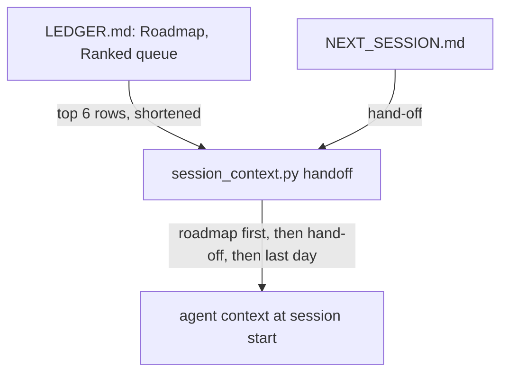
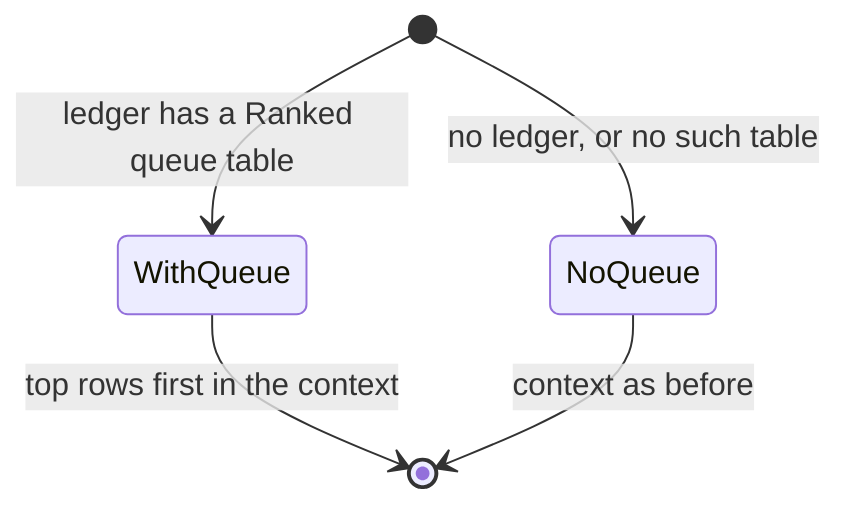

# A fresh fleet session sees the top of the roadmap, not only the hand-off

## Purpose

Owner, 2026-11-07: "How come we didn't do preliminary research into existing context in regard to preplanned work".

The cause: session start gives the agent `NEXT_SESSION.md` and the ledger's latest day, but not the ranked roadmap.
- The roadmap's items 0 (agent cards) and 1 (Weaver) were the work being re-planned that day.
- Neither appeared in the hand-off's pick-up list, so a new spec duplicated Weaver's locked runner spec.

Reuse: `hooks/session_context.py` `handoff()` already builds the agent context, and `section()` and `table_rows()` already parse the ledger.

## Goals and non-goals

Goal: the top roadmap rows reach every fresh fleet session, ahead of anything that could be cut. Non-goal: changing the owner's banner.

## Behaviour

| AC | Traces | Given / when | Pass when | Fail when | Test |
|---|---|---|---|---|---|
| AC-1 | Purpose | a ledger whose Ranked queue has 8 rows, and a long hand-off | the context opens with the first 6 rows (number and item), even when the hand-off is cut | a row is missing, or the cut removes them | `tests/test_session_context.py` |
| AC-2 | States | a ledger with no Ranked queue | the context is the hand-off and the last day, as before | it errors or adds an empty heading | `tests/test_session_context.py` |

## Outcomes

| Dimension | Level | Row or n/a reason | AC |
|---|---|---|---|
| success | L3 | The roadmap reaches the agent | AC-1 |
| invalid input | L3 | No queue table leaves the context unchanged | AC-2 |
| dependency fails | L2 | A missing ledger is already handled | - |
| timeout | L1 | Local file read only | - |
| crash mid-step | L1 | It writes nothing | - |
| concurrent actor | L1 | It only reads files | - |
| duplicate or replay | L1 | Computed fresh each session | - |
| arrival channel | L2 | Startup and clear only, as the hand-off is | - |
| performance or cost | L2 | Six shortened rows, about 1,000 characters, inside the existing cap | - |
| security | L1 | Private fleet docs to the local agent only | - |
| data and compatibility | L3 | Roadmap rows survive a cut hand-off | AC-1 |
| operability | L2 | The heading names `LEDGER.md` | - |

## Assumptions

| Assumption | Observed | If violated |
|---|---|---|
| The queue is the first table under `### Ranked queue` in `## Roadmap` | `D:/repo/docs/LEDGER.md:17-19` | keep: no table found falls back to AC-2 |
