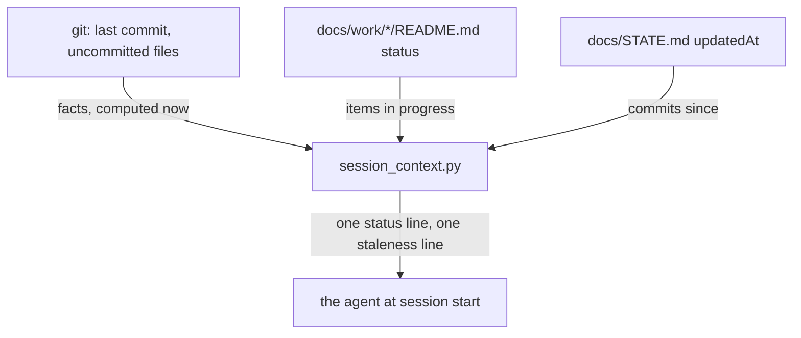
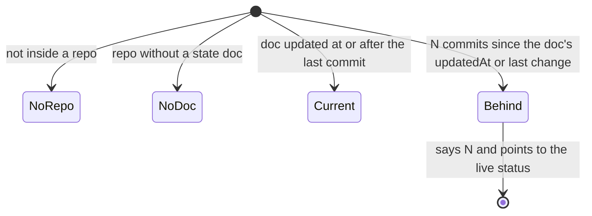

# Session start shows a computed status, and how far behind the state doc is

Research: `D:/repo/docs/reports/2026-11-07-context-lifecycle-research.md`, item 1.

## Purpose

Owner, 2026-11-07: "How come foreman's status and context aren't updated automatically as part of the side effect of development?", then yes to generating status. Foreman's `docs/STATE.md` says `updatedAt: 2026-09-26` while 73 commits landed since, and the session-start check compares file mtime, which any one-line edit resets.

Reuse: `hooks/session_context.py` already names the state doc at session start. Status computed at read time needs no stored copy, so it cannot go stale and needs no trigger.

## Goals and non-goals

Goal: at session start the agent sees live facts and how stale the hand-written doc is. Non-goal: rewriting STATE.md files; Foreman still reads their frontmatter.

## Behaviour

| AC | Traces | Given / when | Pass when | Fail when | Test |
|---|---|---|---|---|---|
| AC-1 | Purpose | a state doc whose `updatedAt` is older than 3 commits, edited today | the line says 3 commits since it was updated | the edit hides it, or no count is shown | `tests/test_session_status.py` |
| AC-2 | Purpose | a repo with a commit, an item at `building` and an uncommitted file | the status names the last commit, the item and 1 uncommitted file | any of the three is missing | `tests/test_session_status.py` |
| AC-3 | States | a doc with no `updatedAt` | the count runs from the doc's last commit | it says the doc is current while commits came after it | `tests/test_session_status.py` |

## Outcomes

| Dimension | Level | Row or n/a reason | AC |
|---|---|---|---|
| success | L3 | The agent sees live status and the doc's lag | AC-2 |
| invalid input | L3 | A doc without a date still gets a count | AC-3 |
| dependency fails | L2 | A git call that fails gives no status line, never a crash | - |
| timeout | L2 | Each git call keeps the hook's 10 second bound | - |
| crash mid-step | L1 | It writes nothing, so nothing is left half done | - |
| concurrent actor | L1 | It only reads git and files | - |
| duplicate or replay | L1 | It is computed fresh each session | - |
| arrival channel | L2 | Startup, resume, clear and compact all run the same lines | - |
| performance or cost | L2 | Four git calls, well under a second | - |
| security | L1 | No secrets read or written | - |
| data and compatibility | L3 | A doc edited today but 3 commits behind is still reported | AC-1 |
| operability | L2 | One line each, under the hook's size limit | - |

## Assumptions

| Assumption | Observed | If violated |
|---|---|---|
| `updatedAt:` is written in ISO form when present | Foreman's STATE.md frontmatter | keep: an unreadable date falls back to the doc's last commit |
