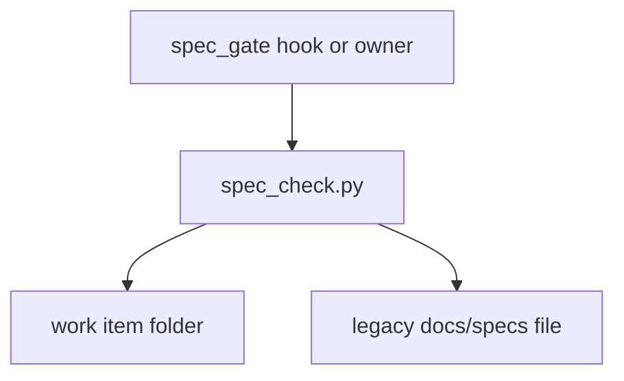

# spec-gate-checker: the Work-Item Standard v2 checker (CK-1..CK-26)

## Purpose
`spec_check.py` validates a work item against the Work-Item Standard v2 rules CK-1..CK-26, grouped into tiers by status, and still accepts the legacy `docs/specs` format until migration ends.

## Non-goals
- Running tests (it proves a test cites an AC, not that it passes).
- Judging whether an NFR target is meaningful (design review does).
- Rules CK-27 and later (a follow-up pass).

## Capabilities
| CAP | Statement |
|---|---|
| CAP-1 | The service must apply each rule only at the statuses its tier names |
| CAP-2 | The service must report each problem on one line that names its rule id |
| CAP-3 | The service must print warnings without failing the run |
| CAP-4 | The service must keep accepting legacy docs/specs files until migration ends |

## Non-functional requirements
None.

## Gate plan
| Risk | Kind (deterministic / qualitative) | Check | Blocking / advisory |
|---|---|---|---|
| a rule passes bad input or fails good input | deterministic | one passing and one failing fixture per rule in tests/test_spec_check.py | blocking |
