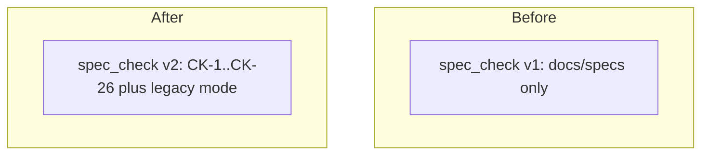

# spec-gate-checker: L2 components

| Component | Owned files | Public interface |
|---|---|---|
| spec_check | `scripts/spec_check.py` | `spec_check.py README.md --root R --for-source-commit` |

## spec_check

### Interface
`spec_check.py README.md [--root R] [--for-source-commit]`. One line per finding, `rule-id: file: message` for errors and `warn: rule-id: file: message` for warnings. Exit 0 with no errors, 1 on any error, 2 on unreadable input.

### Functional requirements
| FR | Requirement |
|---|---|
| FR-1 | The tier sets ALWAYS, STATIC, EXEC and SHIPPED, chosen by status, select which rules run |
| FR-2 | Output is one line per finding naming the rule id; warnings exit 0, errors exit 1, unreadable input exits 2 |
| FR-3 | The flag --for-source-commit adds CK-26 (status is building or shipped) |
| FR-4 | A file under docs/specs is checked with the legacy v1 rules |
| FR-5 | The helper tools (node with markdownlint and the Mermaid parser) run as bounded subprocesses; a timeout or a failure is a named ToolError and exit 2, never a pass |

### Data
Reads files through a tree: the working tree for the CLI, the git index for the commit gate. Reads the work item folder, the tests it names, `docs/DECISIONS.md` and sibling items for parent and child mirroring. Frontmatter rules come from `contracts/work-item.v2.json`, required headings from `contracts/work-item.headings.v2.json` (generated from the standard by `scripts/gen_heading_config.py`).

### Failure modes
| Failure | Detection | Handling |
|---|---|---|
| README unreadable | OSError on read | message on stderr, exit 2 |
| node missing, node_modules missing, or a tool times out | ToolError | message on stderr, exit 2; the gate rejects |
| frontmatter does not parse | PyYAML error | CK-1 error, no further rules |

### Budget
| Dimension | Budget |
|---|---|
| Latency | 1 s p95 per item |
| Cost | none: local process, no tokens |
