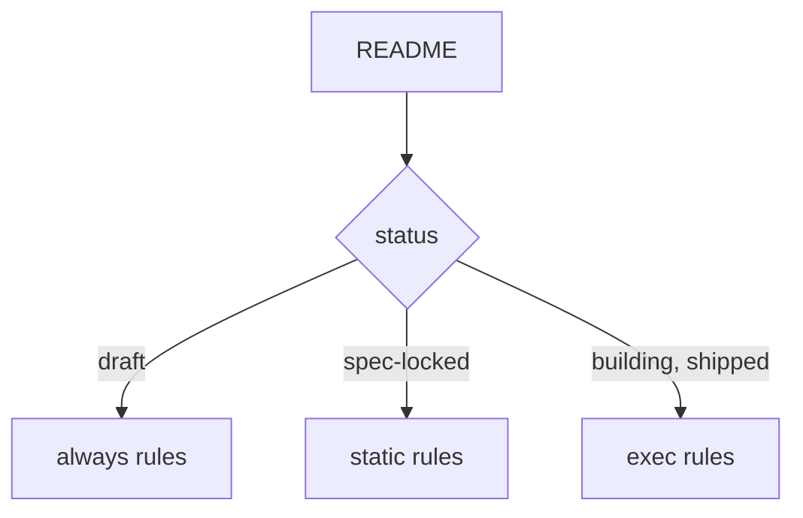

# spec-gate-checker: L3 functional and acceptance criteria

## FR/NFR delta
| ID | Change | Note |
|---|---|---|
| FR-1 | added | tiers |
| FR-2 | added | output and exit codes |
| FR-3 | added | source-commit flag |
| FR-4 | added | legacy mode |

## Acceptance criteria
| AC | Traces | Given / when | Pass when | Fail when | Test |
|---|---|---|---|---|---|
| AC-1 | CAP-1, FR-1 | rules CK-1 to CK-3 (frontmatter, enums, layers and profiles, validated against contracts/work-item.v2.json) run on a passing and a failing fixture | the passing fixture yields no finding and the failing one yields a line naming the rule | a rule is silent on its failing fixture or fires on its passing one | tests/test_spec_check.py, tests/test_work_item_schema.py, tests/test_spec_check_findings.py |
| AC-2 | CAP-1, FR-1 | rules CK-4 and CK-6 (required headings through markdownlint MD043, visual first through the Mermaid parser) run on a pair | the pair is told apart by rule id and a diagram that does not parse is a finding | either fixture is misjudged | tests/test_spec_check.py, tests/test_spec_check_findings.py |
| AC-3 | CAP-1, FR-1 | rules CK-5, CK-7, CK-8 and CK-9 (L0 tables) run on pairs | each pair is told apart by rule id | either fixture is misjudged | tests/test_spec_check.py, tests/test_spec_check_findings.py |
| AC-4 | CAP-1, FR-1 | rule CK-10 (NFR coverage and evidence) runs on a pair | the pair is told apart by rule id | either fixture is misjudged | tests/test_spec_check.py, tests/test_spec_check_findings.py |
| AC-5 | CAP-1, FR-1 | rules CK-11 to CK-14 (AC table, coverage, trace resolution) run on pairs | each pair is told apart; CK-14 is a warning | either fixture is misjudged | tests/test_spec_check.py, tests/test_spec_check_findings.py |
| AC-6 | CAP-1, FR-1 | rules CK-15, CK-16 and CK-22 (lifecycle, call chains, component sections, participants) run on pairs | each pair is told apart by rule id | either fixture is misjudged | tests/test_spec_check.py, tests/test_spec_check_findings.py |
| AC-7 | CAP-1, FR-1 | rules CK-17, CK-18 and CK-23 (nesting, mirror, AC cap) run on a parent and child family | each pair is told apart; CK-23 is a warning when children exist | either fixture is misjudged | tests/test_spec_check.py, tests/test_spec_check_findings.py |
| AC-8 | CAP-1, FR-1 | rule CK-19 (placeholders) runs on a pair, and on a draft | static tiers reject placeholders and a draft accepts them | a placeholder passes in a locked item | tests/test_spec_check.py, tests/test_spec_check_findings.py |
| AC-9 | CAP-1, FR-1 | rules CK-20, CK-24 and CK-25 (test citation, external evidence, shipped evidence) run on pairs | each pair is told apart by rule id | either fixture is misjudged | tests/test_spec_check.py, tests/test_spec_check_findings.py |
| AC-10 | CAP-2, CAP-3, FR-2, FR-3, FR-5 | rules CK-21 and CK-26 run, a warning-only item is checked, and a helper tool times out | lines follow the output format, warnings exit 0, errors exit 1, killed and promoted run only the always rules plus CK-21, the flag rejects spec-locked, a tool timeout is a named failure and never a pass | the format drifts, a warning fails the run, or a failed tool passes | tests/test_spec_check.py, tests/test_spec_check_findings.py |
| AC-11 | CAP-4, FR-4 | a file under docs/specs is checked | the v1 rules apply and the v1 output is unchanged | a legacy file is judged by v2 rules | tests/test_spec_check.py |

Tests cite `spec-gate-checker/AC-n` verbatim.
