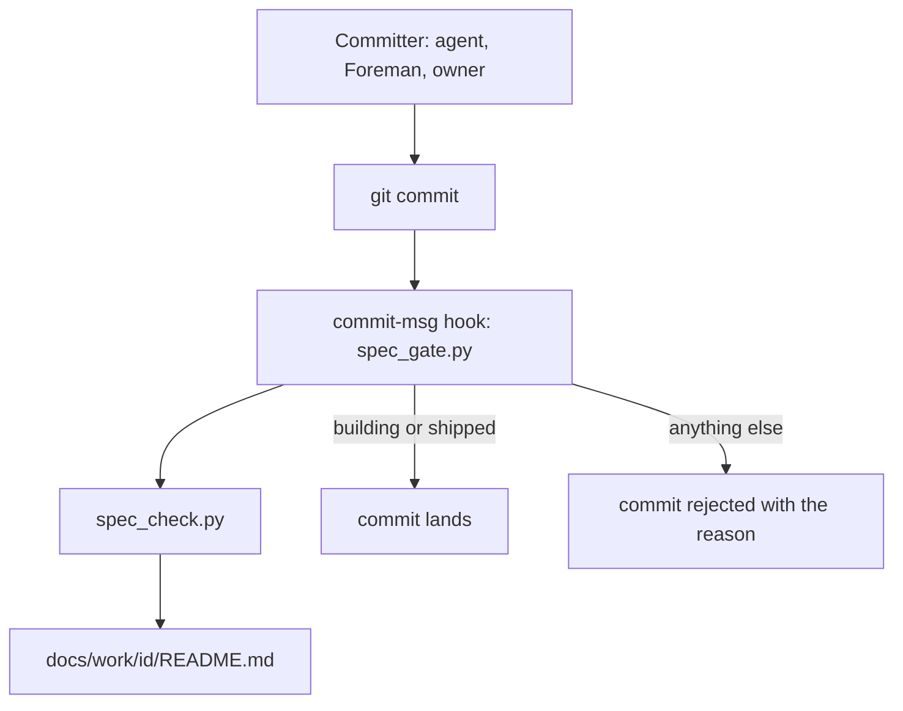

# Spec gate: no behaviour change lands on the default branch without a work item and its pass/fail tests

## Purpose
Every feature, fix or build is defined by a work item at `docs/work/id/` (Work-Item Standard v2). Enforcement runs inside git itself, through hooks the off-the-shelf pre-commit framework manages, so it sees the real staged files and the final message. It applies to every committer. This item is the migration of the earlier `docs/specs/spec-gate.md` into the v2 format; its behaviours keep their AC ids.

## Non-goals
- Backfilling work items for code that is already merged.
- Checking whether a test was red before its code (a reviewer checks that).
- The CI check for pull-request merges (a follow-up item).
- A pre-push hook on the default branch (the follow-up that closes the amend gap below).

## Capabilities
| CAP | Statement |
|---|---|
| CAP-1 | The service must reject a source commit on the default branch unless its Spec trailer names a work item whose status is building or shipped |
| CAP-2 | The service must not gate commits on other branches, merges, exempt subject types, or commits that stage no source |
| CAP-3 | The service must validate a work item and report one problem per line (the rules live in the child spec-gate-checker) |
| CAP-4 | The service must reject staged file names that contain a space or a non-ASCII character |
| CAP-5 | The user can install the hooks into every fleet repo with one command that is safe to re-run |

## Non-functional requirements
| NFR | Target | Method | Evidence |
|---|---|---|---|
| NFR-1 | checking the spec-gate item takes <= 5 s | latency-bench: time spec_check on this item | AC-11 |

## Trade-offs
| Option | Latency | Cost | Maintenance | Extensibility | Refactorability | Verdict |
|---|---|---|---|---|---|---|
| Parse the git command in a PreToolUse hook | low | low | very high: two reviews found 12 and 11 bypass forms | low | low | rejected: predicts the commit from text instead of observing it |
| git commit-msg hook via the pre-commit framework | low | low | low | high: other stages and hooks plug in | high | chosen |
| CI check on pull requests only | high | low | low | medium | high | rejected: acts after the commit has landed |

## Patterns applied
| Pattern | Where | Why |
|---|---|---|
| observe at the authoritative layer | spec-gate hook | git owns the staged index and the final message |
| tiered validation by status | spec_check (child) | placeholders are legal in a draft and illegal in a locked item |

## Components chosen
| Need | Chosen (off the shelf) | Rejected | Why rejected |
|---|---|---|---|
| git hook management | pre-commit framework | hand-written .git/hooks scripts | no install, update or stage handling |
| frontmatter parsing | PyYAML safe_load | hand-rolled key: value parser | cannot read nested layers or lists |
| frontmatter rules | one JSON Schema checked with jsonschema | hand-written if statements | cannot be shared with Catwalk's contract test |
| table rows | markdown-it-py plus pydantic models | regex over raw lines | breaks on code fences and escaped pipes |
| required headings | markdownlint rule MD043 | hand-rolled heading scan | cannot tell a heading from text in a code fence |
| diagram validity | the mermaid package parser under jsdom | @mermaid-js/parser | it cannot parse flowchart, sequence or state diagrams |

## Gate plan
| Risk | Kind (deterministic / qualitative) | Check | Blocking / advisory |
|---|---|---|---|
| an unspecified source commit lands | deterministic | tests/test_spec_gate.py runs real commits | blocking |
| the checker accepts an invalid item | deterministic | tests/test_spec_check.py fixture pairs | blocking |

## Known gaps
- Amend: `git commit --amend` re-runs the commit-msg hook, but an amend that only rewords a message whose staged diff is empty stages no source, so it passes. A pre-push hook on the default branch is the follow-up.
- Squash: a squash merge is gated like any commit, so it needs its own trailer. That is intended.
- Open question: whether a reworded amend of a source commit should be re-checked against the work item's current status.
