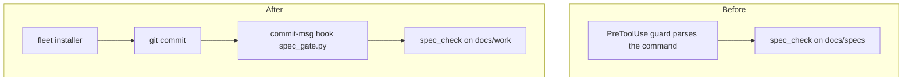
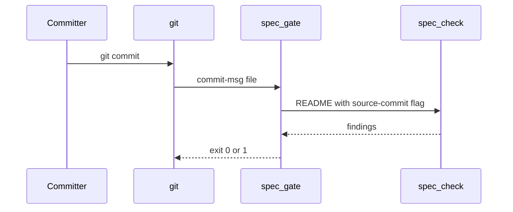

# spec-gate: L1 architecture

Before: the agent's PreToolUse hook predicted a commit from its command text. After: the commit-msg hook observes the commit itself and reads the work item the trailer names.

## Components
| Component | Role (one line) | Spec |
|---|---|---|
| spec_check | validates a work item by tier and rule id | nested: docs/work/spec-gate-checker/ |
| spec-gate hook | rejects a source commit on the default branch without a building or shipped item | components.md |
| fleet installer | puts the pre-commit config into each fleet repo | components.md |

## Call chains
### Source commit on the default branch

