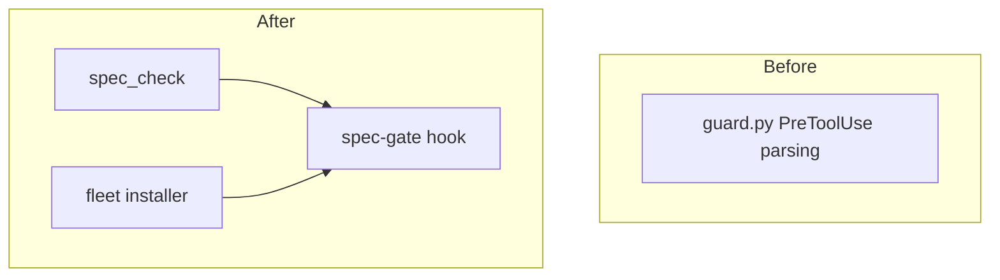

# spec-gate: L2 components

| Component | Owned files | Public interface |
|---|---|---|
| spec_check | `scripts/spec_check.py` | `spec_check.py README.md --root R --for-source-commit` |
| spec-gate hook | `scripts/spec_gate.py`, `git-hooks/fleet-pre-commit-config.yaml` | `spec_gate.py commit-msg-file` |
| fleet installer | `scripts/install_fleet_hooks.py` | `install_fleet_hooks.py folder --no-push` |

## spec_check
Nested spec: `docs/work/spec-gate-checker/`. Trigger: contract.

## spec-gate hook

### Interface
`spec_gate.py commit-msg-file`; exit 0 lets the commit land, exit 1 rejects it with the reason on stderr.

### Functional requirements
| FR | Requirement |
|---|---|
| FR-1 | A commit on the default branch (or a detached HEAD) that stages a source file needs exactly one Spec trailer naming docs/work/id/README.md whose status is building or shipped (CK-26); the item, its tests, configs and DECISIONS are read from the index, never the working tree; a subject type is not an exemption, only a revert that names an existing commit is; any git error, tool failure or timeout rejects the commit |

### Data
Reads the staged index, the branch and the commit message through git itself.

### Failure modes
| Failure | Detection | Handling |
|---|---|---|
| git fails or times out | non-zero exit or timeout | reject the commit and name the git error |

### Budget
| Dimension | Budget |
|---|---|
| Latency | 2 s p95 plus the checker run |
| Cost | none: local process, no tokens |

## fleet installer

### Interface
`install_fleet_hooks.py folder --no-push`; prints one line per repo.

### Functional requirements
| FR | Requirement |
|---|---|
| FR-3 | A fresh or dirty repo gains the config and both hooks and only the config file is committed; a re-run changes nothing; a repo with its own core.hooksPath is skipped and reported |
| FR-4 | The shipped config rejects staged file names that contain a space or a non-ASCII character |

### Data
Writes `.pre-commit-config.yaml` from `git-hooks/fleet-pre-commit-config.yaml`.

### Failure modes
| Failure | Detection | Handling |
|---|---|---|
| repo has its own hooksPath | git config read | skip and report the repo |

### Budget
| Dimension | Budget |
|---|---|
| Latency | 10 s per repo |
| Cost | none: local process, no tokens |
