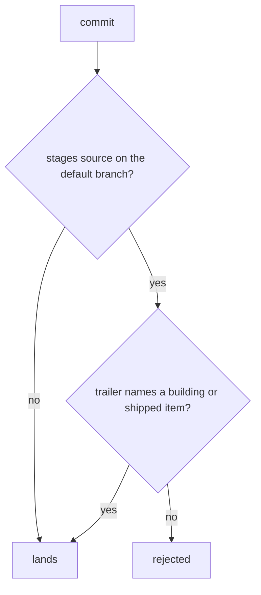

# spec-gate: L3 functional and acceptance criteria

## FR/NFR delta
| ID | Change | Note |
|---|---|---|
| FR-1 | modified | trailer names docs/work/id/README.md; building or shipped only |
| FR-3 | unchanged | installer behaviour |
| FR-4 | unchanged | portable file names |
| NFR-1 | added | checker latency |

## Acceptance criteria
| AC | Traces | Given / when | Pass when | Fail when | Test |
|---|---|---|---|---|---|
| AC-1 | CAP-3 | spec_check runs on a well-formed building item whose tests exist and cite each AC | exit 0, no problems | any problem is reported | tests/test_spec_check.py |
| AC-2 | CAP-3 | the item lacks a frontmatter field, has a bad enum value, or has no AC table | exit 1, naming the rule and the missing piece | exit 0 | tests/test_spec_check.py |
| AC-3 | CAP-3 | a building or shipped item cites a test file that is missing or that does not cite its id and AC number exactly | exit 1, naming the AC | exit 0 | tests/test_spec_check.py |
| AC-4 | CAP-3 | a draft item has no tests yet | exit 0 (only the always rules run in draft) | exit 1 | tests/test_spec_check.py |
| AC-5 | CAP-1, FR-1 | a commit on the default branch, or on a detached HEAD, stages source (by any staging form, in any language or in a nested dist, build or out folder) and has no Spec trailer, whatever its subject type says (feat, refactor, style, test) | the commit is rejected and the message names the rule | the commit lands | tests/test_spec_gate.py, tests/test_spec_gate_review.py |
| AC-6 | CAP-1, FR-1 | the Spec trailer names a missing, draft, spec-locked, killed or invalid item, a path outside docs/work, or there is more than one Spec trailer; or the item, its tests or its configs exist only in the working tree and not in the index | the commit is rejected with the specific reason (the checker's problems, or exactly one trailer) | the commit lands | tests/test_spec_gate.py, tests/test_spec_gate_review.py |
| AC-7 | CAP-2, FR-1 | a valid building or shipped trailer; only docs, tests, config or root build output staged; a revert whose body names an existing commit; a merge or rebase in progress; or a non-default branch | the commit lands | the commit is rejected | tests/test_spec_gate.py, tests/test_spec_gate_review.py |
| AC-8 | CAP-4, FR-4 | a staged file name contains a space or a non-ASCII character | the commit is rejected, naming the file | the commit lands | tests/test_spec_gate.py |
| AC-9 | CAP-1, CAP-4, FR-4 | pre-commit install with both stages and the fleet config in a fresh repo | both hooks run on a real commit and reject an unspecified source commit | either hook is missing or does not run | tests/test_spec_gate.py |
| AC-10 | CAP-5, FR-3 | the installer runs over a folder of repos (one fresh, one configured, one with its own core.hooksPath, one dirty) | fresh and dirty repos gain the config and both hooks and only the config file is committed; a second run changes nothing; the hooksPath repo is skipped and reported | a repo is skipped silently, unrelated files are committed, or a re-run makes a new commit | tests/test_spec_gate.py |
| AC-11 | CAP-3, NFR-1 | spec_check runs on this very item | exit 0 within 5 s | any problem, or over 5 s | tests/test_spec_check.py |

Tests cite `spec-gate/AC-n` verbatim.
