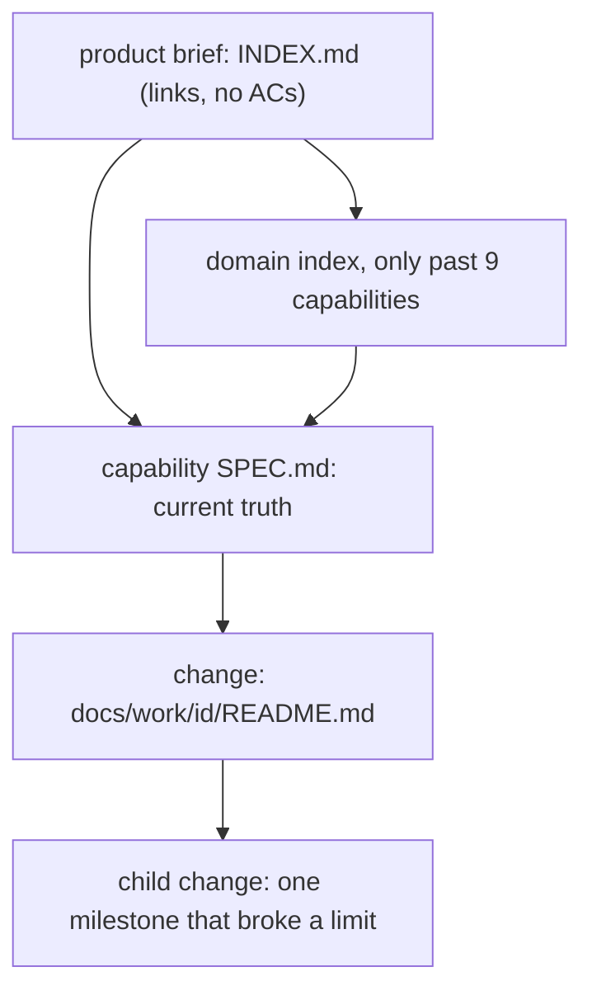

# Spec levels and limits: a product brief, capabilities and changes, each within fixed limits

Moved out of `docs/work/agentic-loop/` as its milestone M4 (agentic-loop Scope cut, 2026-11-03). It shares no path
with agentic-loop M1 or M2 and depends on the capability layer (`capability-layer`, planned, not drafted). Build order
and file owners: [INDEX](../../capabilities/INDEX.md) (SL-1).

**Tier.** The checker computes the tier from the AC count and the flags. With 6 ACs and the flags `contract` (the
product-brief schema and the `limits` keys that other tools read) and `enforcement` (the checker refuses a spec past a
limit), the computed tier is T2.

## Assumed defaults (reversible)

| # | Default | Why assumed | Revisit when |
|---|---|---|---|
| A-2 (moved from agentic-loop, id kept) | The limits in the table below are starting values, not measured optima. A project overrides them in its manifest `limits`, and one item overrides them in its frontmatter `limits:` with a `why`. Every milestone brief reports actual against limit | owner: no accurate estimate yet, keep it reversible and tunable (2026-11-03) | five items per tier have reported actuals |

### Levels and limits (A-2)

A document holds at most two levels. Scale grows sideways (more capabilities) and up (one thin product brief), never
deeper inside a spec.

| Level | Document | Holds | Limit, then |
|---|---|---|---|
| Product | `docs/capabilities/INDEX.md` as a product brief (claudence's own: [INDEX](../../capabilities/INDEX.md)) | vision, capability map, cross-capability contracts, release milestones; links, no ACs | 9 capabilities, then group into domains |
| Domain (only past 9 capabilities) | `docs/capabilities/<domain>/INDEX.md` | the same shape for its capabilities | 9 capabilities each |
| Capability | `docs/capabilities/[<domain>/]<name>/SPEC.md` | current truth: ACs, outcomes, owned paths, timeline | 40 current ACs or 200 lines, then split the capability |
| Change | `docs/work/<id>/README.md` | one change: decisions, milestones, contracts, ACs | 15 ACs, 5 milestones, 5 scopes and about 400 changed lines per milestone, 4 parallel agents |
| Child change | `docs/work/<id>/` with `parent:` | one milestone that broke a limit | never nests again |

Complexity class: **S** is one capability (a change spec alone), **M** is 2-9 capabilities (a product brief),
**L** is 10 or more (domains). Worked example, a Tarive rebuild: [levels-example.md](evidence/levels-example.md).

## Purpose

A large application cannot fit one spec, and today nothing stops a spec, an index or a nesting chain from growing past
what one review or one agent can hold. The owner wants large projects to decompose by rule, from a single change up to
a product (owner design O-19 and O-20, `../agentic-loop/evidence/owner-design.md`).

## Goals and non-goals

- Goal: the checker refuses a change, a capability spec or an index past its limit, naming the limit and the split.
- Goal: limits are tunable per project and per item, never silently.
- Goal: the product brief and domain indexes have one checked shape.
- Non-goal: the capability layer itself (the current-truth `SPEC.md`, the fold at ship); milestones and briefs
  (agentic-loop); T3 nesting on v2.

## Background

- **C4 levels**: context, container, component, code; most teams need only the first two documented.
- **Scopes**: 3-5 scopes per cycle before one is missing (Shape Up); review quality drops past 200-400 changed lines.

Sources

- C4: c4model.com ("context and container diagrams are sufficient for most teams"); arc42; OpenSpec and the Spec Kit
  domain extension group capabilities into domains.
- Split defaults and their sources: agentic-loop probe, section "Split defaults".
- Full notes: `D:/repo/docs/research_notes/spec-folder-structure/`.

## Approach

Baseline: today (one change spec, a 15-AC cap, no product level). Scores +, 0 or - against it.

| Dimension | A: limits as prose, judged by the reviewer | B: limits checked by the checker, overridable with a reason (chosen) | C: numbered folders per feature (Spec Kit style), any depth |
|---|---|---|---|
| Scale to large apps | 0 | + product, domain, capability, change | 0 no current state |
| Owner time | 0 | 0 | - more documents to read |
| Defect escape | - a limit is missed under load | + refused by name | - |
| Reversibility | + | + a manifest or item override | - folder layout fixed early |
| Build complexity | + nothing to build | - one checker module and a schema | - |

Chosen: **B**.

## Milestones

The table is the plan only. Build order and file owners: INDEX.

| Milestone | Slice (what works after it) | Depends on | Owns | Outer test (red first) | Unblocks |
|---|---|---|---|---|---|
| SL-1 | the checker reads the product brief and domains and refuses a spec or index past its limits or depth; limits override per project and per item; each brief reports actual against limit | agentic-loop AL-M1 (plan sections) and AL-M2 (the brief), project-manifest PM-P1 (`limits` through `scripts/manifest.py`), the capability layer | `scripts/spec_levels.py`, `contracts/product-brief.v1.json`, `scripts/spec_v3.py`, `contracts/work-item.v3.json`, `scripts/milestone_brief.py`, `contracts/milestone-brief.v1.json`, `skills/dark-factory/SPEC-STANDARD-V3.md` | AC-1 | large projects decompose by rule |

## Contracts

| Name | Version | Schema | Fixtures |
|---|---|---|---|
| product brief and domain index | v1 | `contracts/product-brief.v1.json` | `contracts/fixtures/brief-index-*.md` |
| item frontmatter `limits:` (each limit key with a value and a `why`) | v3.2 | `contracts/work-item.v3.json` | `contracts/fixtures/limits-*.md` |
| milestone brief: a `limits` part (limit, actual, source: fleet, project or item) | v1 | `contracts/milestone-brief.v1.json` | `contracts/fixtures/brief-*.json` |
| per-project `limits` (defined by project-manifest, read through `scripts/manifest.py`) | v1 | `contracts/project-manifest.v1.json` | `contracts/fixtures/manifest-*.yaml` |

Writers: the fleet defaults by the owner (`contracts/fleet-defaults.v1.yaml`); a project's `limits` by the owner in its
guard-protected manifest; an item's `limits:` by its author, which is why it needs a `why`, shows in every brief and is
judged at design review. Signatures: `spec_levels.check(tree, path, limits: EffectiveLimits) -> list[Finding]`
(pure over the tree; called by `spec_v3.check`); `spec_levels.effective_limits(config: EffectiveConfig,
item_limits: Mapping[str, ItemLimit] | None) -> EffectiveLimits`; `spec_levels.limit_use(tree, item) ->
list[LimitUse]` (read by `milestone_brief.py`).

## Behaviour

| AC | Traces | Given / when | Pass when | Fail when | Test |
|---|---|---|---|---|---|
| AC-1 | SL-1, A-2 | fixtures run by `spec_check.py` and by the commit-msg gate on the staged copy: a change with 16 ACs or 6 milestones; a child of a child; a product brief with 10 capabilities and no domains; a capability SPEC.md over 200 lines or over 40 ACs | each refused at both, naming the limit and the split to make | a limit is ignored at either | tests/test_spec_levels.py |
| AC-2 | SL-1, A-2 | a project manifest raising one limit; an item's frontmatter `limits:` with and without a `why`; a milestone brief for each | the project limit applies; the item override applies only with a `why` and is refused without; each brief shows actual against limit and the limit's source | an override is silently ignored or applied without a reason | tests/test_spec_levels.py |
| AC-3 | SL-1 | claudence's own `docs/capabilities/INDEX.md`; a product brief holding an AC table; a domain index under the product brief; a domain index under a domain index; a brief linking a capability that does not exist | the real INDEX passes; the AC table, the third level and the dead link are refused by name; the domain index passes | a brief with ACs or a third level passes, or the real INDEX is refused | tests/test_spec_levels.py |
| AC-4 | SL-1 | a repo with no `docs/capabilities/`; an unreadable or malformed INDEX.md; a manifest whose `limits` holds an unknown key or a non-number | change-level limits still apply and the product checks report that no product brief exists; the malformed index and the bad limit are refused by name | a missing layer refuses every spec, or a bad limit is used | tests/test_spec_levels.py |
| AC-5 | compatibility | every v2 and v3 item and every index in the fleet | judged exactly as before, except an item or index already past a limit, which is listed in the test output and fails only at its next status move | any other result changes | tests/test_spec_levels.py |
| AC-6 | docs | SPEC-STANDARD-V3.md | it states the levels table, the limits, the override rule and the split rule | the doc contradicts the code | tests/test_spec_levels.py |

## Fixture sources

AC-3 runs on claudence's real `docs/capabilities/INDEX.md` (9 capabilities after this edit) and copies of it edited
one fault at a time. AC-1 and AC-5 run on the real fleet corpus (every `docs/work/*/README.md` under the fleet roots);
the 16-AC and 6-milestone fixtures are copies of the real agentic-loop README with rows added. AC-2's manifest
fixtures start from the real `catalog-info.yaml` that project-manifest PM-P1 writes.

## Outcomes

| Dimension | Level | Row or n/a reason | AC |
|---|---|---|---|
| success | L3 | the real product brief and specs within their limits pass | AC-3 |
| invalid input | L3 | a spec, index or limit past its rule is refused by name | AC-1 |
| dependency fails | L3 | a repo without the capability layer still gets the change-level limits; a broken index is refused | AC-4 |
| timeout | L1 | the check reads only local committed files, with no network or waits | n/a |
| crash mid-step | L1 | a pure check that writes nothing leaves nothing half done | n/a |
| concurrent actor | L1 | the check reads one tree at a time and keeps no state | n/a |
| duplicate or replay | L1 | a stateless check has nothing to replay | n/a |
| arrival channel | L3 | the limits are judged wherever the checker runs: by hand and at commit-msg on the staged copy | AC-1 |
| performance or cost | L1 | the work grows with the files of one item plus at most nine index rows per level | n/a |
| security | L3 | an author can raise only their own item's limit, with a `why` that every brief shows | AC-2 |
| data and compatibility | L3 | existing items and indexes are judged as before; one already past a limit is listed, not refused at once | AC-5 |
| operability | L3 | each milestone brief shows actual against limit and where the limit came from | AC-2 |

## Assumptions

| Assumption | Observed | If violated |
|---|---|---|
| The capability layer exists before SL-1 | `D:/repo/docs/reports/2026-11-03-spec-structure-proposal.md:31` | defer: SL-1 waits; the change-level limits alone could ship earlier as an amendment |
| Per-repo size limits live in the manifest as a fleet default a repo may override | `C:/Users/Michael/.claude/docs/work/project-manifest/README.md:93` | defer: SL-1 waits for PM-P1's reader |
| The limits are starting values taken from the agentic-loop probe's split defaults | `C:/Users/Michael/.claude/docs/work/agentic-loop/evidence/probe.md:45` | keep: A-2 makes them tunable; briefs report actuals |
| The milestone brief exists (agentic-loop AL-M2) before SL-1 adds its limits part | `C:/Users/Michael/.claude/docs/capabilities/INDEX.md:51` | defer: SL-1 waits for AL-M2 |

## Probe

[Probe pointer](evidence/probe.md) to agentic-loop's probe.
