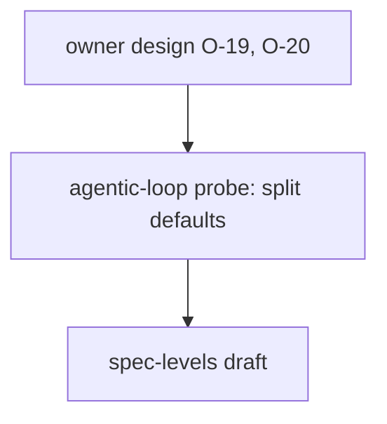

# Probe pointer: spec-levels (2026-11-03)

This item was split out of agentic-loop (its milestone M4). Its probe is agentic-loop's and is not repeated here.

| Source | What it settles |
|---|---|
| [agentic-loop probe](../../agentic-loop/evidence/probe.md), row O-19/O-20 and section "Split defaults" | the limits (15 ACs, 5 milestones, 5 scopes, 4 agents, about 400 lines, depth 2) and their sources |
| [owner design](../../agentic-loop/evidence/owner-design.md) | the owner's ask: split large specs, default depth |
| `D:/repo/docs/reports/2026-11-03-spec-structure-proposal.md` | the capability layer this item depends on |
| [levels-example.md](levels-example.md) (moved here from agentic-loop) | the worked example, a Tarive rebuild |
