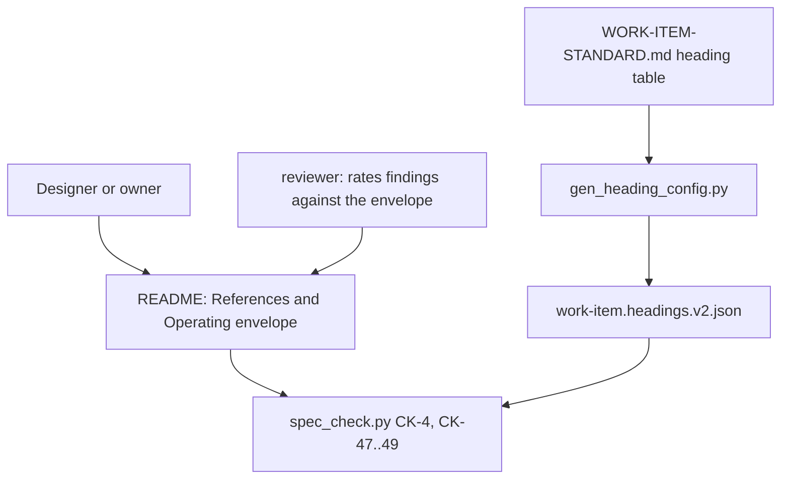

# Work-Item Standard: every spec cites prior art (References) and states its Operating envelope

## References

Owner decision 2026-10-31: this item dogfoods the rule it introduces, so it starts with References and then Operating envelope. The Foreman line numbers were verified against the files on 2026-10-31 (`createWorktree` at worktrees.js:129, `removeWorktree` at :151, `checkpointWorktree` at checkpoint.js:116, `recoverInterruptedRun` at :174, the `--squash` args at merge.js:135). The two quoted sentences in the first two rows are the owner's wording from the brief, kept verbatim; the 2026-10-31 ledger rows nearest to them are 40 and 41 (branch-conventions and Spindle escapes), which do not contain those sentences literally (see OQ-7).

### Local

| Source (file:line) | Status (working / partial / broken) | What it shows | Decision (extract / wrap / replace / ignore) + reason |
|---|---|---|---|
| C:/Users/Michael/.claude/docs/SPEC-GAP-LEDGER.md:29-41 | working | Today's escapes, the rows dated 2026-10-31. Branch-conventions reviews kept finding cases outside the real setup. | extract: the escape categories feed the Gap-ledger check table and the review rule; there is no code to lift |
| D:/repo/Factory/foreman/core/worktrees.js:129 D:/repo/Factory/foreman/core/worktrees.js:151 D:/repo/Factory/foreman/core/checkpoint.js:116 D:/repo/Factory/foreman/core/checkpoint.js:174 D:/repo/Factory/foreman/core/merge.js:135 | working | The Spindle specs never cited Foreman's working worktree code at D:/repo/Factory/foreman/core/worktrees.js (createWorktree :129, removeWorktree :151), checkpoint.js :116/:174, and merge.js :135 (`gh pr merge --squash`). | ignore: it is the evidence for why References is needed; this item does not touch worktrees |
| C:/Users/Michael/.claude/skills/dark-factory/WORK-ITEM-STANDARD.md:62-86 | working | The CK-4 heading table and the L0 heading lists; CK-19 (placeholders) is at :352 and CK-4 at :337. | wrap: add the two headings, the leading/optional notation and CK-47..49 to this table and its checker rows |
| C:/Users/Michael/.claude/contracts/work-item.headings.v2.json:3-21 | working | The generated heading config (l0 full and lite lists); built by scripts/gen_heading_config.py:31-39 (readme_entry, which already extracts the conditional notation) and :55-71 (generate). | wrap: new keys leading, legacyThrough and per-type optional, produced by the same generator, no second config |
| C:/Users/Michael/.claude/scripts/spec_check.py:361-381 | working | required_headings (CK-4 input), ck4 at :429, ck5 at :440 (the table-row check pattern), ck19 at :610, the STATIC set at :52, the RULES list at :711. | wrap: new rules ck47, ck48, ck49 follow ck5's shape; required_headings gains the optional and legacy filters |
| C:/Users/Michael/.claude/scripts/work_item_md.py:138-239 | working | The pydantic Row base, CapRow/NfrRow/AcRow models with per-field rule ids, and parse_rows (exact-header check, one finding per bad cell). | wrap: three new Row subclasses, parse_rows unchanged |
| C:/Users/Michael/.claude/agents/reviewer.md:50-52 | partial | The rating rule already exists in the reviewer and designer agent text (designer.md:30-34), with no standard, template or checker behind it. Searched C:/Users/Michael/.claude/scripts, contracts, skills and tests for `Operating envelope` and `## References` (case-sensitive): no match. | extract: the standard becomes the source of the wording; the agent text is kept consistent by a test |

### Web

| Source (URL) | Date checked | What it shows | Decision |
|---|---|---|---|
| https://docs.arc42.org/section-2/ | 2026-10-31 | arc42 section 2 Constraints: a plain table of constraints with explanations (technical, organizational, conventions). No assumption, observation or fail-safe column. | ignore: constraints are imposed from outside; an assumption here is observed and can break. Only the plain-table form is reused |
| https://docs.arc42.org/section-3/ | 2026-10-31 | arc42 section 3 Context and Scope. 0 matches for "assum" on the page; no references section. | ignore: nothing to borrow |
| https://docs.arc42.org/section-11/ | 2026-10-31 | arc42 section 11 Risks and Technical Debt. 0 matches for "assum"; risks are listed, not tied to an observation or a fail-safe outcome. | ignore: closest in intent, but has no observed-not-hoped column or closed outcome vocabulary |
| https://raw.githubusercontent.com/adr/madr/main/template/adr-template.md | 2026-10-31 | MADR template: Decision Drivers, Considered Options, Pros and Cons. 0 matches for "assum" and for "references". | ignore: options are already covered by Trade-offs |
| https://www.rfc-editor.org/rfc/rfc7322 | 2026-10-31 | RFC Style Guide: a References section is a citation list. 0 matches for "assum". | ignore: a bare citation list has no status or decision column |
| https://raw.githubusercontent.com/DavidAnson/markdownlint/main/doc/md043.md | 2026-10-31 | MD043 headings can use the wildcards star, plus and question mark, and count headings of every level. | wrap: keep MD043 for presence (already used); order is checked in Python over level-2 headings because H3s under References break adjacency |

## Operating envelope

| Assumption | How it is observed (not hoped) | If violated |
|---|---|---|
| Tables are read by markdown-it-py with tables enabled, so the three new tables are real tables in the token stream | AC-4 and AC-5 fixtures: a References section whose tables do not parse yields zero tables and a named CK-48 finding | refuse: the checker reports CK-48 or CK-49 and exits 1; it never treats an unparsed table as a pass |
| The standard's heading table is the only source of the required headings | gen_heading_config.py --check in the gate (AC-1) compares the committed JSON with a fresh generation | refuse: the gate fails on a stale config; the committed JSON is never hand-edited to pass |
| `created` in the frontmatter is a real date | CK-1 validates it before any CK-47..49 rule runs (existing behaviour: spec_check returns after a CK-1 failure) | refuse: CK-1 stops the run, so an item with a bad date is never treated as legacy |
| The node helper (markdownlint) is available for CK-4 | existing FR-5 of spec-gate-checker: a missing or timed-out helper is a ToolError | refuse: exit 2, the gate rejects; CK-4 is never skipped |
| A cited file:line still points at the claimed code | not observed by the checker (OQ-1); the reviewer opens each cited line at review | flag: the reviewer records a finding tagged asserted-not-verified-claim and the item is not locked until it is fixed |

## Purpose
Specs keep escaping review because the author never looked at working code that already exists and never said which conditions the design relies on. Today's ledger rows show it: the Spindle specs rebuilt worktree handling without citing Foreman's working code, and branch-conventions reviews kept finding cases outside the real setup. This item makes two README sections required and machine-checked: References (prior art in the fleet and on the web, each with a decision) and Operating envelope (each assumption, how it is observed, and a fail-safe outcome if it breaks). Existing items are not broken: they get a warning until they are next touched.

## Non-goals
- Checking that a cited file or line exists (OQ-1; a follow-up item).
- Judging whether a decision or an observation is a good one (design review does).
- Rules CK-27 and later (multi-package; reserved by the standard).
- Rewriting the existing work items or the other repos' items.
- Changing Catwalk (it ignores unknown headings).

## Capabilities
| CAP | Statement |
|---|---|
| CAP-1 | The service must require a `## References` section in the README of every work item type |
| CAP-2 | The service must require a `## Operating envelope` section in feature, integration, data-collection and refactor items, and accept it as optional in bugfix, research and experiment items |
| CAP-3 | The service must reject a README whose References and Operating envelope sections are not the first sections after Overview, in that order |
| CAP-4 | The service must reject a References or Operating envelope table whose header, row count or row cells break the rules, naming the rule and the cell |
| CAP-5 | The service must report an item created on or before 2026-10-31 that has neither section as a warning, not an error |
| CAP-6 | The service must tell the reviewer to rate a finding that needs an envelope assumption broken as F, unless the assumption can break silently, in which case a cheap detector is required |
| CAP-7 | The user can start a new item from the README templates and get both sections with the exact table headers |

## Non-functional requirements
None.

## Trade-offs
| Option | Latency | Cost | Maintenance | Extensibility | Refactorability | Verdict |
|---|---|---|---|---|---|---|
| Extend the existing pipeline: heading table, generated config, Row models, three new rules | low: same parse, under 50 ms extra | low | low: one source for headings, one model per table | high: a new section is a table row plus a Row model | high | chosen |
| A separate References/envelope linter script | low | medium | high: a second parser, a second config, a second place to drift | low | low | rejected: a parallel mechanism, which the owner ruled out |
| Keep it as agent instruction text only (status quo in the reviewer and designer agents) | none | low | medium | low | medium | rejected: nothing fails when a section is missing, which is how today's escapes happened |

## Patterns applied
| Pattern | Where | Why |
|---|---|---|
| single source, generated config | heading table to work-item.headings.v2.json to spec_check | a hand-copied heading list drifts (hand-copied-enum) |
| closed vocabulary validated by a model | LocalRefRow, WebRefRow, EnvelopeRow | a free-text cell cannot be checked |
| ratchet: old items warn, touched or new items fail | CK-47 legacy path | nothing breaks today and the debt cannot grow |

## Components chosen
| Need | Chosen (off the shelf) | Rejected | Why rejected |
|---|---|---|---|
| table row validation | the existing pydantic Row models and parse_rows | a new regex linter | a second mechanism |
| heading presence | markdownlint MD043 through the existing spec_lint.mjs | a hand-rolled scan | cannot tell a heading from a code fence |
| heading order | a Python check over the existing Doc.headings (built in-house: MD043 wildcards cannot express adjacency when H3s sit under References) | MD043 sequence with wildcards | a star between the two headings would also accept an unrelated H2 there |
| spec section wording | none off the shelf: arc42 sections 2, 3, 11, the MADR template and RFC 7322 were checked on 2026-10-31 and none has an assumptions or observed-not-hoped section | borrowing arc42 Constraints | constraints are fixed from outside, assumptions are observed and can break |

## Gate plan
| Risk | Kind (deterministic / qualitative) | Check | Blocking / advisory |
|---|---|---|---|
| a new rule misjudges a fixture | deterministic | python -m pytest tests/test_spec_references_envelope.py: one passing and one failing fixture per rule, one fault per failing fixture, asserting the specific message | blocking |
| the committed heading config is stale | deterministic | python scripts/gen_heading_config.py --check | blocking |
| the change breaks an existing item | deterministic | spec_check.py over every docs/work README under ~/.claude exits with the same code as before the change (warnings allowed) | blocking |
| a rule survives a mutation | qualitative | the reviewer flips each regex and each vocabulary word in the new models and one test must fail | blocking |
| this item breaks its own rule | deterministic | python scripts/spec_check.py on this README at draft and on a temp copy at spec-locked | blocking |

## Gap-ledger check
| Category | Handled by |
|---|---|
| probabilistic-call-reliability | n/a: no LLM call |
| creative-domain-anchoring | n/a: no generated creative output |
| asserted-not-verified-claim | AC-6 and AC-7 (a claim needs a file:line or a URL with a date); existence of the cited line is not machine-checked, see OQ-1 |
| concurrent-actor-incomplete | n/a: the checker reads one file per run and no external resource |
| runtime-schema-drift | AC-1 (regenerate-and-diff of the config) and AC-4 to AC-8 (one Row model per table) |
| invariant-checked-on-one-path-only | AC-2 and AC-3 run on every type and on a nested spec; AC-10 runs the same Row models over both templates |
| signal-consumer-enumeration | AC-1: the consumers of the config are spec_check.py, gen_heading_config.py, tests/test_gen_heading_config.py (hard-coded 8 headings, updated) and the spec-gate-checker components.md text |
| cross-platform-path-identity | AC-6: fixtures with a Windows drive path and backslashes |
| authoritative-source | the heading table in the standard (headings, order, optional, cutoff); `created` from frontmatter (AC-9) |
| fail-closed-on-unknown | AC-4 to AC-8 (an unparsed table or unknown word is an error); AC-9 (a missing or invalid date is never legacy) |
| destructive-op-proof | n/a: read-only checker |
| liveness-and-time | n/a: no locks or leases; the cutoff is a fixed date, not the wall clock |
| concurrency-granularity | n/a: stateless, one file per run |
| external-contract-unverified | the Local and Web tables of this item (Foreman lines read on 2026-10-31); AC-6 and AC-7 for later items |
| split-state | n/a: no state |
| untestable-ac | one fault per fixture with a specific message (every AC); mutation row in the Gate plan |
| scope-drift-oversize | 10 ACs; Non-goals name the deferred pieces |
| enforcement-allowlist | AC-2 (envelope optional for bugfix, research, experiment) and AC-9 (legacy items); killed and promoted items run only the ALWAYS tier |
| hand-copied-enum | AC-10: the vocabularies in the standard equal the constants in work_item_md.py |
| escape-record | n/a: a record row, not a spec category |

## Open questions
- OQ-1: A cheap detector for rotted citations (warn when a cited local path or line does not exist). Default: not built here; follow-up item. The reviewer is the only check today, so the matching envelope row says so.
- OQ-2: `created` can be back-dated to dodge the new rules. Default: accepted; CK-47 prints the date in its warning so it is visible in review.
- OQ-3: Assumed defaults for types the owner did not name: data-collection requires both sections (through L0 lite); experiment requires References and treats the envelope as optional. Revisit if experiments start hiding real assumptions.
- OQ-4: The order rule is Python over level-2 headings, not MD043. Revisit if MD043 gains an adjacency form.
- OQ-5: `flag` is a weaker outcome than keep, refuse or defer. It is defined as "take no action on the affected item and raise a visible alert", so no outcome in the vocabulary allows a destructive action. The owner may drop it.
- OQ-6: The legacy warning never expires on its own. Default: no sunset date; add one when the warning count is small.
- OQ-7: The brief's two sentences about today's escapes are cited verbatim but are not literal text in SPEC-GAP-LEDGER.md rows 29-41. The nearest rows are 40 and 41. The owner may want those sentences added to the ledger.
