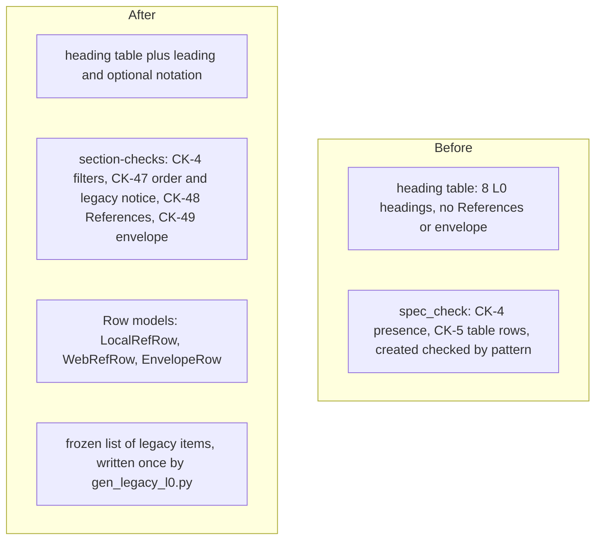

# spec-references-envelope: L2 components



| Component | Owned files | Public interface |
|---|---|---|
| section-checks | `scripts/spec_check.py`, `scripts/work_item_md.py`, `scripts/work_item_schema.py`, `contracts/work-item.v2.json`, `scripts/gen_heading_config.py`, `contracts/work-item.headings.v2.json` (generated), `scripts/gen_legacy_l0.py`, `contracts/work-item.legacy-l0.v1.json` (generated once), `skills/dark-factory/WORK-ITEM-STANDARD.md`, `skills/dark-factory/templates/work-item/README.md`, `skills/dark-factory/templates/work-item/README.experiment.md`, `tests/test_spec_references_envelope.py`, `tests/test_gen_heading_config.py`, `tests/fixtures/work-items/**`, `tests/fixtures/work-items/legacy-baseline.json` (generated once) | `spec_check.py README.md` (unchanged CLI; new rule ids CK-47, CK-48, CK-49); `gen_legacy_l0.py --write / --baseline / --check` |

One component. Its single responsibility: validate the References and Operating envelope sections of one README against the standard. The generators, the Row models and the standard text are its inputs and are changed with it, in the same pass, because splitting them would let the headings, the table headers and the prose disagree. The reviewer agent text (`agents/reviewer.md`) is governance: this item specifies one added sentence (below) which the parent session applies; a test reads it.

## section-checks

### Interface
Signatures only (names and types are the contract; bodies belong to the Implementer).

```
# scripts/work_item_md.py  (same Row base class and parse_rows as CapRow and NfrRow)
# EVIDENCE_TOKEN already exists at work_item_md.py:18 and is imported, never re-spelled.
LOCAL_STATUSES = ("working", "partial", "broken")
DECISIONS      = ("extract", "wrap", "replace", "ignore")
VIOLATED       = ("keep", "refuse", "flag", "defer")
NO_OBSERVATION = ("-", "n/a", "none", "tbd", "todo", "assumed")   # whole-cell, case-insensitive
LOCAL_CITE     : re.Pattern   # one token "path.ext:line" or "path.ext:line-line"; shared by Local Source and Envelope observed
OBSERVED_POINTER : re.Pattern # EVIDENCE_TOKEN | LOCAL_CITE | a backticked command | an http(s) URL
MAX_CITED_BYTES = 5_000_000   # a cited file larger than this is an error "too large to verify"

class LocalRefRow(Row):  # RULE "CK-48"
    HEADER = ["Source (file:line)", "Status (working / partial / broken)", "What it shows",
              "Decision (extract / wrap / replace / ignore) + reason"]
    source: str; status: str; shows: str; decision: str
class WebRefRow(Row):    # RULE "CK-48"
    HEADER = ["Source (URL)", "Date checked", "What it shows", "Decision"]
    source: str; date_checked: str; shows: str; decision: str
class EnvelopeRow(Row):  # RULE "CK-49"
    HEADER = ["Assumption", "How it is observed (not hoped)", "If violated"]
    assumption: str; observed: str; violated: str

def resolve_citation(token: str, root: Path) -> str | None   # None when it resolves, else the error text

# scripts/work_item_schema.py + contracts/work-item.v2.json
def findings(frontmatter: dict) -> list[tuple[str, str]]     # signature unchanged; `created` that matches the pattern but is not a
                                                             # real calendar date (date.fromisoformat) is a CK-1 finding

# scripts/gen_heading_config.py
def generate(standard: Path = STANDARD) -> dict      # adds: "leading": list[str], readme[type]["optional"]: list[str] (key absent when empty)

# scripts/gen_legacy_l0.py   (run once, today, before spec_check.py changes)
ROOT_GLOBS = ("*/*/docs/work", "*/docs/work")        # relative to fleet_paths.REPO_ROOT; plus the harness root ~/.claude/docs/work
def item_key(readme: Path) -> str                    # "Lib/spindle/docs/work/claim-registry"; ".claude/docs/work/spec-gate" for the harness
def generate_index() -> dict                         # the frozen list (schema below)
def main(argv: list[str]) -> int                     # --write (refuses if the file exists), --baseline (refuses if the file exists), --check

# scripts/spec_check.py
def load_legacy_index(path: Path = LEGACY_INDEX) -> dict   # verifies the digest; a mismatch or a missing file raises ToolError (exit 2)
def is_legacy_l0(item: Item) -> bool                 # key in the list AND rank(status) <= rank(status at cutoff) AND neither leading heading present
def required_headings(item: Item) -> dict[str, list[tuple[str, str]]]   # signature unchanged; see FR-2
def ck47(item: Item, rep: Report) -> None            # binds ALWAYS: legacy notice; at STATIC statuses also the order check
def ck48(item: Item, rep: Report) -> None            # References section; STATIC
def ck49(item: Item, rep: Report) -> None            # Operating envelope section; STATIC
```

Config and data contracts (all generated; none hand-written):

| File | Key | Type | Required | Meaning |
|---|---|---|---|---|
| `contracts/work-item.headings.v2.json` | `leading` | list of string | yes | the two headings, in order, that follow `Overview` and precede everything else: `References`, `Operating envelope` |
| `contracts/work-item.headings.v2.json` | `readme.TYPE.optional` | list of string | no (absent when empty) | headings of the type validated if present and never required, nested or not |
| `contracts/work-item.legacy-l0.v1.json` | `cutoff` | string `2026-10-31` | yes | the date the list was frozen |
| `contracts/work-item.legacy-l0.v1.json` | `generatedBy` | string | yes | `scripts/gen_legacy_l0.py` |
| `contracts/work-item.legacy-l0.v1.json` | `statusOrder` | list of string | yes | `draft`, `spec-locked`, `building`, `shipped`; the rank used by `is_legacy_l0` |
| `contracts/work-item.legacy-l0.v1.json` | `items` | object key to status | yes | every README under the walk roots whose frontmatter status is in `statusOrder` and which has neither `References` nor `Operating envelope` at generation time; value = its status then |
| `contracts/work-item.legacy-l0.v1.json` | `digest` | string `sha256:` plus hex | yes | over the sorted lines `key status` joined by newline |
| `tests/fixtures/work-items/legacy-baseline.json` | one entry per README under the walk roots | key to exit code | yes | the exit code of the unmodified spec_check for every README at generation time, any status, any format |

The walk roots: `D:/repo/*/*/docs/work` (this includes `D:/repo/Lib/*/docs/work`), `D:/repo/*/docs/work`, and `~/.claude/docs/work`. A root directory that does not exist is an error of the generator, never skipped. The key is the folder path relative to `fleet_paths.REPO_ROOT` when the README is under it, else `<root folder name>/docs/work/<id>`.

Cell rules (each failing cell is one finding, rule `CK-48` or `CK-49`, line format `rule: README.md: message` as for CK-5):

| Table | Cell | Accepts | Rejects |
|---|---|---|---|
| Local | Source | exactly `none found`, or text containing one or more LOCAL_CITE tokens (the path may start with a drive letter and may use `/` or `\`) | anything else |
| Local | Status | one of LOCAL_STATUSES; exactly `-` on a `none found` row | other words |
| Local | What it shows | non-empty; on a `none found` row it must start `Searched`, then a path containing `/`, then a backtick-quoted pattern | empty; a `none found` row with no search |
| Local | Decision | `word: reason` with word in DECISIONS and a non-empty reason; `n/a: reason` on a `none found` row only | a bare word, other words, an empty reason |
| Local | row set | a `none found` row is the only row of the table | `none found` beside other rows |
| Local, Envelope | every LOCAL_CITE token in Source, What it shows, and How it is observed | resolves per `resolve_citation` (below) | a token that does not resolve |
| Web | Source | `http://` or `https://` followed by non-space characters, with no angle brackets; or `n/a: reason` | a bare domain, text |
| Web | Date checked | a real calendar date `YYYY-MM-DD` no later than today (`date.fromisoformat` and a comparison with `date.today()`); exactly `-` on an `n/a` row | other formats, impossible dates, a future date |
| Web | What it shows, Decision | Decision uses the same `word: reason` form; both are exactly `-` on an `n/a` row | empty cells |
| Envelope | Assumption | non-empty | empty |
| Envelope | How it is observed | matches OBSERVED_POINTER (a typed pointer: an `AC-n`, `config:` or `decision:` token, a local `path.ext:line`, a backticked command, or a URL) and is not a NO_OBSERVATION word | empty, `TBD`, prose with no pointer |
| Envelope | If violated | `word: detail`, word in VIOLATED (lower case), non-empty detail | a bare word, other words, upper case |

`If violated` is checked syntactically only: the first word and a non-empty detail. The checker cannot tell whether the stated outcome is really safe; design review and the reviewer rating rule do that.

`resolve_citation(token, root)` (the canonical form, per cross-platform-path-identity): replace `\` with `/`; expand a leading `~/` to the home folder; a token with a drive letter or a leading `/` is absolute, anything else is relative to `root` (the repo root, `--root`); compare and open through `os.path.normcase(os.path.normpath(...))` so `d:\repo\x.js` and `D:/repo/x.js` are the same file; the file must exist and be at most MAX_CITED_BYTES; every cited line number must be at least 1 and at most the file's line count (`splitlines()` of the UTF-8 text with replacement); in a range `a-b`, `a <= b`. CK-48 and CK-49 report an unresolved token as an ERROR at `spec-locked` and `building`, and as a WARNING at `shipped` (history may drift).

Allowed `If violated` outcomes (the fail-safe vocabulary; the cell starts with the word, a colon, a space, then what happens). It is not a single word, because a bare word does not say what is kept, refused or deferred:
- `keep`: leave the current state untouched; take no action on the affected item.
- `refuse`: reject the request or action and report a named reason (non-zero exit, error response).
- `flag`: take no action on the affected item and raise a visible alert (finding, warning line, notification).
- `defer`: take no action now; retry later within a stated bound.
All four mean: no destructive or irreversible action happens on the violated path.

Reviewer sentence to add to `agents/reviewer.md` (applied by the parent session, asserted by AC-10): "Open each cited local path:line and confirm the code says what the References row claims; spot-check at least one web citation per spec."

### Functional requirements
| FR | Requirement |
|---|---|
| FR-1 | `generate()` reads the standard's heading table and emits `References` then `Operating envelope` at the start of both L0 lists, `leading`, and `optional` for experiment, research and bugfix (`Operating envelope`); the counts are pinned by AC-1; `--check` fails on a stale JSON |
| FR-2 | `required_headings` never requires a heading in the type's `optional` list (nested items included), and omits the `leading` headings for a legacy item (`is_legacy_l0`); CK-4 reports any other missing leading heading |
| FR-3 | `ck47` requires the leading headings present in a README to be the first level-2 headings after an optional `Overview`, in `leading` order; the finding names the offending heading |
| FR-4 | `ck48` requires the `References` section to hold exactly two tables, Local then Web, each with the exact header (compared case- and whitespace-insensitively like every Row model), at least one row, and rows that pass LocalRefRow and WebRefRow |
| FR-5 | `ck49` validates the `Operating envelope` section when present: exact header, at least one row, rows that pass EnvelopeRow including the typed observed pointer |
| FR-6 | An item is legacy only per `is_legacy_l0`; for a legacy item `ck47` emits one `warn: CK-47` line naming the missing sections and the status at the cutoff, and `ck48`, `ck49` and the CK-4 leading check emit nothing; an item with either leading heading, an item not in the list, and an item whose status has passed its status at the cutoff are never legacy |
| FR-7 | The standard, both README templates and the reviewer rating wording carry the sections, tables, vocabularies and rule; a test reads them and compares with the constants |
| FR-8 | CK-47 binds at ALWAYS (the legacy notice, for statuses draft, spec-locked, building, shipped) and runs its order check at the STATIC statuses only; CK-48 and CK-49 bind at STATIC; a `killed` or `promoted` item gets no notice and no check |
| FR-9 | `resolve_citation` resolves every LOCAL_CITE token as defined above; unresolved is an error at `spec-locked` and `building`, a warning at `shipped` |
| FR-10 | The schema layer rejects a `created` that is not a real calendar date as a CK-1 finding, before any other rule; a CK-1 failure ends the run, so such an item is never legacy |

### Data
Reads: the README body through `Doc` (level-2 headings, tables), frontmatter `type`, `status`, `parent`; `contracts/work-item.headings.v2.json`; `contracts/work-item.legacy-l0.v1.json`; the cited files. The authoritative sources: the heading table and the sentence naming the leading headings in the standard (for the heading config); the frozen list, generated once from the folders on disk, for legacy status (the author cannot edit it; `created` is no longer read for this); the cited file itself for citation resolution. Writes: nothing at check time. The generators write the three generated files once.

Standard text added (the Implementer writes the prose; this is its required content):
1. L0 description: `## References` and `## Operating envelope` are items 1 and 2 of the section order, after the optional `## Overview` and before `## Purpose`; each table's exact header and cell rules (the tables above); the typed observed pointer; the `If violated` vocabulary with its four definitions and the statement that it is checked syntactically only.
2. L0 full and lite heading lists begin with `References`, `Operating envelope`.
3. Heading table rows: refactor gains both; bugfix, research and experiment gain `References` and the notation `(optional: `Operating envelope`)`; the sentence naming the leading headings.
4. Per-type profile table: a References/envelope column (feature, integration, data-collection, refactor: required/required; experiment, research, bugfix: required/optional).
5. Checker rules: rows CK-47, CK-48, CK-49 with pass and fail fixtures; line 23 becomes CK-1..CK-49; the ALWAYS and STATIC lists at line 326 gain CK-47 (ALWAYS) and CK-48, CK-49 (STATIC); the CK-4 row notes the legacy exclusion and the CK-1 row notes the real-date check.
6. Migration section (below).
7. A short section "Reviewer rating against the envelope": a finding that needs an envelope assumption broken is rated F, not R, unless the assumption can break silently; then a cheap detector (a check that ends in keep, refuse, flag or defer) is required and its absence is rated R. A spec that rebuilds something its References list as working, without a stated reason, is flagged. The reviewer opens each cited local line and spot-checks a web citation.
8. `wrap` means extend in place; `extract` means lift the code into the new thing (so the Decision words cover all reuse).

Migration (chosen: a frozen list of the items that exist at the cutoff, not a per-item flag and not the `created` date): `scripts/gen_legacy_l0.py --write` runs once, before any change to `spec_check.py`, and records every README under the walk roots that has neither section, with its status at that moment. An item is legacy only while its folder is in the list, it still has neither heading, and its status has not passed the recorded one. Effects: a recorded draft warns while it is a draft and is strict from `spec-locked` (the Spindle drafts branch-conventions, claim-registry and worktree-reaper must convert before they are locked); a recorded `building` item warns until it ships. Adding either heading ends legacy at once, so whoever touches an item to add one must add both. Back-dating `created` or adding a key changes nothing, because neither is read. The list is write-once and digest-checked; nothing is edited in the existing items. Reason against a `legacy-l0: true` flag or a date cutoff: both are facts the author of the item can edit.

### Failure modes
| Failure | Detection | Handling |
|---|---|---|
| a References or envelope table does not parse as a table | zero tables in the section | CK-48 or CK-49 error, exit 1 |
| a cell is outside its vocabulary or form | the Row model validator | one finding per cell, naming rule, row and column |
| a cited path does not exist, is too large, or has fewer lines than cited | `resolve_citation` | CK-48 or CK-49 error at spec-locked and building, warning at shipped |
| `created` is missing or not a real date | CK-1 (schema layer plus `date.fromisoformat`; runs first) | CK-1 error and no further rules, so the item is never legacy |
| the frozen list is missing or its digest does not match | `load_legacy_index` | ToolError, exit 2, the gate rejects (never treated as empty) |
| `leading` missing from the heading config | key lookup at start | error exit 2 naming the key; the gate rejects (never defaults to lenient) |
| the committed config is stale | `gen_heading_config.py --check` exits 1 | the gate fails |
| a generator would overwrite its frozen output | file exists | exit 1, nothing written |
| node helper missing or timed out | existing ToolError | exit 2, the gate rejects |

### Budget
| Dimension | Budget |
|---|---|
| Latency | at most 200 ms added to a spec_check run (table parsing plus up to 50 cited-file reads of at most MAX_CITED_BYTES each) |
| Cost | none: local process, no tokens |
