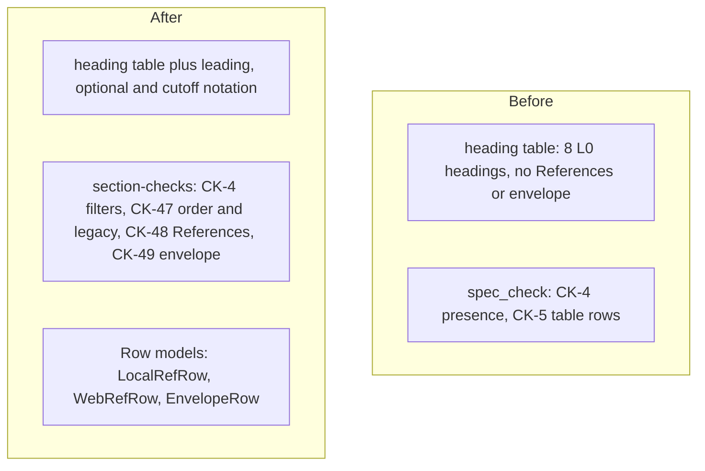

# spec-references-envelope: L2 components



| Component | Owned files | Public interface |
|---|---|---|
| section-checks | `scripts/spec_check.py`, `scripts/work_item_md.py`, `scripts/gen_heading_config.py`, `contracts/work-item.headings.v2.json` (generated), `skills/dark-factory/WORK-ITEM-STANDARD.md`, `skills/dark-factory/templates/work-item/README.md`, `skills/dark-factory/templates/work-item/README.experiment.md`, `tests/test_spec_references_envelope.py`, `tests/test_gen_heading_config.py`, `tests/fixtures/work-items/**` | `spec_check.py README.md` (unchanged CLI; new rule ids CK-47, CK-48, CK-49) |

One component. Its single responsibility: validate the References and Operating envelope sections of one README against the standard. The generator, the Row models and the standard text are its inputs and are changed with it, in the same pass, because splitting them would let the headings, the table headers and the prose disagree. The agent text in `agents/reviewer.md` already carries the rating rule; it is read by a test and not edited here.

## section-checks

### Interface
Signatures only (names and types are the contract; bodies belong to the Implementer).

```
# scripts/work_item_md.py  (same Row base class and parse_rows as CapRow and NfrRow)
LOCAL_STATUSES = ("working", "partial", "broken")
DECISIONS      = ("extract", "wrap", "replace", "ignore")
VIOLATED       = ("keep", "refuse", "flag", "defer")
NO_OBSERVATION = ("-", "n/a", "none", "tbd", "todo", "assumed")   # whole-cell, case-insensitive

class LocalRefRow(Row):  # RULE "CK-48"
    HEADER = ["Source (file:line)", "Status (working / partial / broken)", "What it shows",
              "Decision (extract / wrap / replace / ignore) + reason"]
    source: str; status: str; shows: str; decision: str
class WebRefRow(Row):    # RULE "CK-48"
    HEADER = ["Source (URL)", "Date checked", "What it shows", "Decision"]
    source: str; date_checked: str; shows: str; decision: str
class EnvelopeRow(Row):  # RULE "CK-49"
    HEADER = ["Assumption", "How it is observed (not hoped)", "If violated"]
    assumption: str; observed: str; violated: str

# scripts/gen_heading_config.py
def generate(standard: Path = STANDARD) -> dict      # adds: "leading": list[str], "legacyThrough": str,
                                                     #        readme[type]["optional"]: list[str]  (key absent when empty)

# scripts/spec_check.py
def is_legacy_l0(item: Item) -> bool                 # created <= HEADINGS["legacyThrough"] and no leading heading present
def required_headings(item: Item) -> dict[str, list[tuple[str, str]]]   # signature unchanged; see FR-2
def ck47(item: Item, rep: Report) -> None            # order, plus the one legacy warning
def ck48(item: Item, rep: Report) -> None            # References section
def ck49(item: Item, rep: Report) -> None            # Operating envelope section
```

Config schema additions (JSON, in `contracts/work-item.headings.v2.json`, all generated from the standard, none hand-written):

| Key | Type | Required | Meaning |
|---|---|---|---|
| `leading` | list of string | yes | the two headings, in order, that follow `Overview` and precede everything else: `References`, `Operating envelope` |
| `legacyThrough` | string `YYYY-MM-DD` | yes | last `created` date that may omit both sections |
| `readme.<type>.optional` | list of string | no (absent when empty) | headings of the type that are validated if present and never required, nested or not |

Cell rules (the exact validators; each failing cell is one finding `CK-48` or `CK-49`, line format `rule: README.md: message` as for CK-5):

| Table | Cell | Accepts | Rejects |
|---|---|---|---|
| Local | Source | exactly `none found`, or text containing a token `path.ext:line` or `path.ext:line-line` (the path may start with a drive letter and may use `/` or `\`) | anything else |
| Local | Status | one of LOCAL_STATUSES; exactly `-` on a `none found` row | other words |
| Local | What it shows | non-empty; on a `none found` row it must start `Searched`, then a path containing `/`, then a backtick-quoted pattern | empty; a `none found` row with no search |
| Local | Decision | `word: reason` with word in DECISIONS and a non-empty reason; `n/a: reason` on a `none found` row only | a bare word, other words, an empty reason |
| Local | row set | a `none found` row is the only row of the table | `none found` beside other rows |
| Web | Source | `http://` or `https://` followed by non-space characters, with no angle brackets; or `n/a: reason` | a bare domain, text |
| Web | Date checked | a real calendar date `YYYY-MM-DD` (parsed, so `2026-13-40` fails); exactly `-` on an `n/a` row | other formats, impossible dates |
| Web | What it shows, Decision | Decision uses the same `word: reason` form; both are exactly `-` on an `n/a` row | empty cells |
| Envelope | Assumption | non-empty | empty |
| Envelope | How it is observed | non-empty and not a NO_OBSERVATION word | empty, `TBD`, `n/a` |
| Envelope | If violated | `word: detail`, word in VIOLATED (lower case), non-empty detail | a bare word, other words, upper case |

Allowed `If violated` outcomes (the fail-safe vocabulary; the cell starts with the word, a colon, a space, then what happens). It is not a single word, because a bare word does not say what is kept, refused or deferred:
- `keep`: leave the current state untouched; take no action on the affected item.
- `refuse`: reject the request or action and report a named reason (non-zero exit, error response).
- `flag`: take no action on the affected item and raise a visible alert (finding, warning line, notification).
- `defer`: take no action now; retry later within a stated bound.
All four mean: no destructive or irreversible action happens on the violated path.

### Functional requirements
| FR | Requirement |
|---|---|
| FR-1 | `generate()` reads the standard's heading table and emits `References` then `Operating envelope` at the start of both L0 lists, `leading`, `legacyThrough`, and `optional` for experiment, research and bugfix (`Operating envelope`); `--check` fails on a stale JSON |
| FR-2 | `required_headings` never requires a heading in the type's `optional` list (nested items included), and omits the `leading` headings for a legacy item (`is_legacy_l0`); CK-4 reports any other missing leading heading |
| FR-3 | `ck47` requires the leading headings present in a README to be the first level-2 headings after an optional `Overview`, in `leading` order; the finding names the offending heading |
| FR-4 | `ck48` requires the `References` section to hold exactly two tables, Local then Web, each with the exact header (compared case- and whitespace-insensitively like every Row model), at least one row, and rows that pass LocalRefRow and WebRefRow |
| FR-5 | `ck49` validates the `Operating envelope` section when present: exact header, at least one row, rows that pass EnvelopeRow |
| FR-6 | For a legacy item `ck47` emits one `warn: CK-47` line that names the created date and the missing sections, and `ck48` and `ck49` emit nothing; an item with either leading heading is never legacy |
| FR-7 | The standard, both README templates and the reviewer rating wording carry the sections, tables, vocabularies and rule; a test reads the standard, the templates and the reviewer text and compares them with the constants |
| FR-8 | CK-47, CK-48 and CK-49 bind at the STATIC tier only (`spec-locked`, `building`, `shipped`); a `draft`, `killed` or `promoted` item is not checked by them |

### Data
Reads: the README body through `Doc` (level-2 headings, tables), frontmatter `type`, `status`, `created`, `parent`; `contracts/work-item.headings.v2.json`. The authoritative sources: the heading table and two sentences of the standard (the leading headings; the cutoff `2026-10-31`) for the config; the frontmatter `created` for legacy status. Writes: nothing. No new file formats; the only new data is the three config keys above.

Standard text added (the Implementer writes the prose; this is its required content):
1. L0 description: `## References` and `## Operating envelope` are items 1 and 2 of the section order, after the optional `## Overview` and before `## Purpose`; each table's exact header and cell rules (the tables above); the `If violated` vocabulary with its four definitions.
2. L0 full and lite heading lists begin with `References`, `Operating envelope`.
3. Heading table rows: refactor gains both; bugfix, research and experiment gain `References` and the notation `(optional: `Operating envelope`)`; the sentence naming the leading headings; the sentence naming the legacy cutoff.
4. Per-type profile table: a References/envelope column (feature, integration, data-collection, refactor: required/required; experiment, research, bugfix: required/optional).
5. Checker rules: rows CK-47, CK-48, CK-49 with pass and fail fixtures; STATIC list extended; the CK-4 row notes the legacy exclusion.
6. Migration section: the legacy rule below.
7. A short section "Reviewer rating against the envelope": a finding that needs an envelope assumption broken is rated F, not R, unless the assumption can break silently; then a cheap detector (a check that ends in keep, refuse, flag or defer) is required and its absence is rated R. A spec that rebuilds something its References list as working, without a stated reason, is flagged.
8. `wrap` means extend in place; `extract` means lift the code into the new thing (so the Decision words cover all reuse).

Migration (chosen: a cutoff date held in the standard, not a per-item flag): an item whose frontmatter `created` is on or before `legacyThrough` and which has neither `References` nor `Operating envelope` is legacy: it gets one warning and no error. The moment either heading is present the item is strict, so whoever touches it must add both and fill them. No existing file is edited, and there is no flag to forget or to copy forward. Reason against a `legacy-l0: true` flag: it needs an edit to every existing item, and it can be set on a new item to dodge the rule.

### Failure modes
| Failure | Detection | Handling |
|---|---|---|
| a References or envelope table does not parse as a table | zero tables in the section | CK-48 or CK-49 error, exit 1 |
| a cell is outside its vocabulary or form | the Row model validator | one finding per cell, naming rule, row and column |
| `created` is missing or not a date | CK-1 (runs first) | CK-1 error and no further rules, so the item is never treated as legacy |
| `legacyThrough` or `leading` missing from the config | key lookup at start | error exit 2 naming the key; the gate rejects (never defaults to lenient) |
| the committed config is stale | `gen_heading_config.py --check` exits 1 | the gate fails |
| node helper missing or timed out | existing ToolError | exit 2, the gate rejects |

### Budget
| Dimension | Budget |
|---|---|
| Latency | at most 50 ms added to a spec_check run (pure parsing of tables already read) |
| Cost | none: local process, no tokens |
