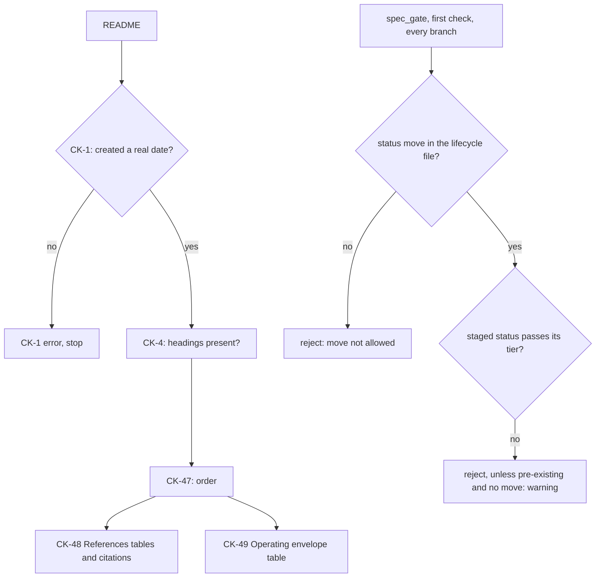

# spec-references-envelope: L3 functional and acceptance criteria

## FR/NFR delta
| ID | Change | Note |
|---|---|---|
| FR-1 | added | generated config keys |
| FR-2 | added | CK-4 optional filter; missing leading section is a warning unless required |
| FR-3 | added | CK-47 order |
| FR-4 | added | CK-48 References |
| FR-5 | added | CK-49 Operating envelope |
| FR-6 | added | spec_gate lifecycle moves and tier check, first check on every branch |
| FR-7 | added | standard, templates, reviewer wording |
| FR-8 | added | tier binding |
| FR-9 | added | citation resolution |
| FR-10 | added | real-date check on created |

## Acceptance criteria
Every AC below is tested by running its fixtures table (section Fixtures): one parametrized case per row, one fault per row, and the case asserts that the expected message substring appears in the finding line of the named rule and that the exit code is 1 (0 for a passing row). A row whose message differs is a failure even if the exit code matches.

| AC | Traces | Given / when | Pass when | Fail when | Test |
|---|---|---|---|---|---|
| AC-1 | CAP-1, CAP-2, FR-1 | gen_heading_config.generate() and `--check` run per the rows of Fixtures AC-1 | every row of the table behaves as stated, including the pinned heading counts and order | any pinned count or order differs, or `--check` exits 0 on a stale JSON | tests/test_gen_heading_config.py, tests/test_spec_references_envelope.py |
| AC-2 | CAP-1, CAP-2, CAP-3, FR-2, FR-3, FR-8 | spec_check runs on the rows of Fixtures AC-2 (run with `--require-sections`) | each faulty row gives exactly one finding of the named rule with the substring; each passing row gives none | a faulty row passes, is reported under another rule, or a passing row is rejected | tests/test_spec_references_envelope.py |
| AC-3 | CAP-4, FR-4, FR-5 | spec_check runs on the rows of Fixtures AC-3 (table headers, table count, empty tables) | each faulty row gives a finding that names the table and, for a header, prints the expected header | a faulty row passes, or the message does not name the table | tests/test_spec_references_envelope.py |
| AC-4 | CAP-4, FR-4 | spec_check runs on the rows of Fixtures AC-4 (Local cells) | each faulty row gives a CK-48 finding naming the row and the cell; each passing row gives none | a faulty row passes or a passing row, including the Windows-path row, is rejected | tests/test_spec_references_envelope.py |
| AC-5 | CAP-8, FR-9 | spec_check runs on the rows of Fixtures AC-5 (citation resolution, in Local and Envelope cells, at spec-locked, building and shipped) | an unresolved token is a CK-48 or CK-49 error at spec-locked and building and a warning at shipped; a resolving token, in any path form, gives no finding | an unresolved token passes at spec-locked, is an error at shipped, or a resolving token is rejected | tests/test_spec_references_envelope.py |
| AC-6 | CAP-4, FR-4 | spec_check runs on the rows of Fixtures AC-6 (Web cells) | each faulty row gives a CK-48 finding naming the row and the cell; each passing row gives none | a faulty row passes or a passing row is rejected | tests/test_spec_references_envelope.py |
| AC-7 | CAP-4, FR-5 | spec_check runs on the rows of Fixtures AC-7 (Envelope cells) | each faulty row gives a CK-49 finding naming the row and the cell; each passing row gives none | a faulty row passes or a passing row is rejected | tests/test_spec_references_envelope.py |
| AC-8 | CAP-5, FR-6, FR-10 | real commits in a temp repo with the spec-gate hook installed, per the rows T1 to T9 of Fixtures AC-8 | each rejecting row is rejected with its substring; each landing row lands | any rejecting row lands, any landing row is rejected, or a git error lets a commit through | tests/test_spec_gate_lifecycle.py, tests/test_work_item_schema.py |
| AC-9 | CAP-9, FR-8 | a one-shot build-time gate (not a permanent test): spec_check runs standalone over every README under D:/repo/*/*/docs/work, D:/repo/*/docs/work and ~/.claude/docs/work with the old and the new checker, per the rows of Fixtures AC-9 | no README moves from exit 0 to exit 1; a missing section shows only as a warning | any README moves from 0 to 1, or a walk root does not exist | tests/test_new_rules_regression.py |
| AC-10 | CAP-6, CAP-7, FR-7 | a test reads the two README templates, the standard and the reviewer text per the rows of Fixtures AC-10 | every row passes | any template header differs from a model, any vocabulary or count differs between the standard and the constants, or a required sentence is missing | tests/test_spec_references_envelope.py |

## Fixtures
Header of every table: fixture id, the single fault, and a substring the finding line must contain. A passing row has the fault `none` and the substring `no finding`. Row cells outside the stated fault are valid.

### AC-1
| Fixture | Single fault | Expected message contains |
|---|---|---|
| 1.1 | none: l0.full is exactly References, Operating envelope, Purpose, Non-goals, Capabilities, Non-functional requirements, Trade-offs, Patterns applied, Components chosen, Gate plan (10 entries) | no finding |
| 1.2 | none: l0.lite is exactly References, Operating envelope, Purpose, Non-goals, Capabilities, Non-functional requirements, Gate plan (7 entries), and nestedBase equals it | no finding |
| 1.3 | none: leading equals References, Operating envelope | no finding |
| 1.4 | none: readme headings counts are feature 10, integration 11, data-collection 9, experiment 10 (References first, no envelope), research 5, bugfix 5, refactor 6 (both new headings first) | no finding |
| 1.5 | none: optional equals Operating envelope for bugfix, research and experiment and is absent for the other four types | no finding |
| 1.6 | the standard's L0 full line loses `References`, JSON not regenerated | stale |
| 1.7 | the committed JSON has no `leading` key | stale |

### AC-2
| Fixture | Single fault | Expected message contains |
|---|---|---|
| 2.1 | feature at spec-locked, no References section | missing section `## References` |
| 2.2 | feature at spec-locked, no Operating envelope section | missing section `## Operating envelope` |
| 2.3 | nested feature (has parent) at spec-locked, no Operating envelope | missing section `## Operating envelope` |
| 2.4 | bugfix at spec-locked, References present, no Operating envelope | no finding |
| 2.5 | research at spec-locked, References present, no Operating envelope | no finding |
| 2.6 | experiment at spec-locked, References present, Operating envelope present with a valid table | no finding |
| 2.7 | feature at draft, no References and no Operating envelope | no finding |
| 2.8 | Purpose appears before References | `## Purpose` must come after `## References` |
| 2.9 | Operating envelope appears before References | `## Operating envelope` must come after `## References` |
| 2.10 | an unrelated `## Notes` sits between References and Operating envelope | `## Notes` |
| 2.11 | Overview appears after References | `## Overview` must come before `## References` |
| 2.12 | order is Overview, References, Operating envelope, Purpose | no finding |
| 2.13 | feature at killed, no References | no finding |

### AC-3
| Fixture | Single fault | Expected message contains |
|---|---|---|
| 3.1 | Local header has one renamed column | table header must be Source (file:line) |
| 3.2 | Web header has one renamed column | table header must be Source (URL) |
| 3.3 | Envelope header has one renamed column | table header must be Assumption |
| 3.4 | References holds one table | needs exactly two tables, has 1 |
| 3.5 | References holds three tables | needs exactly two tables, has 3 |
| 3.6 | Local table has the exact header and zero rows | `Local` needs at least 1 row |
| 3.7 | Web table has the exact header and zero rows | `Web` needs at least 1 row |
| 3.8 | Envelope table has the exact header and zero rows | `Operating envelope` needs at least 1 row |
| 3.9 | References tables written without pipes, so they do not parse as tables | needs exactly two tables, has 0 |
| 3.10 | all three tables valid | no finding |

### AC-4
| Fixture | Single fault | Expected message contains |
|---|---|---|
| 4.1 | Source is a file name with no line number | `source` |
| 4.2 | Status is `maybe` | `status` |
| 4.3 | Decision starts with `extend:` | `decision` |
| 4.4 | Decision is `wrap` with no colon and no reason | `decision` |
| 4.5 | Decision is `wrap:` followed by nothing | `decision` |
| 4.6 | Source is `none found` and What it shows is not a search | `Searched` |
| 4.7 | Source is `none found` beside a second row | `none found` must be the only row |
| 4.8 | Source is `none found` with Status `working` | `status` |
| 4.9 | Source is a URL such as http://x:80 with no path.ext:line | `source` |
| 4.10 | Source is D:\repo\Factory\foreman\core\worktrees.js:129 (Windows backslashes, resolves) | no finding |
| 4.11 | Source is `none found`, Status `-`, shows begins `Searched D:/repo/ for` with a backticked pattern, Decision `n/a: greenfield` | no finding |

### AC-5
| Fixture | Single fault | Expected message contains |
|---|---|---|
| 5.1 | Local Source cites a file that does not exist, at spec-locked | does not exist |
| 5.2 | Local Source cites line 99999 of an existing file, at spec-locked | has fewer lines |
| 5.3 | Local Source cites a range 40-30 | range |
| 5.4 | Local Source cites line 0 | line number must be at least 1 |
| 5.5 | Local Source cites a file larger than MAX_CITED_BYTES (fixture sets the constant to 10 bytes) | too large to verify |
| 5.6 | Envelope observed cell cites a missing file, at building | does not exist |
| 5.7 | the unresolved token of 5.1, at shipped | warn: CK-48 |
| 5.8 | Local Source with a lower-case drive letter and backslashes, d:\repo\Factory\foreman\core\merge.js:135 | no finding |
| 5.9 | Local Source repo-relative, scripts/spec_check.py:52, with the root set to the harness | no finding |
| 5.10 | Local Source starting with ~/, resolving under the home folder | no finding |

### AC-6
| Fixture | Single fault | Expected message contains |
|---|---|---|
| 6.1 | Source is a bare domain, example.com | `source` |
| 6.2 | Date checked is 2026-13-40 | `date_checked` |
| 6.3 | Date checked is 31/10/2026 | `date_checked` |
| 6.4 | Date checked is 2999-01-01 | in the future |
| 6.5 | Source is `n/a` with no reason | `source` |
| 6.6 | Source is `n/a: purely internal refactor` with a date other than `-` | `date_checked` |
| 6.7 | Source is a URL wrapped in angle brackets | `source` |
| 6.8 | Decision is `ignore` with no reason | `decision` |
| 6.9 | URL, date 2026-10-31, Decision `ignore: not relevant` | no finding |
| 6.10 | Source `n/a: purely internal refactor`, every other cell `-` | no finding |

### AC-7
| Fixture | Single fault | Expected message contains |
|---|---|---|
| 7.1 | observed cell is empty | `observed` |
| 7.2 | observed cell is `TBD` | `observed` |
| 7.3 | observed cell is prose with no pointer ("we watch it carefully") | typed pointer |
| 7.4 | If violated is `ignore: carry on` | `violated` |
| 7.5 | If violated is `keep` with no detail | `violated` |
| 7.6 | If violated is `Keep: x` in upper case | `violated` |
| 7.7 | Assumption is empty | `assumption` |
| 7.8 | observed has an AC-n pointer, If violated `refuse: exit 1 with a named reason` | no finding |
| 7.9 | observed has a backticked command, If violated `defer: retry within 1 h` | no finding |
| 7.10 | observed has a URL, If violated `flag: warn line, no block` | no finding |

### AC-8
Each row is a real commit in a temp repo with the hook installed. One row per behaviour of the lifecycle.

| Fixture | Single fault | Expected message contains |
|---|---|---|
| T1 | every allowed move of the lifecycle file (create as draft, draft to spec-locked, spec-locked to draft, spec-locked to building, building to shipped, any to killed, experiment to promoted), each with a README that passes its tier | no finding |
| T2 | every disallowed move (create at spec-locked, building or shipped; draft to building or shipped; spec-locked to shipped; promoted on a non-experiment), one parametrized case each | move not allowed |
| T3 | draft to spec-locked with no References or Operating envelope | missing section `## References` |
| T4 | spec-locked to building with an AC whose test does not cite it | CK-20 |
| T5 | building to shipped with a missing evidence file | CK-25 |
| T6 | a commit that keeps spec-locked and removes the Operating envelope (also as an amend) | missing section `## Operating envelope` |
| T7 | a pre-existing building README edited without a status move, no sections | warn: CK-47 |
| T8 | T2's create-at-shipped case committed on a feature branch | move not allowed |
| T9 | a staged status that is unreadable or outside the lifecycle states | status |

### AC-9
| Fixture | Single fault | Expected message contains |
|---|---|---|
| 9.1 | every README under the walk roots keeps its exit code or moves 1 to 0 (one case per README) | no finding |
| 9.2 | a README that passed before gets a new error from the new rules | exit code |
| 9.3 | one walk root directory does not exist | walk root |

### AC-10
| Fixture | Single fault | Expected message contains |
|---|---|---|
| 10.1 | template README.md: References then Operating envelope are the first two H2s after the title and diagram | no finding |
| 10.2 | template README.md: the three table headers equal the HEADER lists of LocalRefRow, WebRefRow, EnvelopeRow | no finding |
| 10.3 | template README.experiment.md: References first; Operating envelope marked optional and deletable | no finding |
| 10.4 | template header edited by one word | header |
| 10.5 | the standard's If-violated words, Local statuses and Decision words equal VIOLATED, LOCAL_STATUSES, DECISIONS | no finding |
| 10.6 | the standard drops one vocabulary word | vocabulary |
| 10.7 | the standard has rows CK-47, CK-48, CK-49, says CK-1..CK-49 at the enforcement row, and lists CK-47, CK-48, CK-49 in STATIC | no finding |
| 10.8 | the standard lacks the rating sentence (F unless it can break silently, then a cheap detector) | rating |
| 10.9 | the reviewer text lacks the sentence about opening each cited local line and spot-checking a web citation | cited local line |
| 10.10 | the reviewer text and the standard both state the rating rule and the citation sentence | no finding |
