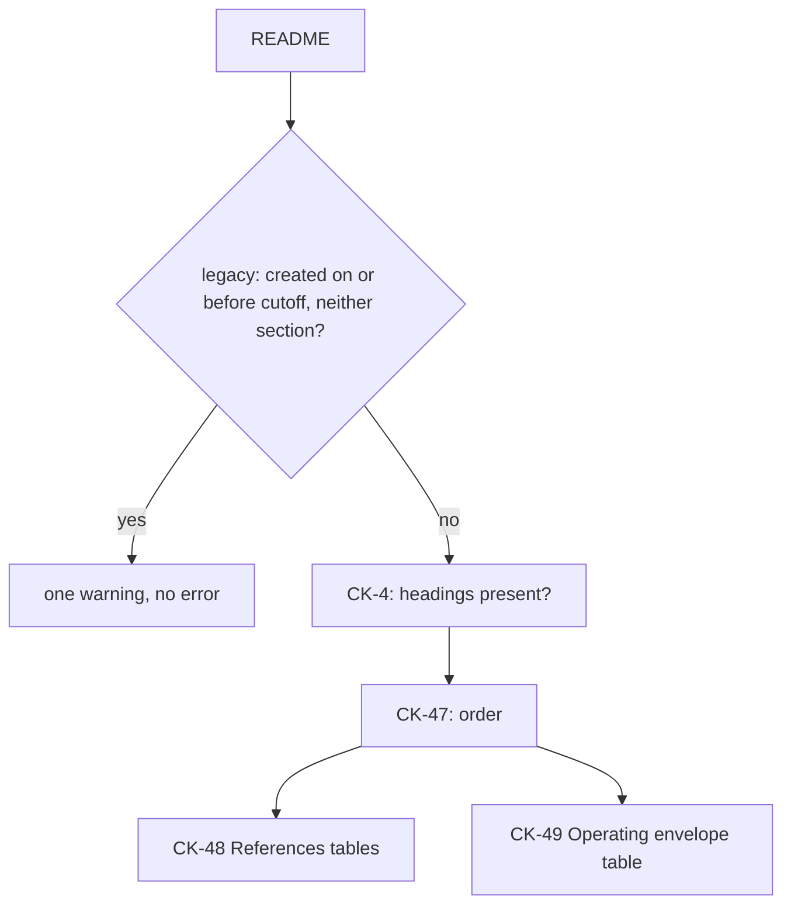

# spec-references-envelope: L3 functional and acceptance criteria

## FR/NFR delta
| ID | Change | Note |
|---|---|---|
| FR-1 | added | generated config keys |
| FR-2 | added | CK-4 filters for optional and legacy |
| FR-3 | added | CK-47 order |
| FR-4 | added | CK-48 References |
| FR-5 | added | CK-49 Operating envelope |
| FR-6 | added | legacy warning |
| FR-7 | added | standard, templates, reviewer wording |
| FR-8 | added | STATIC tier only |

## Acceptance criteria
| AC | Traces | Given / when | Pass when | Fail when | Test |
|---|---|---|---|---|---|
| AC-1 | CAP-1, CAP-2, FR-1 | gen_heading_config.generate() runs on the edited standard, and `--check` runs once on the committed JSON and once after the standard's heading table is edited | the config lists `References` then `Operating envelope` first in both L0 lists, `leading` equals those two, `legacyThrough` equals the cutoff in the standard, `optional` equals the envelope for bugfix, research and experiment and is absent for every other type; `--check` exits 0 on the fresh JSON and 1 after the edit | any key is missing or differs, or `--check` exits 0 on a stale JSON | tests/test_gen_heading_config.py, tests/test_spec_references_envelope.py |
| AC-2 | CAP-1, CAP-2, FR-2, FR-8 | spec_check runs on fixtures created 2026-11-01: a feature at spec-locked without `References`, a feature without `Operating envelope`, a nested feature, a bugfix without `Operating envelope`, a research item without it, and the same first feature at draft | the first two give one CK-4 error each naming the missing heading; the nested feature is required to carry both; the bugfix and research items give no CK-4 error for the envelope; the draft exits 0 | the bugfix or research item is rejected for the envelope, a feature missing either heading passes, or the draft is rejected | tests/test_spec_references_envelope.py |
| AC-3 | CAP-3, FR-3 | spec_check runs at spec-locked on fixtures where `Purpose` precedes `References`, `Operating envelope` precedes `References`, an unrelated `## Notes` sits between them, or `Overview` follows `References` | each gives exactly one CK-47 error naming the offending heading; a README with Overview, References, Operating envelope, Purpose in that order gives none | any misordered fixture passes or is reported under another rule, or the ordered fixture is rejected | tests/test_spec_references_envelope.py |
| AC-4 | CAP-4, FR-4, FR-5 | spec_check runs on fixtures that each change one thing: the Local header, the Web header or the Envelope header has one renamed column; the References section holds one table; it holds three tables | each renamed header gives a CK-48 (Local, Web) or CK-49 (Envelope) error that prints the expected header; a table count other than two gives a CK-48 error naming the count; the unchanged fixture gives none | a fixture passes, or the message does not name the table or the expected header | tests/test_spec_references_envelope.py |
| AC-5 | CAP-4, FR-4, FR-5 | spec_check runs on three fixtures, each with one table that has the exact header and zero rows (Local, Web, Envelope) | each gives an error of its rule saying the table needs at least 1 row | any empty table passes, or it is reported without the table name | tests/test_spec_references_envelope.py |
| AC-6 | CAP-4, FR-4 | spec_check runs on Local fixtures with one fault each: a source with no `path.ext:line`; a status outside working, partial, broken; a decision outside the four words; a decision with no reason; `none found` whose What-it-shows is not a search; `none found` beside another row; `none found` with a status other than `-` | each gives a CK-48 error naming the row and the cell; the passing fixtures give none: `D:\repo\x.js:129`, `C:/a/b.md:29-41`, and a `none found` row with `Searched D:/repo/ for` plus a backticked pattern | any faulty fixture passes, or a passing Windows-path fixture is rejected | tests/test_spec_references_envelope.py |
| AC-7 | CAP-4, FR-4 | spec_check runs on Web fixtures with one fault each: a source that is a bare domain; a date `2026-13-40`; a date `31/10/2026`; `n/a` with no reason; an `n/a` row with a date other than `-` | each gives a CK-48 error naming the row and the cell; a row with a URL and `2026-10-31`, and a row `n/a: purely internal refactor` with `-` in the other cells, give none | any faulty fixture passes or a passing fixture is rejected | tests/test_spec_references_envelope.py |
| AC-8 | CAP-4, FR-5 | spec_check runs on Envelope fixtures with one fault each: an empty observed cell; observed `TBD`; If violated `ignore: carry on`; If violated `keep` with no detail; If violated `Keep: x` in upper case | each gives a CK-49 error naming the row and the cell; `refuse: exit 1 with a named reason` gives none | any faulty fixture passes or the passing row is rejected | tests/test_spec_references_envelope.py |
| AC-9 | CAP-5, FR-6 | spec_check runs at spec-locked on three fixtures: created 2026-10-31 with neither section; created 2026-11-01 with neither; created 2026-10-30 with `References` only; plus every existing docs/work README under ~/.claude | the first exits 0 with one `warn: CK-47` line naming the created date and both sections and no CK-4 error for them; the second gives CK-4 errors; the third gives a CK-4 error for the envelope; each existing item exits as it did before the change | the first fixture errors, or the second or third passes, or an existing item's exit code changes | tests/test_spec_references_envelope.py |
| AC-10 | CAP-6, CAP-7, FR-7 | a test reads the two README templates, the standard and the reviewer text | each template has `References` then `Operating envelope` at the leading position (the experiment template marks the envelope as optional and deletable), tables whose headers equal the Row models' HEADER lists; the standard lists CK-47..CK-49 and the same four If-violated words, three statuses and four decision words as the constants; the standard and the reviewer text both state: rated F unless it can break silently, then a cheap detector is required | a template header differs from a model, a vocabulary word differs between the standard and the constants, or the rating sentence is missing from either file | tests/test_spec_references_envelope.py |
