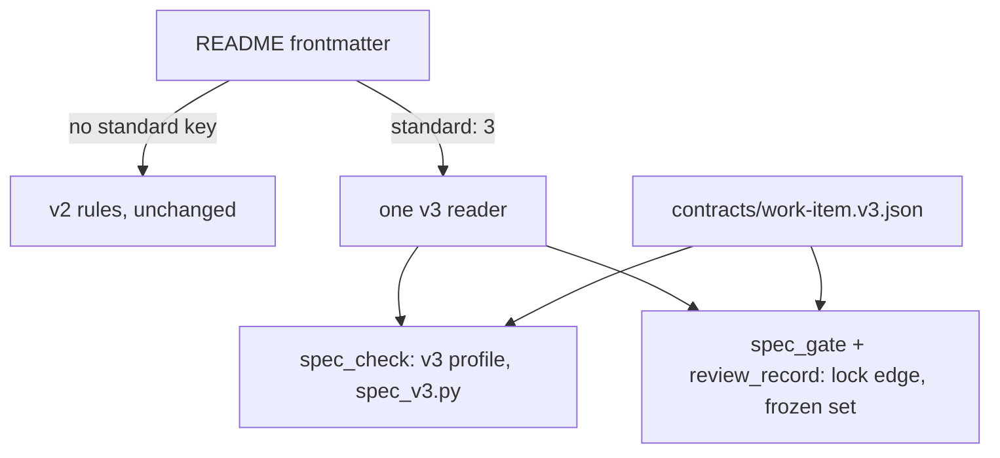

# Work-Item Standard v3: an opt-in minimal profile, sized by tier and risk

## References

### Local

| Source (file:line) | Status (working / partial / broken) | What it shows | Decision (extract / wrap / replace / ignore) + reason |
|---|---|---|---|
| C:/Users/Michael/.claude/docs/work/spec-standard-v3/evidence/probe.md:80 | working | the settled design, the must-not-change list and the 15 adversary dispositions this item carries | extract: every accepted row is a closing rule below |
| C:/Users/Michael/.claude/scripts/spec_check.py:425 | working | `check_work_item` parses frontmatter, validates it, then runs the rules of the status tier | wrap: one call into the new module, v2 path untouched |
| C:/Users/Michael/.claude/scripts/spec_check.py:342 | working | the AC table source is chosen by `type` | ignore: v3 branches on `standard`, never on `type`, so this stays as is for v2 |
| C:/Users/Michael/.claude/scripts/work_item_schema.py:14 | working | the frontmatter schema path is fixed to v2 and loaded at import | wrap: the v3 contract is a second file, loaded lazily, only for `standard: 3` |
| C:/Users/Michael/.claude/scripts/review_record.py:289 | working | `required_records` decides which review class an edge needs | extract: the lock-edge rule for v3 lives here and nowhere else |
| C:/Users/Michael/.claude/scripts/spec_gate.py:365 | working | the gate checks a cited item through `check_work_item` | wrap: the frozen-set rule joins `lifecycle_problem`, which already sees HEAD and the index |
| C:/Users/Michael/.claude/contracts/work-item.lifecycle.v1.json:1 | working | an enum and a state machine kept as data both sides load | extract: the v3 contract follows the same pattern |
| C:/Users/Michael/.claude/docs/work/review-records/functional.md:36 | working | the last shipped feature: AC table, outcome inventory, one enum source | extract: shape and the `NFR-2` one-enum-source test pattern |

### Web

| Source (URL) | Date checked | What it shows | Decision |
|---|---|---|---|
| n/a: not re-fetched for this item | - | the conventions (tiered review, bug-to-spec escalation, no size-only gate) were surveyed in D:/repo/docs/reports/Minimal spec lifecycle structure.md:30 and are cited there with dates | - |

## Operating envelope

| Assumption | How it is observed (not hoped) | If violated |
|---|---|---|
| Every v2 item judges byte-identically after the change | AC-1 over every `docs/work/*/README.md` under D:/repo and C:/Users/Michael/.claude (54 at the probe) | refuse: the change does not land |
| `contracts/work-item.v3.json` loads and validates | AC-13, loaded lazily on the first `standard: 3` item | refuse: a named refusal of v3 items only, v2 unaffected |
| The repo's `deploymentTier: live` line in CLAUDE.md is the authority for the `live` flag | AC-3, read from the committed CLAUDE.md | flag: a missing or unreadable CLAUDE.md means not live; the reviewer persona rule files a missing flag as breaking |
| Risk flags other than `live` are declared by the author | the reviewer persona rule, AC-15 | defer: path-derived flags go to work item `gate-ci` |
| A local hook sees the commit that makes the lock move | `scripts/spec_gate.py:365` and AC-10 | defer: commits the hook cannot judge are re-checked by work item `gate-ci` after the push |
| The checker is a pure function of the committed tree | AC-1, AC-12 | refuse: a tree that cannot be read is an error, never a v2 fallback |

## Purpose

Give small changes a spec that costs minutes, and keep the heavy review for changes that carry risk, with the tier computed
from facts the checker can count and never lowered by a declaration.

## Non-goals

- Living specs per feature, the `Spec: T0` trailer, LOC caps, commit-order and mutation checks, path-derived flags and
  code freshness: deferred to work item `gate-ci`.
- Any change to a v2 item, to the lifecycle edges, to the review-record hash or to Catwalk.
- Nesting for v3: T3 stays on v2 nesting.

## Capabilities

| CAP | Statement |
|---|---|
| CAP-1 | The service must judge every v2 item exactly as it does today |
| CAP-2 | The service must read a v3 item's frontmatter through one reader and refuse look-alike and unknown values |
| CAP-3 | The service must compute the tier from AC count and risk flags and require the sections and tables that tier, type and flags name |
| CAP-4 | The service must require a design record at the lock only where the computed tier or a flag calls for one |
| CAP-5 | The service must not let `standard`, `type`, `tier` or `risk` change after the item leaves draft |
| CAP-6 | The service must read every flag, dimension and level from one contract and name a missing contract |
| CAP-7 | The user can find the v3 rules, the dispatch tiers and the reviewer rule in the harness docs |

## Non-functional requirements

| NFR | Target | Method | Evidence |
|---|---|---|---|
| NFR-1 | zero flag, dimension or level lists outside `contracts/work-item.v3.json` | fitness: the checker and the gate load the lists from the contract, and a test edits a temp copy; no import of a second list | AC-14 + config:contracts/work-item.v3.json |

## Trade-offs

| Option | Latency | Cost | Maintenance | Extensibility | Refactorability | Verdict |
|---|---|---|---|---|---|---|
| Opt-in `standard: 3` profile in one new module, v2 untouched | one frontmatter read per item | none | one module, one contract | a new flag is one contract value | v2 is deleted later by removing a branch | chosen |
| Edit the v2 rules in place | none | none | one rule set | low | a v2 regression reaches 54 shipped items | rejected: the corpus test could not tell intent from drift |
| A separate v3 checker script | a second parse | none | two checkers to keep in step | low | high | rejected: a second implementation of the same role |

## Patterns applied

| Pattern | Where | Why |
|---|---|---|
| strangler: new profile beside the old, switched by a key | `spec_check.check_work_item` | v2 results stay byte-identical until v2 is retired |
| single source enum | `contracts/work-item.v3.json` | the checker and the gate cannot disagree on a flag or a level |
| frozen set after approval | `spec_gate.lifecycle_problem` | tier and risk cannot be lowered after the review that depended on them |

## Components chosen

| Need | Chosen (off the shelf) | Rejected | Why rejected |
|---|---|---|---|
| frontmatter schema | `jsonschema` Draft 2020-12 against `contracts/work-item.v3.json` (already used for v2) | pydantic | the enums must be data both sides load |
| YAML read | PyYAML `safe_load` with a duplicate-key check in the one reader | a hand-written parser | the existing loader is the authoritative reading |
| table parsing | the checker's existing markdown table helpers | a new parser | a second parser is a second look-alike surface |

## Gate plan

| Risk | Kind (deterministic / qualitative) | Check | Blocking / advisory |
|---|---|---|---|
| a v2 item judges differently | deterministic | python -m pytest tests/test_spec_v3.py -q -k corpus | blocking |
| a v3 rule is bypassed by a look-alike or an arrival channel | deterministic | python -m pytest tests/test_spec_v3.py -q | blocking |
| the existing gate and checker regress | deterministic | python -m pytest tests/test_spec_check.py tests/test_spec_gate.py tests/test_spec_gate_lifecycle.py tests/test_spec_gate_review.py tests/test_review_records.py -q | blocking |
| the docs drift from the contract | deterministic | python -m pytest tests/test_spec_v3.py -q -k docs | blocking |

## Gap-ledger check

| Category | Handled by |
|---|---|
| probabilistic-call-reliability | n/a: no LLM call |
| creative-domain-anchoring | n/a: no generated creative output |
| asserted-not-verified-claim | AC-9 (citations in a v3 Assumptions table must resolve), AC-1 (the v2 claim is measured on the corpus) |
| concurrent-actor-incomplete | n/a: the checker reads one tree per run; the gate's actors are git's own locked index |
| runtime-schema-drift | AC-14 (one contract holds the frontmatter schema; the reader validates against it) |
| invariant-checked-on-one-path-only | AC-2 (one reader used by spec_check, spec_gate and review_record), AC-12 (merge, squash and revert) |
| signal-consumer-enumeration | AC-2: the consumers of the frontmatter are spec_check, spec_gate and review_record, all through the reader |
| cross-platform-path-identity | AC-9 (Windows-shaped `path:line` citation fixtures) |
| authoritative-source | AC-3 (tier from counts and CLAUDE.md, not from the declaration), AC-10 (the staged content), AC-11 (HEAD) |
| fail-closed-on-unknown | AC-2 (unknown key, flag or standard), AC-13 (missing contract), AC-10 (git error refuses) |
| destructive-op-proof | n/a: read-only checker; no delete or overwrite |
| liveness-and-time | n/a: no locks, leases or clocks |
| concurrency-granularity | n/a: stateless, one item per run |
| external-contract-unverified | References (file:line read on 2026-11-02) and AC-9 |
| split-state | n/a: no mutable state; the contract is the one enum store |
| untestable-ac | one fault per AC row with a specific message substring; AC-1 and AC-12 use real files and real git |
| scope-drift-oversize | 15 ACs; Non-goals name the deferred pieces |
| enforcement-allowlist | AC-1 (v2 and killed items), AC-12 (merge, squash, revert), AC-11 (a lowering refused, a raise with a design record) |
| hand-copied-enum | AC-14 |
| escape-record | n/a: a record row, not a spec category |
| composite-history-vs-per-commit | AC-12 (merge, squash and revert fixtures), AC-11 |
| citation-regex-false-positive | AC-9 (look-alikes of `path:line` and of `TBD` get negative fixtures) |
| lifecycle-gate-legitimate-commit-blocked | AC-10, AC-11, AC-12 (the lock of a T1 item, a mid-build raise with its record, and a merge all land) |
