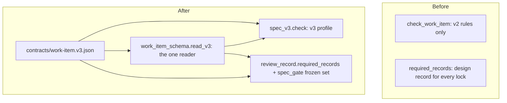

# spec-standard-v3: L2 component specs



| Component | Owned files | Public interface |
|---|---|---|
| v3 profile | `scripts/spec_v3.py`, `scripts/work_item_schema.py` (reader), `contracts/work-item.v3.json`, `scripts/spec_check.py` (one call), `scripts/review_record.py` (`required_records`), `scripts/spec_gate.py` (frozen set), `tests/test_spec_v3.py` | `read_v3(text) -> V3Frontmatter \| None`; `spec_v3.check(item, tree, root) -> list[Finding]`; `required_records(tree, item_dir, edges, item_type, v3=None)`; `frozen_set_problem(head_fm, staged_fm, moves_to_draft) -> str \| None` |

Searched `C:/Users/Michael/.claude/scripts` and `contracts` for the role "judge a frontmatter profile": found
`work_item_schema.py` (v2 schema) and `spec_check.check_work_item`; extending both, adding one module for the rules and one
contract file for the enums. It stays one component because the reader, the rules and the gate edge all consume the same
contract and answer one question: what does a `standard: 3` item owe at its status. A split would give two packages one
contract and trigger the multi-package machinery for no gain; the Gate plan and AC-14 pin the single source instead.
The docs (AC-15) are written by the parent session and are not part of this component's implementation.

## v3 profile

### Interface

```text
CONTRACT = contracts/work-item.v3.json        # flags, dimensions, levels, flag_to_dimensions, frontmatter schema
load_contract() -> Contract                    # lazy, cached; raises ContractError(path, reason) when missing or corrupt
read_v3(text: str) -> V3Frontmatter | None     # None when no `standard` key; raises V3Refusal(rule, msg) otherwise
V3Frontmatter: id, type, standard=3, status, touches, layers, created, owner, tier: "T1"|"T2"|None, risk: list[str]
computed_tier(fm, ac_count, live: bool) -> "T1" | "T2" | "SPLIT"
spec_v3.check(item, tree, root) -> list[Finding]   # called from spec_check.check_work_item only when read_v3 is not None
required_records(tree, item_dir, edges, item_type, v3) -> str | None   # v3 is the staged V3Frontmatter or None
frozen_set_problem(head_fm, staged_fm, moves_to_draft) -> str | None
```

### Functional requirements

| FR | Requirement |
|---|---|
| FR-1 | v2 judgement is untouched: with no `standard` key `check_work_item` takes the v2 path with no read of the v3 contract, and the output is byte-identical to before. v3 branches on `standard`, never on `type`. |
| FR-2 | `read_v3` is the only v3 frontmatter reader; `spec_check`, `spec_gate` and `review_record` call it. `standard` is exactly int 3 (not `"3"`, `3.0`, `true`). `tier` is exactly `T1` or `T2`, required for a feature and absent for a bugfix. `risk` is a list of known lowercase flags (`contract`, `data`, `security`, `enforcement`, `concurrency`, `removal`, `live`), duplicates refused. `type` is `feature` or `bugfix`; `layers` is all four keys `none`. Refused (CK-1): a duplicate key, `parent`, `children`, `nestTrigger` or `nestWhy`, a `standard` other than 3, `tier` or `risk` without `standard: 3`. A layer file under a v3 item is CK-3. |
| FR-3 | Computed tier: more than 5 ACs, or any flag, is T2; more than 15 ACs is a split error; `live` is a flag whenever the repo CLAUDE.md `deploymentTier:` line is `live`, whatever `risk` says. A declared tier below the computed one is an error. |
| FR-4 | Required H2 sections (exact text, case-insensitive). Feature T1: `Purpose`, `Goals and non-goals`, `Behaviour`, `Outcomes`; T2 adds `Approach`, `Assumptions`, `Probe`; flag `contract` adds `Contracts`. Bugfix: `Symptom`, `Reproduce`, `Expected`, `Actual`, `Must not change`, `Root cause`; any flag adds `Probe`. Required from the same status as CK-4. |
| FR-5 | The AC table is the only table in `Behaviour` (feature) or `Expected` (bugfix), with the exact v2 header. A bugfix has 1 to 3 rows; more is refused as "a spec change, not a bug". CK-11 and CK-20 apply as in v2. |
| FR-6 | The `Outcomes` table, header `\| Dimension \| Level \| Row or n/a reason \| AC \|`, is the only table in its section; each of the 12 dimensions appears exactly once, spelled as in the contract; `Level` is exactly `L1`, `L2` or `L3`; an L3 row names an existing `AC-n`; an L1 reason is at least 3 words and not a placeholder (`n/a`, `none`, `-`, `tbd`, `todo`, `not applicable`). |
| FR-7 | From `spec-locked`: T1 needs `success` and `invalid input` at L3; T2 allows no L2 row; each flag forces its mapped dimensions to L3 (map below). |
| FR-8 | A bugfix carries `Must not change` as `\| ID \| Must not change \| Test \|`, ids `MNC-n`, at least 1 row. `Build amendments`, when present, is `\| Change \| Why (what the test exposed) \| Test \|` with every Test cell non-empty. From `building`, tests cite `<id>/AC-n` and `<id>/MNC-n` (CK-20 rule). |
| FR-9 | The `Assumptions` table is `\| Assumption \| Observed \| If violated \|`; If violated starts with `keep`, `refuse`, `flag` or `defer` plus `:`; each `path:line` in Observed resolves (v2 CK-48 resolver). `Probe` links an existing file under `evidence/`. From `spec-locked`, `[NEEDS CLARIFICATION` and `TBD` outside inline code are errors. |
| FR-10 | Lock edge. `required_records` demands a design record for an edge into `spec-locked` unless the STAGED content is a v3 T1 feature or an unflagged v3 bugfix (computed tier from FR-3, never the declaration alone). v2 items and every ship edge are unchanged: the ship needs a code record for all. |
| FR-11 | Frozen set. When HEAD's copy of a v3 README is past `draft`, the staged `standard`, `type`, `tier` and `risk` must equal HEAD's unless the staged status is `draft`. A v2 item gaining `standard` past draft is refused by the same rule. |
| FR-12 | Arrival channels: the lock rule and the frozen set run on the staged content for commit, merge, squash and revert as the gate runs today; they add no second edge derivation (probe row 13). |
| FR-13 | `contracts/work-item.v3.json` is loaded on the first v3 item only; a missing, unparseable or schema-invalid file yields `CK-V3: <file>: contract <path> <reason>` for v3 items and nothing for v2. |
| FR-14 | Flags, dimensions, levels, the flag-to-dimension map and the frontmatter schema are read from the contract by the checker and the gate; no module holds a second list. |

Flag-to-dimension map (FR-7, stored in the contract as `flag_to_dimensions`):

| Flag | Dimensions forced to L3 |
|---|---|
| contract | data and compatibility, arrival channel |
| data | data and compatibility, crash mid-step |
| security | security, invalid input |
| enforcement | invalid input, arrival channel |
| concurrency | concurrent actor, duplicate or replay |
| removal | data and compatibility |
| live | operability, dependency fails |

The 12 dimensions: `success`, `invalid input`, `dependency fails`, `timeout`, `crash mid-step`, `concurrent actor`,
`duplicate or replay`, `arrival channel`, `performance or cost`, `security`, `data and compatibility`, `operability`.

### Data

Authoritative sources: the staged README for `standard`, `tier`, `risk`, AC count and tables (the index, never the working
tree); HEAD's README for the frozen set; the committed repo `CLAUDE.md` for `live`; the contract file for every enum.
The reader reads the frontmatter block only, from bytes already read by the existing trees.

### Failure modes

| Failure | Detection | Handling |
|---|---|---|
| contract missing or corrupt | `load_contract` raises on the first v3 item | refuse: named finding on v3 items only; v2 judged as before |
| frontmatter look-alike (`standard: "3"`, `3.0`, `true`, `T1 `, `Risk`) | `read_v3` exact-type checks | refuse: CK-1 naming the key and value |
| duplicate key in a v3 item | loader hook that raises on a repeated key | refuse: CK-1 naming the key |
| HEAD copy unreadable or git error in the gate | the gate's existing 10 s bound and error path | refuse: fails closed as today |
| CLAUDE.md missing at the repo root | file absent in the tree | flag: treated as not live; the reviewer rule covers a missing flag |

### Budget

One frontmatter read per item and one contract load per process; no added git call beyond the HEAD README the gate already
reads. The v3 check adds under 50 ms to a checker run on a 15-AC item.
