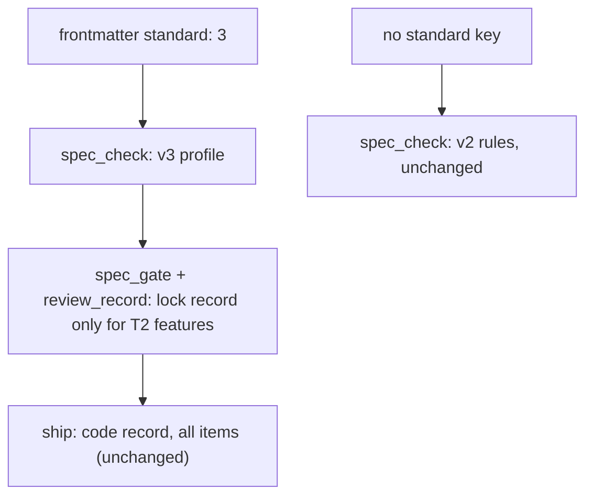

# Probe: minimal Work-Item Standard v3 (2026-11-02)

Owner ask (2026-11-02 19:26): "Let's run a minimally designed set for v3", after the report
`D:/repo/docs/reports/Minimal spec lifecycle structure.md:1` and the owner's earlier ask for size-scaled effort, a
requirement cap, coverage metrics, and a smaller bug artifact.

## Facts read (local, verified this session)

| Fact | Where |
|---|---|
| Rule tiers by status: ALWAYS = CK-1, 2, 3, 18; STATIC from spec-locked; EXEC (CK-20, 24) from building; CK-25 at shipped | `C:/Users/Michael/.claude/scripts/spec_check.py:54` |
| AC table source chosen by type: bugfix/refactor in README `Acceptance criteria`, feature/integration in `functional.md` | `C:/Users/Michael/.claude/scripts/spec_check.py:342` |
| Entry point: `check_work_item` parses frontmatter, validates with the v2 schema, runs rules by tier | `C:/Users/Michael/.claude/scripts/spec_check.py:425` |
| Frontmatter schema path is fixed to v2 | `C:/Users/Michael/.claude/scripts/work_item_schema.py:14` |
| AC header is exactly `\| AC \| Traces \| Given / when \| Pass when \| Fail when \| Test \|` (CK-11); tests cite `<id>/AC-n` (CK-20) | `C:/Users/Michael/.claude/skills/dark-factory/WORK-ITEM-STANDARD.md:132` |
| The 8 outcome kinds: success, invalid input, dependency fails, timeout, crash mid-step, concurrent actor, duplicate or replay, arrival channel | `C:/Users/Michael/.claude/skills/dark-factory/WORK-ITEM-STANDARD.md:152` |
| Which review class an edge needs: design into spec-locked, code into shipped (design for research/experiment) | `C:/Users/Michael/.claude/scripts/review_record.py:289` |
| The gate checks a cited item through `check_work_item` | `C:/Users/Michael/.claude/scripts/spec_gate.py:365` |
| Lifecycle states and edges (unchanged by v3) | `C:/Users/Michael/.claude/contracts/work-item.lifecycle.v1.json:1` |
| Catwalk's zod schema requires `type` from the v2 enum and a `layers` object with all four keys | `D:/repo/Factory/catwalk/src/lib/work-item-schema.ts:28` |
| Foreman reads `docs/work/*/cycles/` and `runs.jsonl` by path only | `D:/repo/Factory/foreman/core/scorecard.js:53`, `D:/repo/Factory/foreman/core/merge.js:272` |
| `docs/specs/<slug>.md` is already the checker's legacy spec path, so v3 must not reuse `docs/specs/` | `C:/Users/Michael/.claude/scripts/spec_check.py:975` |
| The checker runs from `~/.claude/scripts` for every fleet repo, so a v3 change reaches all repos at once | `C:/Users/Michael/.claude/scripts/install_fleet_hooks.py:1` |

## Design (minimal)

- **Opt-in by frontmatter**: `standard: 3`. No key means v2, judged exactly as today. Shipped v2 items stay v2.
- **Same place, same lifecycle, same gate**: `docs/work/<id>/README.md` only, plus `reviews/` and `evidence/`. Statuses
  unchanged. Living specs per feature (`docs/specs/`), the `Spec: T0` trailer, LOC caps, commit-order and mutation
  checks are deferred to `gate-ci` (they need CI or measured diffs).
- **Catwalk stays readable without a Catwalk change**: `type` is `feature` or `bugfix` (both in the v2 enum), and
  `layers` is kept with all four keys `none`, because the content lives in the README.
- **Frontmatter v3**: `id`, `type` (feature | bugfix), `standard: 3`, `status`, `touches`, `layers` (all `none`),
  `created`, `owner`, `risk` (list of flags: contract, data, security, enforcement, concurrency, removal, live; may be
  empty), `tier` (T1 | T2; required for feature, absent for bugfix).
- **Feature sections**: T1 = Purpose, Goals and non-goals, Behaviour (the AC table), Outcomes. T2 adds Approach,
  Assumptions, Probe. Risk `contract` adds Contracts. `Build amendments` is validated when present.
- **Bugfix sections**: Symptom, Reproduce, Expected (AC table, 1-3 rows), Actual, Must not change, Root cause. A
  bugfix with any risk flag adds Probe.
- **Computed tier**: a feature with any risk flag, or more than 5 ACs, must declare T2. More than 15 ACs: split (T3
  stays on v2 nesting). 2+ flags is still T2 (the security reviewer is a dispatch rule, not a checker rule).
- **Outcomes table** (feature only): header `| Dimension | Level | Row or n/a reason | AC |`, exactly the 12
  dimensions once each (the 8 outcome kinds + performance or cost, security, data and compatibility, operability),
  level L1-L4 (L1 = n/a with a reason, L2 = prose, L3 = an AC, L4 = that AC's test seen red then green). L3/L4 rows
  name an AC that exists. From spec-locked: T1 needs success and invalid input at L3+; T2 allows no L2 rows. At
  shipped: no L3 rows remain.
- **Gate change, one place** (`review_record.required_records`): for a v3 item, the edge into spec-locked needs a
  design record only when it is a T2 feature. A T1 feature or a bugfix locks on the mechanical check. Ship still needs
  a code record for every item.

## Must not change

- Every existing v2 item in the fleet gets byte-identical errors and warnings before and after (corpus: every
  `docs/work/*/README.md` under `D:/repo` and `C:/Users/Michael/.claude`).
- The gate's record rule for v2 items, the content hash, and the lifecycle edges are unchanged.
- Catwalk renders a v3 item without a schema error.

## Probe questions answered (outcome kinds on the problem)

- invalid input: `standard: 4`, `standard: "3"`, missing `tier` on a feature, `tier` on a bugfix, an unknown flag.
- arrival channel: a v2 item edited to add `standard: 3` mid-life (allowed only at draft? no: allowed at any status,
  it is re-judged by v3 at its status), a merge carrying a v3 item (gate path unchanged).
- concurrent actor, duplicate or replay, timeout, crash mid-step: no new state; the checker is a pure function of the
  tree, n/a with reason.
- dependency fails: a missing or corrupt v3 contract is a named refusal, never a fall-back to v2.

## Adversary pass on the probe (2026-11-02 19:35): dispositions

Corpus fact from the adversary: 54 v2 items across `D:/repo` and `C:/Users/Michael/.claude`; none has a `standard`,
`tier` or `risk` key, so refusing those keys on a non-v3 item changes no v2 result.

Rows 4 and 6 are superseded by FR-11 and D41: the frozen set lets `tier` and `risk` rise past draft (a raise needs a fresh
design record) and lets them fall only in a commit that moves the item back to `draft`; `standard` and `type` never change.

| # | Gap (breaking?) | Disposition | Closing rule |
|---|---|---|---|
| 1 | lock requirement read from the staged copy (yes) | accept, narrowed | the lock needs a design record unless the STAGED content's computed tier is T1 or an unflagged bugfix; computed tier comes from AC count and flags, so a declaration alone cannot lower it |
| 2 | flagged bugfix skips review (yes) | accept | a v3 bugfix with any risk flag needs the design record, like T2; `introducedBy` stays optional (a bug's origin is often unknown) |
| 3 | risk flags self-declared (yes) | accept part | derive `live` from the repo's `deploymentTier: live` (CLAUDE.md); a code reviewer who sees a missing flag in the diff files it as breaking (persona rule); path-derived flags go to `gate-ci` (`touches` holds theme tags, not paths) |
| 4 | tier, risk, ACs change after lock (yes) | accept | frozen set: once HEAD's copy is past `draft`, `standard`, `type`, `tier` and `risk` must equal HEAD's unless the commit moves the item back to `draft`; computed tier above the declared tier is always an error, so ACs added past 5 force a return to draft and a T2 re-lock |
| 5 | decomposition evades T2 (yes) | accept | v3 rejects `parent`, `children`, `nestTrigger`, `nestWhy`; T3 stays on v2 nesting |
| 6 | mid-life conversion (yes) | accept | covered by the frozen set (row 4): `standard` changes only at `draft` |
| 7 | frontmatter look-alikes, three readers (yes) | accept | one v3 reader in `work_item_schema`: `standard` is exactly int 3 (not bool or float), `tier` exactly `T1`/`T2`, `risk` a list of known lowercase flags; a duplicate key in a v3 item is an error; gate and review_record call that reader |
| 8 | bad `standard` falls back to v2 (yes) | accept | a `standard` key other than 3 is a CK-1 error; `tier` or `risk` without `standard: 3` is a CK-1 error |
| 9 | L4 unverifiable; weak n/a reasons (yes) | accept, simplified | levels are L1 (n/a + reason), L2 (prose), L3 (an AC); no L4: the executable share is L3 rows whose AC has a citing test (CK-20, from building); a reason is at least 3 words and not a placeholder; each flag forces its dimensions to L3 (map in the contract) |
| 10 | parser look-alikes (yes) | accept | exactly one table in Behaviour, Expected and Outcomes; dimension and level strings exact, from the contract; duplicate AC ids stay an error (CK-11) |
| 11 | v2 corpus too weak (yes) | accept | the v2 regression test runs every corpus item at each of the 6 statuses, `require_sections` on and off, and `for_source_commit`, byte-identical before and after; v3 branches on `standard`, never on `type` |
| 12 | eager contract load (yes) | accept | the v3 contract loads lazily, only for `standard: 3`; a missing or corrupt file is a named refusal of v3 items, v2 unaffected |
| 13 | merge exemption inherits 1 and 4 (yes) | reject as a separate rule | each side's commits already passed the frozen-set and computed-tier rules; tests for merge, squash and revert fixtures are kept |
| 14 | Catwalk shows no layer content (no) | accept as note | a layer file under a v3 item is a CK-3 error; Catwalk's degraded display (no layer chips) is accepted until Catwalk adopts v3 (UI work is owner-gated) |
| 15 | code record not tied to code (no) | accept as note | v3 T1 and bugfix rely on D32's gap until `gate-ci` checks code freshness; stated in the standard |
