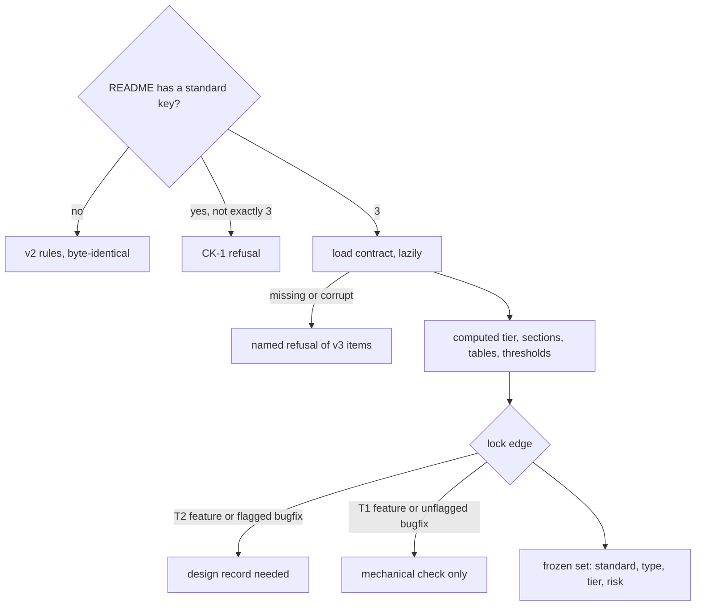

# spec-standard-v3: L3 functional and acceptance criteria

## FR/NFR delta

| ID | Change | Note |
|---|---|---|
| FR-1 | added | v2 untouched, branch on `standard` |
| FR-2 | added | the one reader and its refusals |
| FR-3 | added | computed tier, `live` from CLAUDE.md |
| FR-4 | added | sections by type, tier and flag |
| FR-5 | added | one AC table, bugfix 1 to 3 rows |
| FR-6 | added | Outcomes table, 12 dimensions, levels |
| FR-7 | added | thresholds and flag map from spec-locked |
| FR-8 | added | Must not change, Build amendments |
| FR-9 | added | Assumptions, Probe, open-question markers |
| FR-10 | added | lock edge record rule |
| FR-11 | added | frozen set |
| FR-12 | added | merge, squash, revert |
| FR-13 | added | lazy contract |
| FR-14 | added | one enum source |
| NFR-1 | added | no second enum list |

## Acceptance criteria

Every refusal is asserted by its named reason, not only by the exit code. Fixtures: AC-1 reads the real corpus; AC-2 to
AC-9 and AC-13 use README text built by editing a real shipped item (`docs/work/review-records/README.md`) and real
`yaml.safe_load` output; AC-10 to AC-12 run real commits in a temp git repo; AC-14 edits a temp copy of the real contract.

| AC | Traces | Given / when | Pass when | Fail when | Test |
|---|---|---|---|---|---|
| AC-1 | CAP-1, FR-1 | every `docs/work/*/README.md` under D:/repo and C:/Users/Michael/.claude, at each of the 6 statuses (the status line rewritten in a temp copy), `require_sections` on and off, and `for_source_commit`; old checker output captured from the pre-change checker at a pinned commit | new and old errors and warnings are byte-identical for every combination | any single byte differs, or the corpus is empty or below the 54 items found at the probe | tests/test_spec_v3.py |
| AC-2 | CAP-2, FR-2 | frontmatter with: `standard: "3"`, `standard: 3.0`, `standard: true`, `standard: 4`; `tier: t1`, `tier: "T1 "`, `tier` on a bugfix, no `tier` on a feature; `risk: [Security]`, `risk: [unknown]`, `risk: security`, a repeated flag; a duplicate key; `parent`, `children`, `nestTrigger`, `nestWhy`; `tier` or `risk` with no `standard`; a layer file beside a v3 README; and the valid T1 and T2 forms | each invalid form is refused with its rule and the key named (CK-1, CK-3 for the layer file); the valid forms read; `spec_check`, `spec_gate` and `review_record` each get the same result through `read_v3` | any invalid form is accepted, falls back to v2, or a reader other than `read_v3` is called | tests/test_spec_v3.py |
| AC-3 | CAP-3, FR-3 | features with 5, 6 and 15 and 16 ACs; each of the 7 flags with 1 AC; a repo whose CLAUDE.md says `deploymentTier: live` and a feature declaring `T1` with `risk: []`; a declared `T2` on a 2-AC unflagged feature | 5 ACs and no flag is T1; 6 ACs or any flag is T2; 16 is a split error; the live repo makes the T1 declaration an error naming `live`; a higher declared tier passes | a computed T2 passes as T1, 16 ACs pass, or `live` comes from `risk` alone | tests/test_spec_v3.py |
| AC-4 | CAP-3, FR-4 | a README missing one required section at a time: feature T1 (4 sections), feature T2 (7), feature T2 with `contract` (8), bugfix (6), flagged bugfix (7); each at `draft` and `spec-locked`; a `Behaviours` and `Assumption` look-alike heading | at `spec-locked` each missing section is an error naming it; at `draft` none is; look-alike headings do not count | a missing section passes at `spec-locked`, or a look-alike satisfies a required heading | tests/test_spec_v3.py |
| AC-5 | CAP-3, FR-5 | `Behaviour` with the exact header and 2 rows; with a second table; with a header differing by one word; with a duplicate `AC-1`; a bugfix `Expected` with 3 rows and with 4 | exactly one table with the exact header reads; the 4-row bugfix is refused as "a spec change, not a bug"; the others are refused naming the table or the id | a second table is ignored, a near header is accepted, or 4 bugfix rows pass | tests/test_spec_v3.py |
| AC-6 | CAP-3, FR-6 | an Outcomes table with: a dimension missing, duplicated, or spelled `Invalid Input`; level `L4`, `l3`, `L3 `; an L3 row naming `AC-9` that does not exist; an L1 reason of `n/a`, `tbd`, two words; a second table in the section | each is refused with a specific message; a valid 12-row table reads | any look-alike is accepted | tests/test_spec_v3.py |
| AC-7 | CAP-3, FR-7 | at `spec-locked`: a T1 feature with `success` at L2; a T2 feature with one L2 row; a feature with each flag and the first of its mapped dimensions at L2; the same tables at `draft` | each is refused naming the dimension and the threshold or flag; the draft is not; each flag's refusal matches `flag_to_dimensions` in the contract | a mapped dimension below L3 passes at `spec-locked` | tests/test_spec_v3.py |
| AC-8 | CAP-3, FR-8 | a bugfix with no `Must not change` table, a header of `\| ID \| Must not change \|`, an id `MNC-x`, zero rows; a `Build amendments` row with an empty Test cell; at `building` a test file that cites `<id>/AC-n` but not `<id>/MNC-n` | each is refused naming the table or the id; the cited test passes | an empty Test cell or an uncited MNC row passes at `building` | tests/test_spec_v3.py |
| AC-9 | CAP-3, FR-9 | Assumptions with an If violated of `retry` or empty; an Observed `src/a.py:99999` that does not resolve and the look-alikes `3.5:1`, `v1.2:3`, `127.0.0.1:8080`, `C:/x/y.py:12` for a file that exists; a Probe link to a missing file, to a path outside `evidence/`, and to an existing file; `[NEEDS CLARIFICATION`, `TBD` in prose and in inline code, and `TBDs` | the bad outcome words, the unresolved citation and the bad Probe links are refused; the look-alike strings are not read as citations; `TBD` in prose and the marker are refused from `spec-locked` and allowed at `draft`; `TBD` in inline code and `TBDs` are allowed | a look-alike is read as a citation, or an open marker survives the lock | tests/test_spec_v3.py |
| AC-10 | CAP-4, FR-10 | lock commits with no design record for: a v3 T2 feature, a flagged v3 bugfix, a v2 feature, a v3 T1 feature, an unflagged v3 bugfix; a v3 T1 feature whose staged ACs rose to 6 while it still declares `T1`; a ship commit of a v3 T1 feature with no code record; a git error while reading | the first three and the 6-AC case are refused naming `needs a fresh design review`; the T1 feature and the unflagged bugfix lock; the ship is refused for lack of a code record; the git error refuses | a T2 item locks with no design record, the rule reads the working tree or the declared tier alone, or any ship needs no code record | tests/test_spec_v3.py |
| AC-11 | CAP-5, FR-11 | HEAD at each of `spec-locked`, `building`, `shipped`; staged changes to `tier`, `risk`, `type`, `standard`, one at a time and a v2 item gaining `standard: 3`; the same changes in a commit that sets `status: draft`; HEAD at `draft` | each change past draft is refused naming the key; the move back to draft lands; a draft changes freely; ACs added past 5 under a declared `T1` are refused by FR-3 | a frozen key changes past draft without a return to draft | tests/test_spec_v3.py |
| AC-12 | CAP-4, CAP-5, FR-12 | real git repos: a merge of a branch that locked a T1 item, a squash of a branch with a T2 item lock and its design record, a squash without the record, a revert of a lock commit, a merge carrying a tier change made after the lock | the first, second and revert land as the gate lands them today; the squash without a record and the late tier change are refused with the same reasons as a plain commit | a merge, squash or revert is judged by a rule a plain commit would not meet, or skips one it would | tests/test_spec_v3.py |
| AC-13 | CAP-6, FR-13 | the contract file deleted, then replaced with invalid JSON, then with a valid JSON that fails its own meta-schema; a v3 item and a v2 item checked in each case; a commit with no v3 item | the v3 item gets one named `CK-V3` refusal naming the file and reason; the v2 item and the commit with no v3 item are judged exactly as before and never read the file | a v3 item falls back to v2, or a v2 item is affected | tests/test_spec_v3.py |
| AC-14 | CAP-6, FR-14, NFR-1 | a temp copy of the contract with an extra flag, an extra dimension and a changed flag-to-dimension map, loaded by the checker and the gate; the repo scanned for a second list of the 7 flags or 12 dimensions | the new flag is accepted and its mapped dimensions enforced by both; a value absent from the copy is rejected by both; no `.py` outside the contract loader holds a list of them | either module keeps its own list | tests/test_spec_v3.py |
| AC-15 | CAP-7, FR-14 | `skills/dark-factory/SPEC-STANDARD-V3.md`, `skills/dark-factory/WORK-ITEM-STANDARD.md`, `playbooks/agent-dispatch.md`, `agents/reviewer.md` (written by the parent session, not the implementer) | the v3 doc is 200 lines or fewer and names the contract path and every flag; the v2 standard opens with a banner pointing to it; the dispatch playbook has a tier table with stage budgets, a security reviewer for 2 or more flags and a probe before the draft; the reviewer persona says a missing risk flag is breaking | any piece is missing, the doc exceeds 200 lines, or it restates a flag map that differs from the contract | tests/test_spec_v3.py |

Tests cite `spec-standard-v3/AC-<n>` verbatim.

## Outcome inventory

### Judge a v3 item (`spec_v3.check`)

| Stage | Outcome | Kind | Class | Handled by |
|---|---|---|---|---|
| check | a valid T1 or T2 item reads and every rule passes | success | nominal | AC-2 |
| check | look-alike or unknown frontmatter, a bad table, a missing section, a threshold below its level | invalid input | closed: refused | AC-2 |
| check | the contract file is missing or corrupt | dependency fails | closed: refused | AC-13 |
| check | n/a: a pure read of one tree, no wait | timeout | nominal | AC-1 |
| check | n/a: no state is written | crash mid-step | nominal | AC-1 |
| check | n/a: reads one committed tree | concurrent actor | nominal | AC-1 |
| check | a table row or id repeated | duplicate or replay | closed: refused | AC-5 |
| check | the item reaches the checker as a v2 item, a v3 item, a v2 item gaining `standard`, a layer file under v3 | arrival channel | closed: refused | AC-2 |

### Lock and freeze (`required_records`, `frozen_set_problem`)

| Stage | Outcome | Kind | Class | Handled by |
|---|---|---|---|---|
| lock | a T1 item locks on the mechanical check; a T2 item locks with a fresh design record | success | nominal | AC-10 |
| lock | the declared tier is below the computed one, or a frozen key changed past draft | invalid input | closed: refused | AC-11 |
| lock | git cannot read HEAD or the index | dependency fails | closed: refused | AC-10 |
| lock | n/a: one bounded git read, the gate's existing 10 s | timeout | closed: refused | AC-10 |
| lock | n/a: a refused commit leaves the repo unchanged | crash mid-step | nominal | AC-10 |
| lock | two branches change `tier` or `risk` differently and merge | concurrent actor | closed: refused | AC-12 |
| lock | an old design record copied in after the tier rose | duplicate or replay | closed: refused | AC-10 |
| lock | the move arrives by commit, merge, squash or revert | arrival channel | nominal | AC-12 |
| lock | the move arrives by amend, `--no-verify`, rebase, cherry-pick, rename, first commit or import | arrival channel | closed: escalated | AC-12 |

### Load the contract (`load_contract`)

| Stage | Outcome | Kind | Class | Handled by |
|---|---|---|---|---|
| load | the contract loads once for the first v3 item | success | nominal | AC-13 |
| load | valid JSON that fails its own schema | invalid input | closed: refused | AC-13 |
| load | the file is absent or unreadable | dependency fails | closed: refused | AC-13 |
| load | n/a: a local file read | timeout | nominal | AC-13 |
| load | n/a: read only | crash mid-step | nominal | AC-13 |
| load | n/a: read only | concurrent actor | nominal | AC-13 |
| load | the contract is read twice in one process | duplicate or replay | nominal | AC-14 |
| load | the first access comes from the checker, the gate or the tests | arrival channel | nominal | AC-14 |

### Rejected outcomes

| Outcome | Reason |
|---|---|
| a code record not tied to the code | accepted risk: the local gate does not judge code freshness (D32); work item `gate-ci` checks it over pushed history |
| a risk flag the author never declared | the reviewer persona rule (AC-15); path-derived flags go to `gate-ci` |
