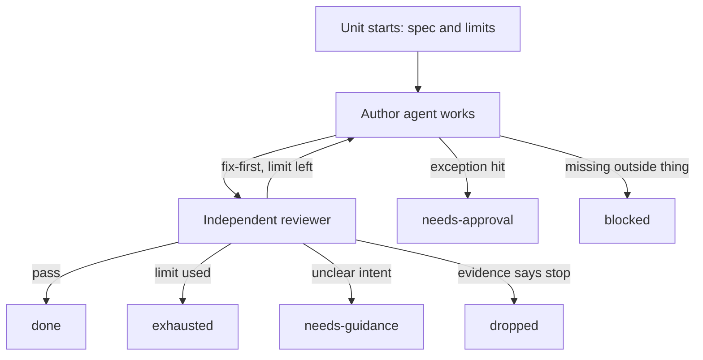

# Workflow units: several agents, one atomic step, a fixed set of endings

Owner ask 2026-11-06: a hand-off should be a workflow of several agents in one atomic unit, with a review agent as a matter of course, a configurable number of cycles, and defined states for how it ends.

Status: draft. The rule that every hand-off has a reviewer applies now, by hand. The rest is not built.

## What exists

| Part | Today | Gap |
|---|---|---|
| Atomic unit | `cycle`: design, review, implement, review (`skills/dark-factory/CYCLE.md`) | `workflows/cycle.js` suspended since 2026-11-02, so stages run by hand |
| Cycle limit | One fix round, then a verify review | Not configurable; the old S/M/L budget is retired |
| Endings | `passed`, `budget-exhausted` | Two endings can't say why work stopped |
| Research | One agent, no reviewer | Not a unit at all |
| Bandwidth | Agent budgets in Cortex only | No cost or time limit on a unit |

## Unit types

| Unit | Agents, in order | Default limit |
|---|---|---|
| Research | researcher, reviewer | 1 fix round |
| Spec | designer, reviewer (adversary and design) | 2 |
| Build | implementer, reviewer | 2 |
| Study | designer, implementer, reviewer, script run, reviewer | 2 |
| Security change | Any unit plus reviewer in security mode | 2 |

Limits sit in one config beside the workflows, overridable per project manifest and per item. A limit has three parts, and whichever runs out first ends the unit: `maxFixRounds` (hard cap 5), `maxUsd`, `maxHours`.

## Endings

Every unit ends in exactly one, written to the work item and sent as one event.

| Ending | Meaning | Next |
|---|---|---|
| `done` | Reviewer passed it | Moves on by itself (C125) |
| `needs-guidance` | Intent is unclear; more cycles won't help | Owner gate, with the one question |
| `needs-approval` | Finished up to a C125 exception | Owner gate, Yes or No |
| `blocked` | Waiting on something outside: credentials, data, another item | Names the unblock; resumes when it clears |
| `exhausted` | Limit used without convergence, and the way forward is unclear | Designer decides, once; the owner only for a C125 exception. A limit reached with a known small fix is not `exhausted`: the parent decides and the unit carries on |
| `dropped` | Evidence says stop: a study adds nothing, or an idea fails its check | Recorded with the reason; closed |

Mapping to the global stop classes: `blocked` covers `credentials-no-agentic-path`, `needs-approval` covers `irreversible-approval`, `exhausted` covers `repair-budget-exhausted`, `needs-guidance` covers `hard-to-reverse-choice`.

## Acceptance criteria

| Id | Pass | Fail | Test |
|---|---|---|---|
| AC1 | A unit never ends without one named ending and its evidence | A silent stop | workflow test on a fixture |
| AC2 | The author never reviews its own work | Same agent in both roles | workflow test |
| AC3 | Each of the three limits ends a unit as `exhausted` | It runs past a limit | workflow test, one case per limit |
| AC4 | Project and item overrides win, up to the hard cap | Ignored, or over the cap | config test |
| AC5 | `needs-guidance` and `needs-approval` open an owner gate; the answer resumes the unit | Owner must restart it by hand | contract test with `owner-gate` |
| AC6 | Cortex Researcher briefs get a reviewer step, sampled or full, within budget | Briefs ship unchecked | Cortex persona and run test |
| AC7 | Live: one research unit and one build unit reach an ending with no session steering | Any step needs a person | run record |

## Depends on

- `stage-trace`, which un-suspends `cycle.js`; fold it in here rather than fixing the old file separately
- Cortex `docs/work/owner-gate/README.md` for AC5

Review date: 2026-11-20. Running a Workflow script needs the owner's opt-in, so the first live run asks first.
