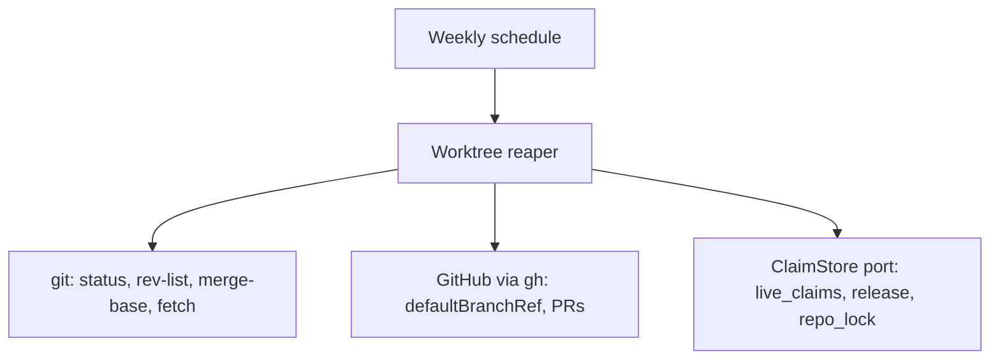

# Worktree reaper: safe-delete predicate and weekly cleanup

Home repo: `~/.claude`. External targets: local git worktrees under `D:/wt/<repo>/<id>`, the GitHub repos meter, telefi and weaver (read-only through `gh`), and the claims store of the parent item `docs/work/branch-conventions/` (contracts `ext:branch-conventions:work-claim@1` and `ext:branch-conventions:claim-store@1`).

## Purpose
Finished agent worktrees and branches pile up, and deleting them wrongly loses work. This item defines one fail-closed merged-proof and a bounded weekly reaper that applies it, so a worktree or branch is removed only when its work is provably on the default branch.

## Non-goals
- Deleting remote branches (owner chose local cleanup only; remote auto-delete stays owner-pending in the parent).
- Touching Foreman's `.git/foreman-worktrees` until Weaver's Foreman step replaces them.
- Creating or claiming worktrees (the parent's claim store does that).

## Capabilities
| CAP | Statement |
|---|---|
| CAP-1 | The service must delete a worktree or branch only when ONE merged-proof holds, in one of two exclusive forms, and rules 1 and 2 hold in both: (1) clean, meaning an empty `git status --porcelain=v2 --untracked-files=all`, no ignored files outside the regenerable allow-list, and no stash on its branch; (2) no unpushed commits, `git rev-list @{u}..HEAD` empty. Form (a): a PR exists, is MERGED, has `baseRefName` equal to the default branch, has `headRefOid` equal to HEAD, and its `mergeCommit.oid` is an ancestor of a freshly fetched `origin/<default>`. Form (b): no PR exists at all and HEAD is an ancestor of `origin/<default>`. A PR in any other state means keep |
| CAP-2 | The service must take the default branch from GitHub `defaultBranchRef`, never from local origin/HEAD, and keep stacked PRs whose base is not the default branch |
| CAP-3 | The service must fail closed: any gh error, git error, timeout, or missing or unset upstream, and any registry error, means keep with a recorded reason (`gh-error`, `git-error`, `registry-error`) |
| CAP-4 | The service must remove in order: delete each link and junction itself first, then plain `git worktree remove` (never `--force`), then prune, then `git branch -D`, and must not delete anything inside a junction target |
| CAP-5 | The service must exclude `.git/foreman-worktrees`, worktrees with a live claim, and the default-branch worktree |
| CAP-6 | The service must hold the per-repo advisory lock through the ClaimStore port while removing, and release the claim itself after the merged-proof when the holder has not |
| CAP-7 | The service must run weekly from a registered schedule, bounded in time with a minimum-progress guarantee, using upstream `[gone]` only as a candidate filter and detecting squash merges by `gh`, never by `git branch --merged` |

## Non-functional requirements
| NFR | Target | Method | Evidence |
|---|---|---|---|
| NFR-1 | 0 deletions of unmerged work across all 5 predicate rules, 1 injected fault per case | fault-injection: per-rule tests against real temp repos with a stubbed `gh` | AC-1 + AC-2 + AC-3 + AC-4 + AC-5 + AC-6 |
| NFR-2 | one run over 200 worktrees ends in <= 120 s, each external call <= 10 s, and at least 6 worktrees decided even when every `gh` call is slow | latency-bench: reaper over a synthetic 200-worktree set with a slow stubbed `gh` | AC-12 |
| NFR-3 | 1 spike ends in 1 recorded decision on whether git follows junctions during `git worktree remove` | spike: time-boxed experiment on a throwaway repo with a sentinel junction target | AC-8 + decision:D22 |
| NFR-4 | 0 files inside a junction target deleted | fault-injection: a sentinel file in the target of a real junction | AC-7 |

## Gate plan
| Risk | Kind (deterministic / qualitative) | Check | Blocking / advisory |
|---|---|---|---|
| Unmerged work deleted | deterministic | per-rule fault-injection tests (AC-1 to AC-6) | blocking |
| Junction target deleted | deterministic | sentinel-file test (AC-7) | blocking |
| Reaper runs unbounded or makes no progress | deterministic | bounds test (AC-12) | blocking |
| gh JSON field drift | deterministic | recorded real `gh` output fixtures (AC-6) | blocking |
| Soundness of the predicate | qualitative | adversarial design review before `spec-locked` | advisory |

## Open questions
1. Whether git for Windows follows junctions on `git worktree remove` is an open spike (AC-8); decision:D18 records an incident where it did, so links are deleted first regardless.
2. A worktree whose branch was never pushed has no upstream and is always kept (`git-error`), even when its commits are on the default branch; accepted as the fail-closed default.
3. The `gh` JSON fields used (`state`, `baseRefName`, `headRefOid`, `mergeCommit`) are checked against recorded real output, not against the live API in CI.

## Gap-ledger check
Categories from `docs/SPEC-GAP-LEDGER.md` (2026-10-31 rows).

| Category | Handled by |
|---|---|
| authoritative-source | FR-3 and AC-3 (default branch from `defaultBranchRef`, PR state from GitHub, merge commit checked against a freshly fetched default branch) |
| fail-closed-on-unknown | FR-6, AC-6 (gh and git errors, timeouts, missing or unset upstream), AC-9 (registry error keeps all) |
| destructive-op-proof | CAP-1, FR-1, FR-2, NFR-1, AC-1 to AC-5 (a positive control in each case proves delete happens only when all rules hold), AC-7, AC-8 |
| liveness-and-time | FR-9, AC-9 (a live claim excludes a worktree), FR-13 and AC-12 (bounds measured on a monotonic clock) |
| concurrency-granularity | FR-10, AC-10 (removal under the per-repo lock; claim key is the package-level id of the parent) |
| external-contract-unverified | AC-6 (recorded real `gh` output fixtures fail on field drift), NFR-3 and AC-8 (junction behaviour) |
| split-state | n/a: the reaper owns no state; it reads git, GitHub and the claim store and releases through the port |
| untestable-ac | each case asserts its own named reason, with a positive control that must delete; mutation-check the predicate (AC-1 to AC-5) |
| scope-drift-oversize | split from branch-conventions; 12 ACs |
| enforcement-allowlist | FR-1 and AC-1 (regenerable ignored paths), FR-8 and AC-9 (Foreman worktrees, live claims, default-branch worktree) |

## References
- git-scm.com/docs/git-worktree, git-status, git-rev-list, git-merge-base: https://git-scm.com/docs
- GitHub CLI `gh pr list --json` and `gh repo view --json defaultBranchRef`: https://cli.github.com/manual
- Parent item: `docs/work/branch-conventions/README.md`; research on gwq and git-worktree-runner is cited there.
- decision:D18 (junction incident), decision:D22 (junction spike), in `docs/DECISIONS.md`.

Unverified: whether git follows junctions on `git worktree remove` (treated as dangerous regardless).
