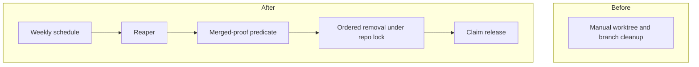
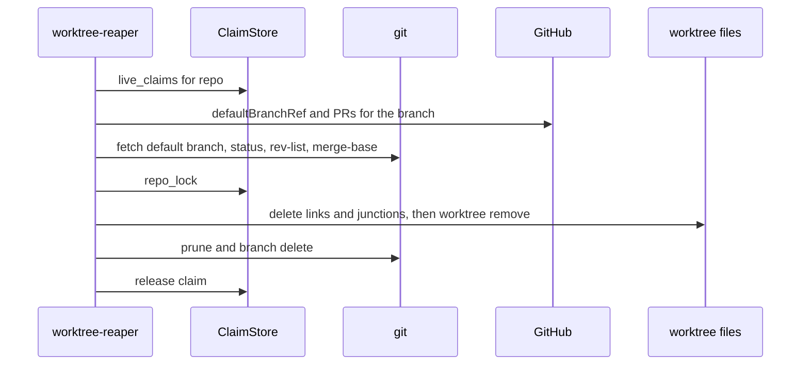

# worktree-reaper: L1 architecture

Before: cleanup is manual and the Foreman path deletes with its own checks. After: one predicate decides, one ordered removal executes it under the per-repo lock, and the claim is released through the ClaimStore port.

## Components
| Component | Role (one line) | Spec |
|---|---|---|
| worktree-reaper | merged-proof predicate, ordered removal, claim release, weekly schedule | components.md `## worktree-reaper` |

## Call chains
### Reap one worktree

