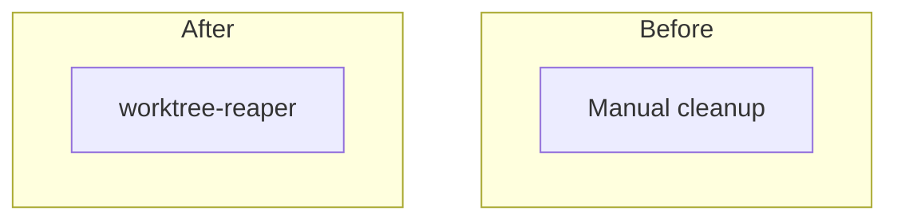

# worktree-reaper: L2 component specs

| Component | Owned files | Public interface |
|---|---|---|
| worktree-reaper | `scripts/worktree_reaper/**`, `tests/worktree_reaper/**` | `safe_to_delete`, `reap`, `python scripts/worktree_reaper/reap.py`, `register_schedule` |

## worktree-reaper

### Interface
`safe_to_delete(worktree: Path, store: ClaimStore, gh: GhClient, git: GitClient) -> Decision` with `Decision = {delete: bool, reason: str}`. Reason codes: `dirty`, `untracked`, `ignored-files`, `branch-stash`, `unpushed`, `pr-not-merged`, `wrong-base`, `head-moved`, `merge-not-in-default`, `no-pr-not-ancestor`, `live-claim`, `excluded`, `gh-error`, `git-error`, `registry-error`, and `ok-form-a` or `ok-form-b` for delete. `reap(repo, dry_run=True) -> Report`. `register_schedule()` registers a weekly Windows scheduled task. The ClaimStore port is injected; it is the contract `ext:branch-conventions:claim-store@1` with operations `live_claims(repo)`, `release(claim)` and `repo_lock(repo)`, over records of `ext:branch-conventions:work-claim@1`.

### Functional requirements
| FR | Requirement |
|---|---|
| FR-1 | Rule 1 holds only if `git status --porcelain=v2 --untracked-files=all --ignored` shows no entry other than ignored paths under the allow-list (node_modules, dist, build, .venv, __pycache__, coverage, cache) and `git stash list` has no entry for this branch |
| FR-2 | Rule 2 holds only if `git rev-list @{u}..HEAD` succeeds and is empty; both rules must hold in form (a) and in form (b) |
| FR-3 | The default branch is read from GitHub `defaultBranchRef`; a PR whose `baseRefName` differs from it is kept; `origin/<default>` is fetched fresh before any ancestor test |
| FR-4 | Form (a): every PR for the head branch is MERGED, and at least one has base equal to default, `headRefOid` equal to HEAD and `mergeCommit.oid` an ancestor of `origin/<default>`; any PR in another state means keep |
| FR-5 | Form (b): no PR exists at all (listed with state all) and HEAD is an ancestor of `origin/<default>`; a no-PR non-ancestor is kept |
| FR-6 | A gh error or timeout, a git error or timeout, a missing or unset upstream, or an unparseable output means keep with reason `gh-error` or `git-error`; `[gone]` alone never deletes |
| FR-7 | Removal order: delete each link and junction itself, then plain `git worktree remove` (never `--force`), then prune, then `git branch -D`; nothing inside a junction target is deleted |
| FR-8 | Excluded: paths under `.git/foreman-worktrees`, the default-branch worktree, and any worktree with a claim in `live_claims` |
| FR-9 | Any ClaimStore error means keep all worktrees of that repo with reason `registry-error` |
| FR-10 | Removal runs while holding `repo_lock(repo)` through the port |
| FR-11 | After the merged-proof the reaper releases the claim through the port if the holder has not; the holder releases on PR merge otherwise |
| FR-12 | The schedule is registered weekly and candidates are found by upstream `[gone]` or `gh pr list --state merged`, never `git branch --merged` |
| FR-13 | A run has a total time bound of 120 s and a per-worktree cap of 20 s measured on a monotonic clock; undecided worktrees are reported `deferred`; a run that decided none exits non-zero with `no-progress` |

### Data
Reads git, `gh` JSON, and the claim store through the port; it owns no state. It writes only deletions, claim releases and a report of reasons.

### Failure modes
| Failure | Detection | Handling |
|---|---|---|
| `gh` timeout or non-zero exit | subprocess timeout or exit code | keep, reason `gh-error` |
| git timeout, error or unset upstream | exit code or empty upstream | keep, reason `git-error` |
| Commit made after the merge | `headRefOid` differs from HEAD | keep, reason `head-moved` |
| Stacked PR into a non-default base | `baseRefName` differs from the default | keep, reason `wrong-base` |
| Junction inside the worktree | reparse-point check | junction removed itself first; if that fails, keep |
| Claim store unreachable | port raises | keep all, reason `registry-error` |
| Time bound reached | monotonic clock | stop, report the rest as `deferred` |

### Budget
| Dimension | Budget |
|---|---|
| Latency | 120 s per run over 200 worktrees; 10 s per external call; 20 s per worktree |
| Cost | $0 per run |
