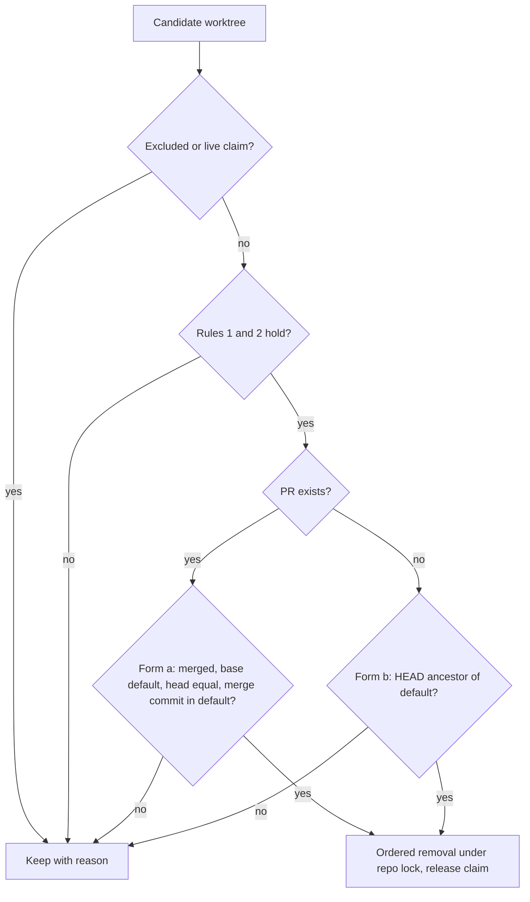

# worktree-reaper: L3 functional and acceptance criteria

## FR/NFR delta
| ID | Change | Note |
|---|---|---|
| FR-1..FR-13 | added | see components.md |
| NFR-1..NFR-4 | added | see README |

## Acceptance criteria
| AC | Traces | Given / when | Pass when | Fail when | Test |
|---|---|---|---|---|---|
| AC-1 | CAP-1, FR-1, NFR-1 | a real temp repo with a merged PR is made dirty by one fault per case: a modified tracked file, an untracked file, a stash on its own branch, an ignored file outside the allow-list; plus a clean control and a control with only allow-listed ignored paths (node_modules) | each fault case keeps with its own reason (`dirty`, `untracked`, `branch-stash`, `ignored-files`), a stash on another branch does not block, and both controls delete | any fault case deletes, a wrong reason is returned, or a control keeps | tests/worktree_reaper/test_rule1_clean.py |
| AC-2 | CAP-1, CAP-3, FR-2, NFR-1 | one unpushed commit; a branch with no upstream; an unset upstream; and a pushed control, each in form (a) and in form (b) | the unpushed case keeps with `unpushed`, the missing and unset upstream cases keep with `git-error`, and the pushed control deletes, in both forms | rule 2 skipped in either form, or the control keeps | tests/worktree_reaper/test_rule2_pushed.py |
| AC-3 | CAP-1, CAP-2, FR-3, FR-4, NFR-1 | a PR that is OPEN; a PR that is CLOSED unmerged; a merged PR into a non-default base (stacked); a repo whose local origin/HEAD differs from `defaultBranchRef`; a merged PR into the default as control | the three non-merged-into-default cases keep with `pr-not-merged` or `wrong-base`, the default is taken from `defaultBranchRef` not local origin/HEAD, and the control deletes | a stacked or unmerged PR deletes, or the local origin/HEAD decides the default | tests/worktree_reaper/test_rule3_pr_state.py |
| AC-4 | CAP-1, FR-4, NFR-1 | a commit is added to the worktree after the merge (`headRefOid` differs from HEAD); the merge commit is absent from a freshly fetched `origin/<default>`; a matching control | the head-moved case keeps with `head-moved`, the missing merge commit keeps with `merge-not-in-default`, and the control deletes | either case deletes | tests/worktree_reaper/test_rule4_head.py |
| AC-5 | CAP-1, FR-5, NFR-1 | no PR exists and HEAD is an ancestor of `origin/<default>`; no PR exists and HEAD is not an ancestor; a branch with a PR in any non-merged state | the ancestor case deletes with `ok-form-b`, the non-ancestor case keeps with `no-pr-not-ancestor`, and the open-PR branch is never judged by form (b) | the non-ancestor deletes, or form (b) applies when any PR exists | tests/worktree_reaper/test_rule5_no_pr.py |
| AC-6 | CAP-3, FR-6, NFR-1 | `gh` returns a non-zero exit, times out at 10 s, or returns unparseable JSON; git fetch fails or times out; replayed recorded real `gh` JSON is parsed; a candidate is only upstream `[gone]` | gh failures keep with `gh-error`, git failures keep with `git-error`, the recorded real output parses with every field used present, and `[gone]` alone never deletes | any failure deletes, a field rename in the recorded output is not detected, or `[gone]` deletes | tests/worktree_reaper/test_fail_closed.py |
| AC-7 | CAP-4, FR-7, NFR-4 | a worktree contains a real junction whose target holds a sentinel file, and a link; the worktree is reaped | the sentinel file survives, links and junctions are removed first, `git worktree remove` runs without `--force`, then prune, then `branch -D`, in that order | the sentinel is deleted, `--force` is used, or the order differs | tests/worktree_reaper/test_removal_order.py |
| AC-8 | CAP-4, NFR-3 | a throwaway repo with a sentinel junction target runs `git worktree remove` once with the junction left in place | a decision row `D22` is recorded stating whether the sentinel survived, and the reaper's link-first order is kept regardless | no decision recorded, or the removal runs on a real repo | tests/worktree_reaper/test_junction_spike.py |
| AC-9 | CAP-5, CAP-3, FR-8, FR-9 | candidates include a `.git/foreman-worktrees` path, the default-branch worktree and a worktree with a live claim; separately the ClaimStore raises | the three excluded worktrees are untouched with reasons `excluded` and `live-claim`, and a registry error keeps all worktrees of the repo with `registry-error` | an excluded worktree is removed, or a registry error lets a delete proceed | tests/worktree_reaper/test_exclusions.py |
| AC-10 | CAP-6, FR-10, FR-11 | a delete passes the proof with a fake ClaimStore that records calls; the holder has not released | removal occurs only between `repo_lock` acquire and release, and the claim is released through the port after the proof | removal outside the lock, or the claim left unreleased after a delete | tests/worktree_reaper/test_claim_release.py |
| AC-11 | CAP-7, FR-12 | the schedule is registered; a squash-merged branch exists | a weekly scheduled task is found with a weekly trigger, the squash merge is found through upstream `[gone]` as candidate and `gh pr list --state merged`, and `git branch --merged` is never called | no schedule found, or `git branch --merged` is used for detection | tests/worktree_reaper/test_schedule_detection.py |
| AC-12 | CAP-7, FR-13, NFR-2 | the reaper runs over 200 synthetic worktrees with every `gh` call slow; and once with all calls hanging | the run ends in <= 120 s, at least 6 worktrees are decided, the rest are reported `deferred`, and the all-hanging run exits non-zero with `no-progress` | the run exceeds 120 s, fewer than 6 are decided, or all-hanging exits zero | tests/worktree_reaper/test_bounds.py |

Tests cite `worktree-reaper/AC-<n>` verbatim (for example `worktree-reaper/AC-1`). Every CAP appears in the Traces of at least one row.
