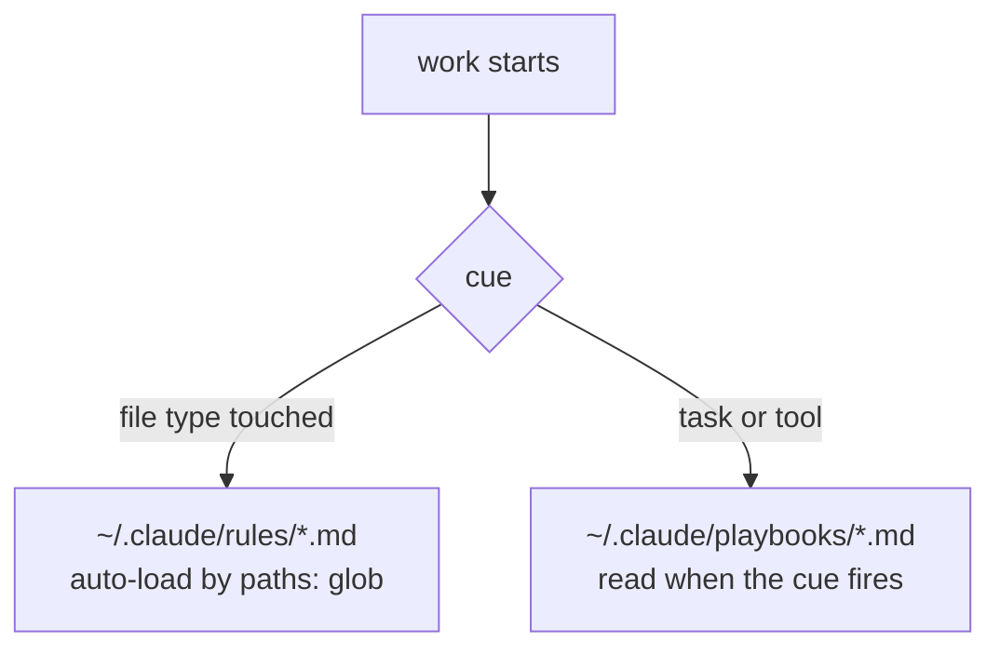

# Playbooks and rules (index)

| file | loads | covers |
|---|---|---|
| `~/.claude/rules/python.md` | `*.py` | imports, deps, typing, errors, I/O, pytest |
| `~/.claude/rules/javascript.md` | `*.js/mjs/cjs`, package.json | Node ESM |
| `~/.claude/rules/typescript.md` | `*.ts/tsx` | strict, zod, React/Next boundaries |
| `~/.claude/rules/shell.md` | `*.ps1/sh/cmd/vbs` | PowerShell 5.1 + bash, Windows tasks, live workspaces |
| `~/.claude/rules/testing.md` | test files | the three test kinds, minimal asserts, see it fail |
| `~/.claude/rules/docs.md` | `*.md` | Mermaid-first, one canonical doc, decision rows |
| `~/.claude/rules/nextjs-vercel.md` | next/vercel config, app tsx | smoke before handoff, provisioning, env |
| `~/.claude/rules/hooks.md` | settings / hooks | fail-closed hooks, loops, tests |
| `notion.md` | any Notion tool | write permission, field minimization |
| `reliability.md` | guards, monitors, "done?" | verify the effect, quality floors |
| `first-principles.md` | designing, fixing, reviewing; a fix that keeps finding new holes | authoritative layer, root cause, convergence stop |
| `refactor-pass.md` | a large milestone is done, or code goes public | simplify, constants, minimal tests, mutation check, fresh review |
| `agent-dispatch.md` | Agent / Workflow | dispatch order, fan-out pre-flight, isolation |

A rule is a default: a deviation carries a one-line comment saying why. Copying a legacy local pattern is not a reason. The language files that used to live here are pointer stubs now.
