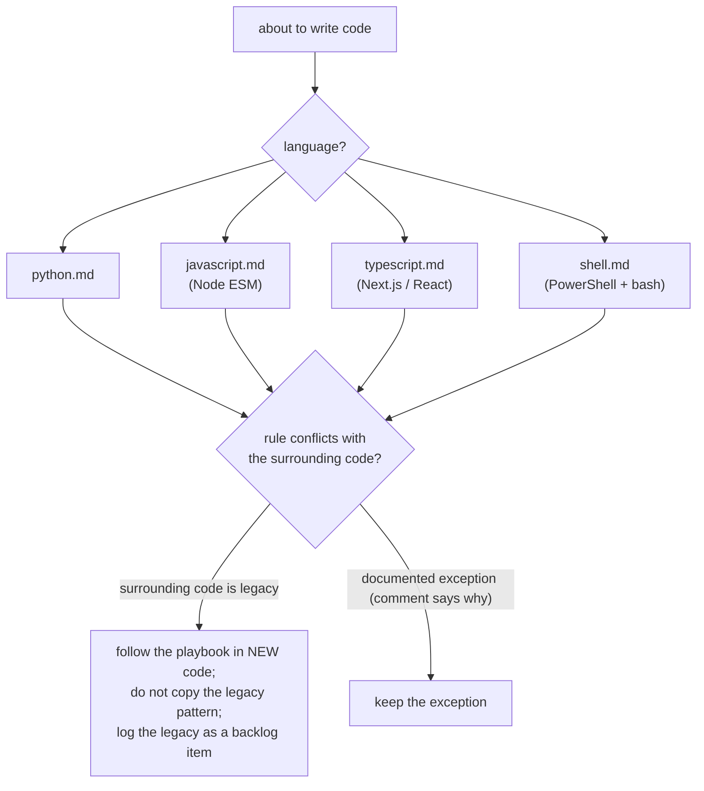

# Language ground rules (global playbook)

Adopted 2026-10-25 (owner: "imports by default are done at the root level on the top; follow
development best practices per language; set up a heuristic playbook"). These are **defaults**:
a deviation needs a one-line comment at the site saying why. "The file next to it does it" is not
a reason; copying a local pattern that breaks a ground rule is how the rule decays.

| file | covers |
|---|---|
| [python.md](python.md) | imports, dependencies, typing, errors, I/O, tests (pytest) |
| [javascript.md](javascript.md) | Node ESM: imports, async, child processes, errors, tests (node:test) |
| [typescript.md](typescript.md) | strict mode, schemas (zod), React/Next.js boundaries |
| [shell.md](shell.md) | PowerShell 5.1 and bash on Windows |

**Upkeep:** when a review or the owner corrects a language-level habit, add it here (one line,
with the incident) in the same turn, not just to memory.
