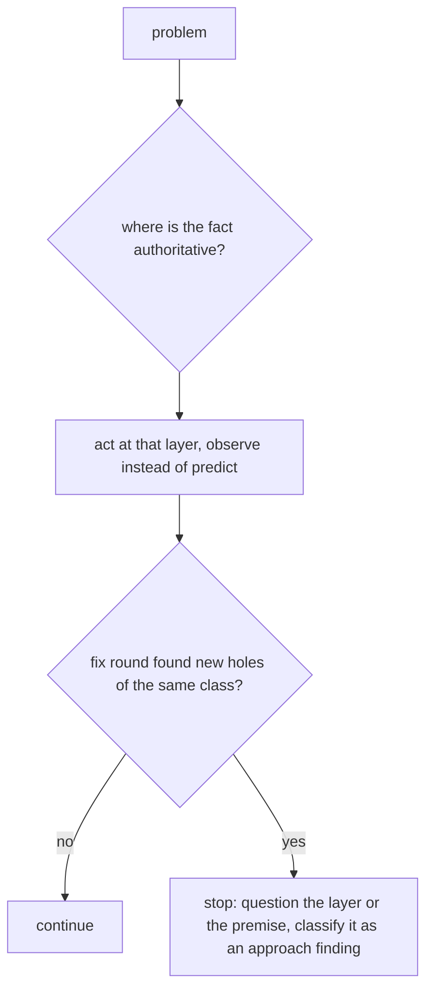

# First principles: find the authoritative layer, and stop patching when fixes don't converge

Adopted 2026-10-31 after two loops that did not converge:
- The Cortex dedup fix took 5 rounds. Job state was split across 6 stores written separately, and each fix moved
  the window where they disagree.
- The spec gate took 2 rounds and 23 holes. It predicted a commit from the shell command text, where git's own
  commit-msg hook observes the commit itself.

Both were the same mistake: deriving or enforcing a fact from a proxy instead of its source.

## Rules (every persona)
1. **Name the authoritative source** of the fact being derived or enforced, before designing or fixing.
   - Prefer to *observe the effect* at that layer: a git hook, a DB transaction, GitHub's PR state.
   - Don't *predict it* from a proxy: command text, an agent's own claim, several files that are written separately.
2. **Root cause before patch.** State the cause in one sentence, and the layer it lives in. A fix at a different
   layer is a workaround, and is labelled as one.
3. **Convergence check.** A fix round can produce new findings of the same class as the ones it fixed: new
   bypass forms, new consistency windows, new edge cases of the same parser. When it does, the approach is the
   defect, so stop patching.
   - Raise an `approach` finding that names the authoritative layer to move to.
   - Never spend a third round on the same layer.
4. **Question the premise.** Ask whether the requirement is needed as stated, and whether a smaller or different
   design removes the problem.
5. **Prefer off-the-shelf** components that already own the hard part, such as DBOS for durable state or the
   pre-commit framework for git hooks, over hand-rolled equivalents.

## Per role
- **Designer / architect**: every contract names the source of truth for each field, and who writes it.
- **Implementer**: if the spec makes you derive a fact from a proxy, stop and report it rather than patching
  around it.
- **Reviewer**: classify findings as `implementation`, `test`, `spec`, `design` or `approach`. Use `approach` when
  this round's findings repeat the class of the last round's.
