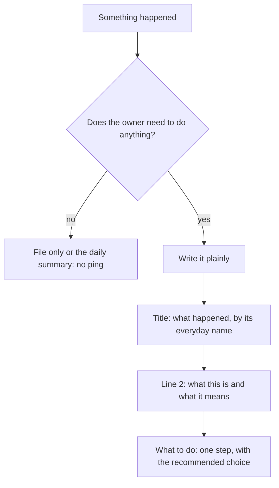

# Notifications: what reaches the owner's phone

Read this before writing or changing any message sent through TeleFi. Owner's standard, 2026-11-07: every message brings enough context in plain words, and is actionable.

## The shape

- **Title**: what happened, using the everyday name of the thing. "The dates fix for Cortex stopped building", not "cortex #10 gate-failed".
- **Line under it** (`insight`, 300 characters at most): the surrounding context: what this thing is, what state it is in now, and what it means if nobody acts.
- **What to do** (`next_step`, 200 characters at most): one concrete step and the recommended choice. Name a button only if it really does something.
- **Details** (`body`, `sections`, `evidence`): collapsed, so technical text belongs here: logs, ids, paths, exit codes.

## Layout of a rich message

Check every layout against these before showing it to the owner; looking good on one try is not the test.

- Two levels at most: the message, then one dropdown ([NN/g, progressive disclosure](https://www.nngroup.com/articles/progressive-disclosure/)).
- Colour never alone: each dot or coloured button sits next to its word ([WCAG 2.2, 1.4.1](https://www.w3.org/WAI/WCAG22/Understanding/use-of-color.html)).
- One emphasis code per meaning; spelled-out words, not symbol chips.
- An item's details, options and buttons stay together inside its dropdown ([proximity](https://www.nngroup.com/articles/gestalt-proximity/)).
- Red only for something destructive. Detail and the owner's agreed layout: `D:/repo/docs/telefi/notification-design.md` section 7.

## Plain words

Say what a thing does, not what it is called. On the two glance lines, never use exit codes, error class names, file paths, code or job names, internal status labels (`gate-failed`, `dry-run`, `repair-budget-exhausted`) or a bare id as the subject.

## When to send

- Nothing to do means no ping: `kind: info` stays in the file, or it waits for the daily summary.
- One message per problem. Say it again only when something changed or a decision is still open, at most once a day.
- A blip that fixes itself is not news: alert when it lasts, not on the first failure.
- Check before alarming: a job that is still running has not failed.

## Check it

`python -m telefi check-wording` judges the messages really sent, for every sender; its rules are in TeleFi (`telefi/wording.py`). A sender's own tests run `python -m telefi check-wording --stdin` on what it builds.
