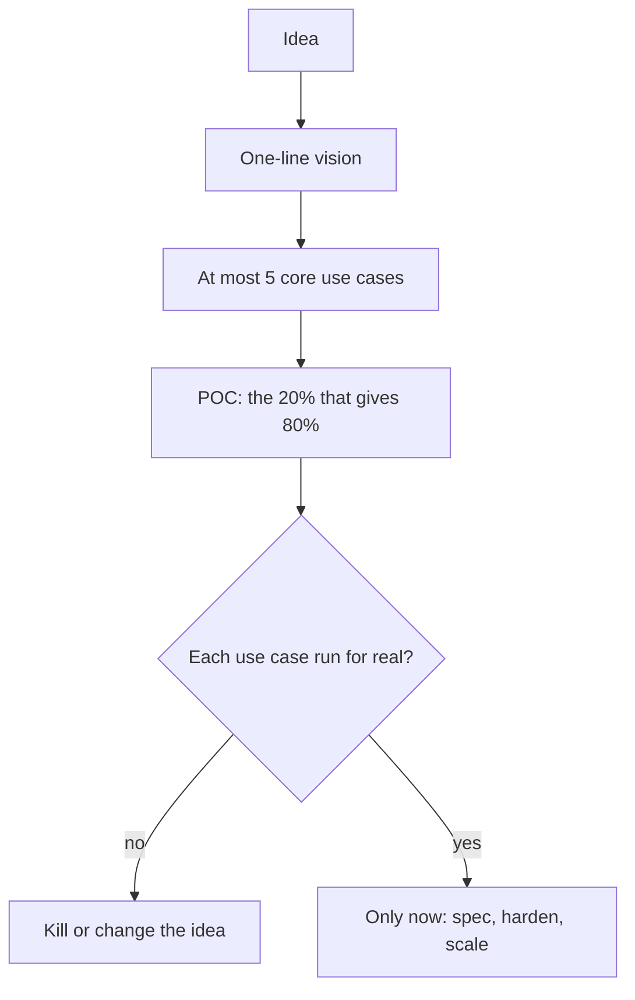

# Product development: prove it first

Owner's standard, 2026-11-08. Read this before starting any new product, service, platform or large feature. It runs before
`/dark-factory` or a full spec. Bug fixes, config and small changes skip it.

## Steps

1. **Vision.** One line. Every requirement traces to it.
2. **Core use cases.** At most 5, each with a pass and a fail condition.
3. **Check what exists.** Local research first, then GitHub, web and community threads. Prefer running an existing product
   over writing one, and say which sources could not be searched.
4. **POC.** Build or configure only what runs those use cases, on one real case. Set a time box, a stop date and a spend cap.
5. **Decide.** Run each use case for real and keep the evidence. All pass: invest further. One fails: change the method or kill
   it. Never scale a failed sample.

## Pushback (the owner asked for it)

While there is no revenue, tag each requirement `POC`, `later` or `never`, and say so when the owner asks for detail that no
core use case needs. Give the evidence and a recommendation, then respect the owner's call.

- No framework or general language before a third real instance needs it.
- No migration of something that works until the replacement has passed its POC.
- Documents cost attention: one page per step at most.

## Limits

A POC shows that something can work. Only people show that it is wanted: for anything meant to earn money, customer
discovery comes first or alongside (`D:/repo/docs/research_notes/solo-founder-playbook-2026-10-28.md:1`).
