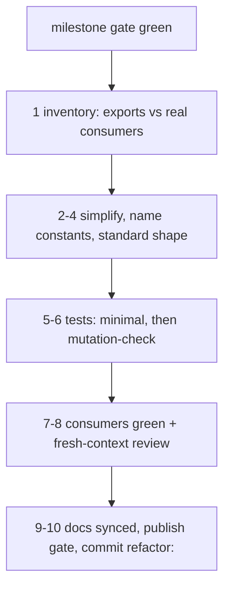

# Refactor pass (end of every large milestone)

Cue: a milestone, project or service feature is done, or code is about to go public. Behaviour-preserving
only: a behaviour change found here becomes its own `fix:` commit with a test. Adopted 2026-10-29 (owner:
"clean up, refactor, simplify... at the end of every large milestone"); first run: `D:/repo/Lib/meter` 253d678.

1. **Inventory.** List files and line counts; grep every export across `D:/repo` for its consumers. Unexport
   or delete what nothing uses. Note the public API you must not break.
2. **Simplify.** One implementation per role: merge duplicated parsing, loops and helpers. Prefer the standard
   library over hand-rolled code (e.g. recursive `readdirSync`). Delete dead code, legacy branches and
   compatibility shims nobody needs. Bound memory on anything that reads files of unknown size (one at a time).
3. **Constants and comments.** Every threshold, unit, regex and magic number gets a name. Comments say why,
   never what or history; history goes to `docs/DECISIONS.md`. Every `catch` either rethrows or says why it
   swallows.
4. **Standard shape.** Match the repo's own sections and patterns, the file-type rules in `~/.claude/rules/`
   and the design patterns already in use (pure core, injected I/O, errors only at boundaries). Do not invent
   a new pattern in a cleanup.
5. **Tests** (`~/.claude/rules/testing.md`). Behaviour-named (not "review 3"), one behaviour each, 1-3 asserts
   on the field that carries it, deterministic, imports at the top, no whole-shape `deepEqual` unless the
   shape is the contract. Delete tests that pin implementation. Add one per uncovered acceptance criterion.
6. **Mutation check.** List 15-25 one-line deliberate bugs (flip a comparison, drop a filter, skip a dedupe,
   change an exit code) and run the suite on each: every one must turn it red. A survivor means a test is
   missing or a code path is unneeded: fix whichever is true. Keep backups in the session scratchpad, never
   `/tmp` (a stale `/tmp` file from another session was restored over real code, 2026-10-29).
7. **Consumers.** Run the test suite of every repo that imports the code.
8. **Independent review.** A `reviewer` agent with fresh context diffs against the pre-refactor commit:
   behaviour changes, bugs, leftover complexity, weak tests. Fix blockers and majors; log the rest.
9. **Docs.** SPEC, README, CLAUDE.md and DECISIONS match the code. Preserve each file's line endings
   (`git ls-files --eol`; a diff of the whole file means they flipped).
10. **Publish gate** (only when going public): `git log -p` scanned for secrets, tokens, private paths and
   usage data; a LICENSE; a DECISIONS row for going public. Then commit `refactor:` and add a LEDGER row.
