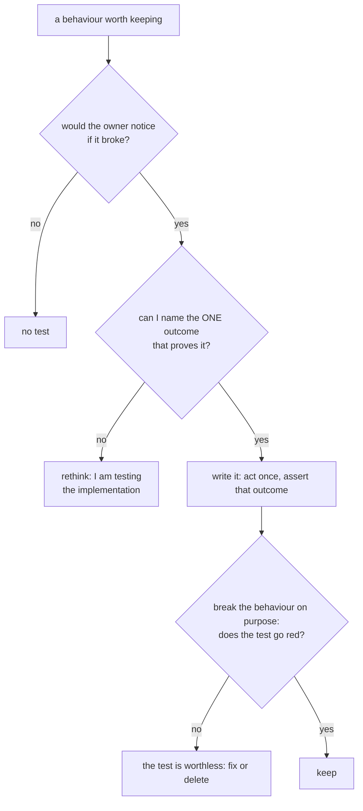

---
paths:
  - "**/*test*.*"
  - "**/*spec*.*"
  - "**/tests/**"
  - "**/test/**"
  - "**/e2e/**"
---
# Testing ground rules (every language)

Adopted 2026-10-25 (owner: "freeze only the most fundamental behaviours, so tests don't need
rewriting every time; tests must be able to fail and test meaningfully, not always pass or test
the wrong thing"). Sources: Google, *Software Engineering at Google* ch. 12 (test behaviours via
public APIs, prefer state over interactions, unchanging tests); Fowler, *TestPyramid* and
*Mocks Aren't Stubs*; Beck, red-green-refactor; mutation testing (a test that survives a deliberate
bug is not testing that code).

## 1. What to test (freeze the fundamentals only)
- **A test freezes a contract, not a design.** Test what a caller or the owner relies on: the
  public function, the CLI, the file a consumer reads, the message the owner sees. Not private
  helpers, call order, or how many times something is called.
- **Kinds allowed** (global CLAUDE.md testing contract): a sanity/smoke test, one test per
  acceptance criterion, and a regression test named after its incident. Nothing speculative.
- **The change test:** a refactor that keeps the behaviour must keep the tests green. If a harmless
  rename, reorder or rewording breaks a test, the test pinned implementation: loosen it.

## 2. How to assert (minimal, outcome-only)
- **One behaviour per test; 1-3 asserts on its outcome.** Act once, assert what it produced.
- Assert the **field that carries the behaviour**, not the whole object (`note in comment`, not
  `deepEqual(fullEnvelope)`), unless the exact shape IS the contract (a schema, a wire format).
- Match **meaning, not formatting**: `"#43" in reply`, not the full sentence. Exact strings only when
  the string is the requirement (a protocol token, a callback format with a byte limit).
- No assert on a value the test itself just set (tautology), and no assert on a mock's own return.

## 3. Make it able to fail (and prove it)
- **See it red once.** Before trusting a new test, break the behaviour (flip a condition, return
  early, drop the field) and confirm the test fails, then restore. Regression tests start red by
  construction: reproduce the bug first.
- **Mocks only at real boundaries** (network, clock, filesystem, subprocess, third-party APIs).
  Never mock the unit under test or its in-repo collaborators: a test of mocks passes forever.
- **Prefer real, cheap dependencies**: a temp directory, a real git repo in `tmp`, an in-memory db.
  These catch what a fake cannot (Foreman post-merge views 2026-10-24: call-string tests passed
  while the real git flow was broken).
- A test whose only assert is "no exception" or `is not None` tests almost nothing; assert what was
  produced.

## 4. Keep them trustworthy
- Deterministic: fixed seeds, injected clocks, no real network; never sleep to wait.
- Independent: no order dependence, no shared state; each test builds what it needs.
- Fast: unit tests in milliseconds; slow or live checks behind a flag (`NOTIFLY_LIVE=1`).
- A flaky test is a failing test: fix the cause or delete it, never retry it into green.
- Sandbox anything a test could write for real (autouse fixtures for spools, phones, prod paths).

## 5. Review checklist (apply before committing a test)
1. Which contract does this freeze, in one sentence?
2. What single outcome proves it?
3. Did I see it fail when the behaviour broke?
4. Would a behaviour-preserving refactor keep it green?
