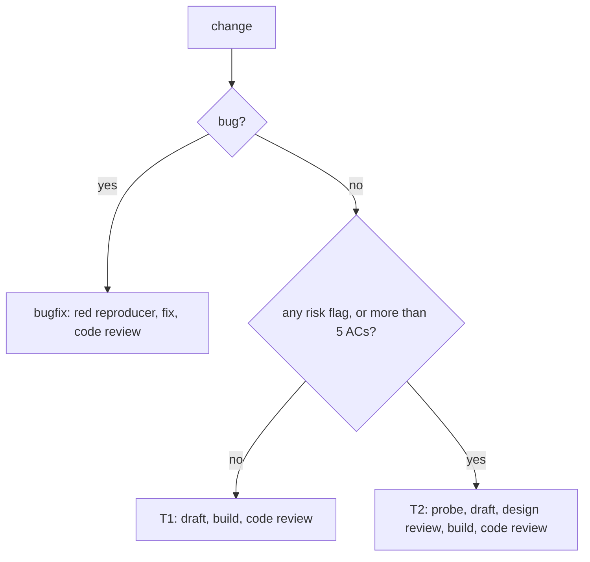

# Work-Item Standard v3: one README per change, effort scaled by risk

Adopted 2026-11-02 (owner: "run a minimally designed set for v3"). Research and rationale:
`D:/repo/docs/reports/Minimal spec lifecycle structure.md:1`. Decisions D38-D42 in `~/.claude/docs/DECISIONS.md`.
Built by work item `~/.claude/docs/work/spec-standard-v3/`. Glossary: `~/.claude/GLOSSARY.md`.

## Scope

- **Opt-in**: an item is v3 when its frontmatter says `standard: 3`. Without the key it is v2
  (`WORK-ITEM-STANDARD.md`), judged exactly as before. Shipped v2 items stay v2.
- **Same place, same lifecycle, same gate**: `docs/work/<id>/README.md` only, with `reviews/` and `evidence/` beside
  it. No layer files (one under a v3 item is an error). Statuses and moves are v2's
  (`contracts/work-item.lifecycle.v1.json`).
- **Types**: `feature` (also used for a service) and `bugfix`. Research, experiment, refactor, integration and
  data-collection stay on v2, and so does a change needing more than 15 ACs (split it, v2 nesting).
- **One enum source**: `contracts/work-item.v3.json` holds the frontmatter schema, risk flags, dimensions, levels and
  the flag-to-dimension map. Where this page and the contract differ, the contract wins.

## Tiers

The tier is computed, not chosen: a declared tier below the computed one is an error.

| Tier | Trigger | Stages | Agent-stage budget (expected / cap) |
|---|---|---|---|
| bugfix | one divergence from expected behaviour, 1-3 expected ACs | red reproducer, fix, code review | 2 / 4 |
| bugfix, flagged | a bugfix with any risk flag | probe, design review, red reproducer, fix, code review | 3 / 5 |
| T1 | 1-5 ACs, no risk flag | draft, red tests, build, code review | 2 / 4 |
| T2 | 6-15 ACs, or any risk flag | probe, draft, design review, red tests, build, code review | 6 / 9 |

- **Risk flags** (any one makes T2): `contract` (an API, schema, CLI or file format another part reads), `data`
  (migration, irreversible or user data), `security` (auth, secrets, payments, PII), `enforcement` (a gate, guard or
  hook that admits or refuses), `concurrency` (state changed by more than one actor), `removal` (a behaviour removed
  or narrowed), `live` (the repo's CLAUDE.md says `deploymentTier: live`; derived, and it also needs recorded human
  approval).
- **2 or more flags**: still T2, plus the security reviewer (`agents/security.md`) in design mode.
- **Budget**: a stage is one agent dispatch. Exhausting the cap stops the item as `repair-budget-exhausted`; it is
  never extended. Changes over 400 changed lines are code-reviewed in slices of at most 400 lines.
- **Frozen after lock**: once the committed copy is past `draft`, `standard` and `type` never change, and `tier` and
  `risk` never fall (a lowering needs a move back to `draft`, which the lifecycle allows only from `spec-locked`).
  They may rise: ACs or a flag added during the build that raise the computed tier are allowed, and that commit needs
  a fresh design record for the new content, exactly like a lock.

## Frontmatter

`id` (= folder), `type` (`feature` | `bugfix`), `standard: 3` (the integer), `status`, `touches` (theme tags),
`layers` (all four keys `none`: Catwalk reads them), `created`, `owner`, `risk` (required: a list, may be empty `[]`), and for a
feature `tier` (`T1` | `T2`). Refused: a duplicate key, `parent`, `children`, `nestTrigger`, `nestWhy`, a `standard`
other than 3, and `tier` or `risk` on an item without `standard: 3`.

## Sections (H2, exact titles)

The checker enforces presence, the table headers and the counts named below. Content limits marked *advisory* (Purpose
length, goal counts, Approach options, Contracts content) are review guidance, not checker rules.

| Section | Content | Required for |
|---|---|---|
| diagram | one Mermaid block before the first H2 | all |
| Purpose | the problem, who has it, why now; at most 5 lines (*advisory*) | feature |
| Goals and non-goals | 1-5 goals, at least 1 non-goal (*advisory*) | feature |
| Behaviour | the AC table, exactly one table | feature |
| Outcomes | the coverage table | feature |
| Approach | the chosen design and at least 2 options, a one-line verdict each (*advisory*) | T2 |
| Assumptions | `\| Assumption \| Observed \| If violated \|`; If violated is `keep`, `refuse`, `flag` or `defer`; Observed cites `path:line` that resolves | T2 |
| Probe | a link to the saved probe output under `evidence/` | T2, flagged bugfix |
| Contracts | name, version, schema path, valid and invalid fixtures (*advisory*) | flag `contract` |
| Symptom | one line naming the symptom, not the fix | bugfix |
| Reproduce | minimal numbered steps, or the reproducer test | bugfix |
| Expected | the AC table, 1-3 rows (more is a spec change, not a bug) | bugfix |
| Actual | verbatim output or error | bugfix |
| Must not change | `\| ID \| Must not change \| Test \|`, ids `MNC-n`, at least 1 row | bugfix |
| Root cause | facts apart from hypotheses, filled in at the fix | bugfix |
| Build amendments | `\| Change \| Why (what the test exposed) \| Test \|`, every Test cell filled (D37) | when present |

**AC table** (v2's, unchanged): `| AC | Traces | Given / when | Pass when | Fail when | Test |`, unique `AC-n`, at
most 15. Tests cite `<id>/AC-n` and `<id>/MNC-n` verbatim (checked from `building`).

## Outcomes: how many dimensions, at what detail

`| Dimension | Level | Row or n/a reason | AC |`, one row for each of the 12 dimensions: `success`, `invalid input`,
`dependency fails`, `timeout`, `crash mid-step`, `concurrent actor`, `duplicate or replay`, `arrival channel`,
`performance or cost`, `security`, `data and compatibility`, `operability`.

| Level | Meaning |
|---|---|
| L1 | cannot occur here: a reason of at least 3 words |
| L2 | stated in prose |
| L3 | an AC with pass and fail conditions (the AC column names it) |

- **Ready thresholds** (from `spec-locked`): T1 has `success` and `invalid input` at L3. T2 has no L2 rows. Every
  flag forces its dimensions to L3:

| Flag | Dimensions forced to L3 |
|---|---|
| contract | data and compatibility, arrival channel |
| data | data and compatibility, crash mid-step |
| security | security, invalid input |
| enforcement | invalid input, arrival channel |
| concurrency | concurrent actor, duplicate or replay |
| removal | data and compatibility |
| live | operability, dependency fails |

- **Executable share**: the L3 rows whose AC has a citing test, over all L3 rows. Done means 100%.
- A spec with a state machine may add per-stage outcome rows under Approach; they are not counted.

## Definition of ready (the lock, `draft` to `spec-locked`)

1. The declared tier is at least the computed tier.
2. Every required section is present; the AC table has 1-15 rows (bugfix 1-3), each with every cell filled.
3. No open-question marker (`[NEEDS CLARIFICATION`, `TBD` outside inline code) remains.
4. Outcomes meet the tier's thresholds.
5. Every cited local `path:line` resolves.
6. T2 and flagged bugfix: the probe is saved under `evidence/`, and a fresh `pass` design or verify record matches
   the item's hash (`scripts/review_record.py`). T1 and unflagged bugfix lock on the mechanical check alone.
7. Bugfix: the reproducer test is written and seen red for the stated reason (quoted in the red-test commit).

## Definition of done (the ship, `building` to `shipped`)

1. Every AC and MNC row has a test that cites it, seen red before the code, and the full suite is green.
2. A fresh code or verify `pass` record matches the hash and the commit. For a parser, guard or gate, the review ran
   an old-versus-new corpus diff and a mutation check on the AC lines.
3. Every change to the spec after the lock is listed in Build amendments with its test (D37).
4. Evidence is attached (the failing-to-passing test for a bug; a demo or before/after pair for a visible feature).
5. The deploy tier's gate is green; `live` also needs recorded human approval.

## Reviews

- **Probe** (T2, flagged bugfix): before the draft. The adversary's outcome-kind questions on the problem, the real
  tool run on real inputs, environment facts; saved to `evidence/probe.md` and cited by the Probe section.
- **Design review** (T2, flagged bugfix): one attempt; only breaking findings loop (D36); fix, verify the fix diff,
  then the architect on a second `fix-first`.
- **Code review** (every tier): runs the tests, a mutation check and, for parsers, guards and gates, a corpus diff. A
  missing risk flag seen in the diff is a breaking finding.
- **Code verify**: T1 and bugfix rerun the tests and mutants on the fix diff; T2 dispatches a verify review.

## Deferred to `gate-ci`

Living specs per feature, the `Spec: T0` trailer for trivial changes, measured LOC caps, commit-order and mutation
checks in CI, flags derived from changed paths, and code freshness at ship (D32). Until then, T1 and bugfix ships
rely on the code record, which is not yet tied to the code.

## Skeletons

~~~markdown
---
id: my-feature
type: feature
standard: 3
tier: T1
risk: []
status: draft
touches: [harness]
layers: {architecture: none, component: none, functional: none, data: none}
created: "2026-11-03"
owner: harness
---
# One-line title
(mermaid block)
## Purpose
## Goals and non-goals
## Behaviour
| AC | Traces | Given / when | Pass when | Fail when | Test |
## Outcomes
| Dimension | Level | Row or n/a reason | AC |
~~~

A bugfix swaps the feature sections for Symptom, Reproduce, Expected, Actual, Must not change and Root cause, and
drops `tier`.
