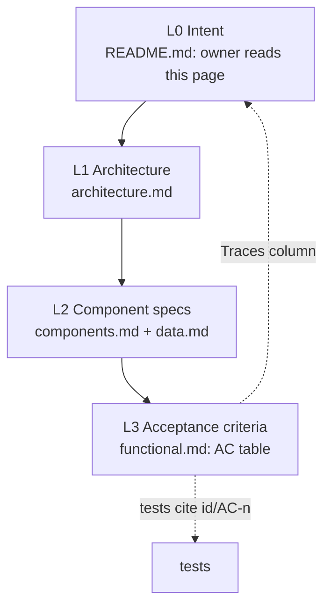
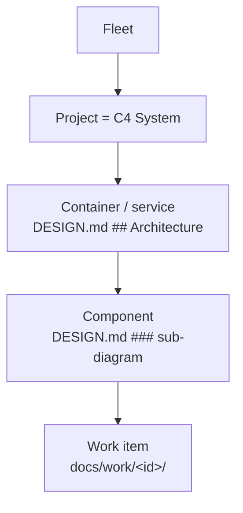
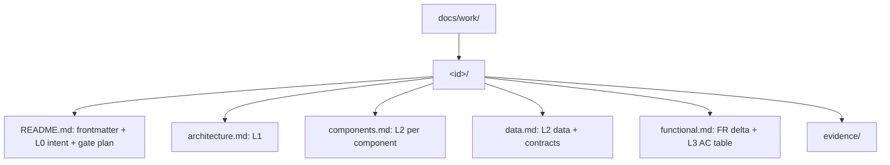
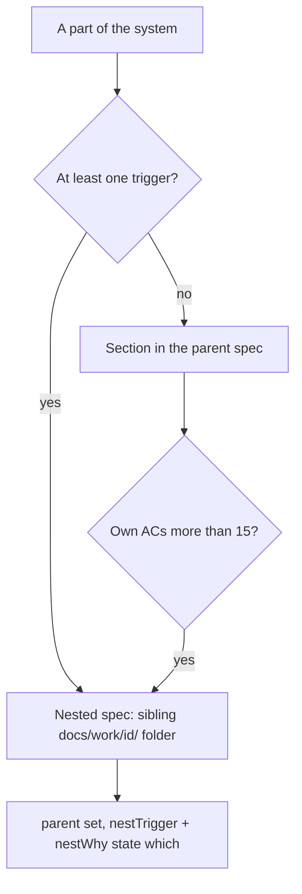
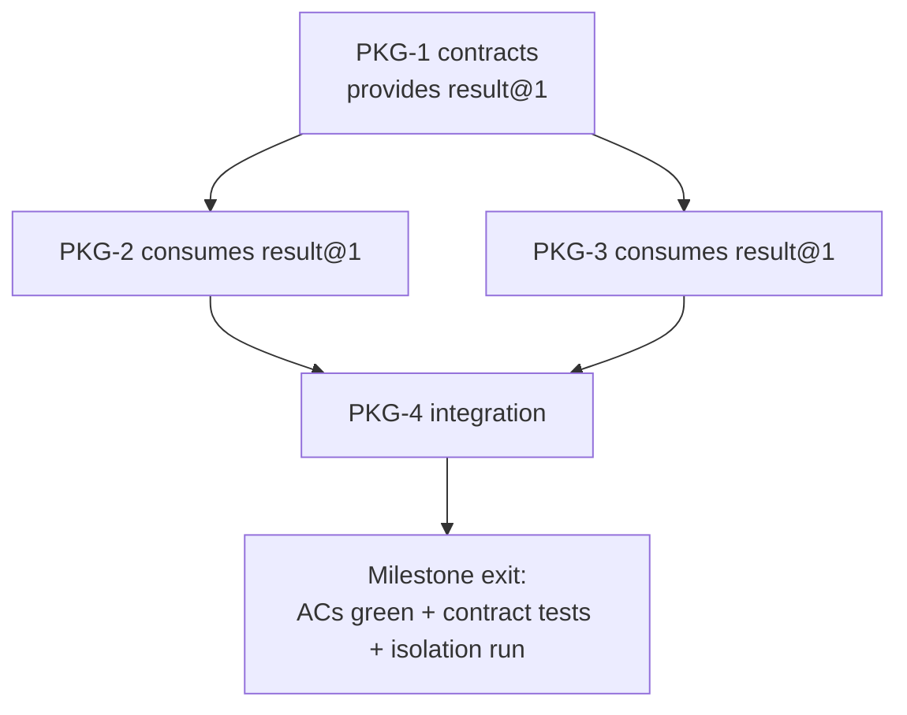

# Work-Item Standard v2 — one spec per change: L0 intent, L1 architecture, L2 components, L3 acceptance criteria

History: v1 adopted 2026-09-25 (C4 spine, `docs/work/<id>/`, per-layer before/after, per-type profiles; rendered by Catwalk, `D:/repo/Factory/catwalk/docs/work/c4-change-impact/`). **v2 adopted 2026-10-31**: merges the `docs/specs/<slug>.md` format (spec-gate, same day) into this standard, so there is one spec format, one folder, one checker. Changes are tagged **[v2]** below (tags stay until adoption is confirmed). Everything untagged is v1, unchanged.



## What v2 changes [v2]

| Area | v1 | v2 |
|---|---|---|
| Spec formats | work item folder AND `docs/specs/<slug>.md` (duplicate) | one: `docs/work/<id>/`. `docs/specs/` retired (see Migration) |
| Levels | 4 C4 layer files, no intent page | L0-L3 mapped onto the same files; L0 intent added to README |
| ACs | list in functional.md, free form | one table, one id scheme `<id>/AC-<n>`, each AC traced to a CAP, FR or NFR; more than 15 ACs forces a split |
| NFRs | free text | target + named verification method from a closed list |
| Nesting | undefined | trigger rule; a nested spec is a sibling work item with `parent:` |
| Enforcement | Phase 7.5 file-presence check | `spec_check.py` rules CK-1..CK-46 in tiers + git `Spec:` trailer |
| Frontmatter | id type status touches layers evidence | adds `created owner` (required by the checker) and optional `lifecycle parent children nestTrigger nestWhy supersededBy introducedBy`. Catwalk ignores the new keys |

## The spine (unchanged)



The C4 tree in `docs/DESIGN.md` is the only containment model. A work item attaches with `touches: [<arch node id>]`. A roadmap node's `partOf` names an architecture node id. Work-item nesting (below) is a separate, spec-to-spec relation and does not replace `touches`.

## Folder layout and level mapping [v2]



Work items stay at `docs/work/<id>/` (Catwalk already reads this path). `<id>` = folder name = frontmatter `id` = the string tests cite.

| Level | Lives in | Leads with (first block after the H1) | Must contain |
|---|---|---|---|
| **L0 Intent** | `README.md` | context diagram, a `flowchart` (the thing, its users, external systems) | see L0 below |
| **L1 Architecture** | `architecture.md` | `flowchart` with `subgraph Before` and `subgraph After` (containers) | components, lifecycle `stateDiagram` iff `lifecycle: true`, `sequenceDiagram` per main call chain |
| **L2 Components** | `components.md` (+ `data.md`) | `flowchart` with `subgraph Before` and `subgraph After` (components) | one `## <component>` section per component, see L2 below |
| **L3 Acceptance** | `functional.md` | flow/state diagram of the changed behaviour | FR delta (v1), the AC table |

"Visual first" is a rule: in each file the first block after the H1 is a ` ```mermaid ` fence (CK-6). Exempt: the README of `bugfix` and `research` items. A layer declared `none` has no file.

### Required headings per type, exact text (mechanical basis of CK-4) [v2]

Match is case-insensitive on the H2 text. "L0 full" headings: `Purpose`, `Non-goals`, `Capabilities`, `Non-functional requirements`, `Trade-offs`, `Patterns applied`, `Components chosen`, `Gate plan`. "L0 lite": `Purpose`, `Non-goals`, `Capabilities`, `Non-functional requirements`, `Gate plan`.

| type | README H2 headings required (in addition to the frontmatter) |
|---|---|
| feature | L0 full |
| integration | L0 full + `External contract` |
| data-collection | L0 lite + `Sample size`, `Stopping rule` |
| experiment | `Purpose`, `Non-goals`, `Gate plan`, `Hypothesis`, `Metric`, `Control vs variant`, `Kill/adopt threshold`, `Timebox`, `Result` (`Promoted to` added when status is `promoted`) |
| research | `Question`, `Sources`, `Findings`, `Recommendation` |
| bugfix | `Root cause`, `Observed vs expected`, `Acceptance criteria`, `Gate plan` |
| refactor | `Motivation`, `What got simpler`, `Acceptance criteria`, `Gate plan` |
| nested spec (any type with `parent`) | L0 lite (plus the type's own headings) |

`introducedBy` (bugfix) is a **frontmatter key**, format `<repo>#<issue>@<mergeSha>`, optional, not a heading.

| File | Required H2 headings |
|---|---|
| architecture.md | `Components` (feature, integration); `Work breakdown` iff the item is multi-package (components.md has >= 2 non-stub `##` component sections); `Lifecycle` iff `lifecycle: true`; `Call chains` (feature, integration, when `layers.architecture` is not `none`) |
| components.md | one `## <component>` per component (feature, integration); other types: none required |
| functional.md | `FR/NFR delta`, `Acceptance criteria` |
| data.md | `Schema`, `Contracts`, `Migration and back-compat` |

"Required" below means: the layer is declared and its value is not `none`. "Required (may be none)" means: declared, any value. "Forbidden"/"must be none" means the value is `none`. "Optional" means any value.

### L0 Intent (README.md body, one page) [v2]

Sections in order, exact H2 headings (these do not collide with Catwalk's experiment-card headings Hypothesis/Metric/Result/Promoted when the type is feature or integration):

1. `## Purpose` and `## Non-goals`.
2. `## Capabilities`: rows `| CAP | Statement |`, ids `CAP-<n>`. Statement forms: "The user can …", "The service must …", "The service must not …". Guidance 5-10 rows: fewer means the item is too thin for a full L0 and more means it is two items; the checker lints the range (warn), it is not a hard rule. Every capability is traced by at least one AC (CK-12).
3. `## Non-functional requirements`: `| NFR | Target | Method | Evidence |`, ids `NFR-<n>`. Target is measurable. Method starts with a kind token from the list below. Evidence has the exact format below. Every NFR is traced by an AC (CK-10).
4. `## Trade-offs`: `| Option | Latency | Cost | Maintenance | Extensibility | Refactorability | Verdict |`, at least 2 rows, exactly one verdict `chosen`.
5. `## Patterns applied`: `| Pattern | Where | Why |`, at least 1 row.
6. `## Components chosen`: `| Need | Chosen (off the shelf) | Rejected | Why rejected |`, at least 1 row. A need built in-house says so in "Chosen" and states why nothing off the shelf fit.
7. `## Gate plan` (v1): risk, deterministic|qualitative, check, blocking|advisory.
8. Multi-package items also carry `## Overview` (at most 300 words; see Context packs). Type-specific sections from the heading table.

**Evidence cell format:** one or more tokens joined by ` + `: `AC-<n>`, `config:<repo-relative path>`, `decision:<R-id>` (the `DECISIONS.md` row id). Regex: `^(AC-\d+|config:[^\s+]+|decision:[\w.-]+)( \+ (AC-\d+|config:[^\s+]+|decision:[\w.-]+))*$`. Example: `AC-7 + config:.dependency-cruiser.cjs`.

NFR verification kinds (closed list; the `Method` cell starts with the kind token):

| Kind token | Meaning | Evidence is |
|---|---|---|
| `fault-injection` | behaviour test with injected faults | `AC-n` |
| `latency-bench` | benchmark with a budget assertion | `AC-n` |
| `cost-budget` | test over recorded tokens/$ against a budget | `AC-n` |
| `extensibility` | a new plug-in added with no core change, asserted by test | `AC-n` |
| `fitness` | architecture fitness function: import-boundary rules (dependency-cruiser / import-linter), size or complexity caps | `AC-n + config:<path>` (the AC's test runs the rule) |
| `observability` | observability contract test (required spans/metrics/log fields exist) | `AC-n` |
| `clock-kill` | clock and process-kill injection | `AC-n` |
| `spike` | time-boxed spike ending in a decision | `AC-n + decision:<R-id>` |

### L1 Architecture (architecture.md) [v2]

Before/after container flowcharts first. Then `## Components` (one-line role per component, matching L2 section names), `## Lifecycle` (a `stateDiagram-v2`; the section exists if and only if README `lifecycle: true`), and `## Call chains` (one `sequenceDiagram` per main call chain, at most 5 participants each, hard rule CK-22). Lifecycle stages are sections of the parent spec, not nested specs, unless they are plug-in points (then trigger `contract`). A multi-package item adds `## Work breakdown` here (see Work breakdown).

### L2 Component specs (components.md, data.md) [v2]

components.md keeps the before/after diagram and, for single-package items, an owned-files table (multi-package items carry `owns` in the Work breakdown instead), then one `## <component>` section per component. Each full section has these H3s in order: `### Interface`, `### Functional requirements` (`FR-<n>` ids, unique per work item), `### Data`, `### Failure modes` (`| Failure | Detection | Handling |`), `### Budget` (latency and cost, numbers). A **nested stub** is a `## <component>` section with no H3 whose first non-blank line starts `Nested spec: ` followed by `docs/work/<child-id>/`; it is exempt from the five H3s and must name an existing child in `children`. data.md is the shared data contract and the contracts register (`## Contracts`, exact columns in Work breakdown) that `### Data` sections link to rather than duplicate.

### L3 Acceptance criteria (functional.md) [v2]

FR delta (v1), then `## Acceptance criteria` with exactly this header:

`| AC | Traces | Given / when | Pass when | Fail when | Test |`

- `AC` = `AC-<n>`, unique.
- `Traces` = comma-separated `CAP-n`, `FR-n`, `NFR-n` defined in the same work item. No cross-item traces: a nested spec's ACs trace its own CAP/FR/NFR.
- `Test` = repo-relative test files, comma separated, optional `::node` suffix.
- Tests cite `<id>/AC-<n>` verbatim.
- For bugfix and refactor the same table lives in README under `## Acceptance criteria`, and `Traces` may be `-`.
- At most 15 AC rows per work item (CK-23).

## README.md frontmatter (machine-read by Catwalk) [v2: extended]

```yaml
id: <slug>                 # = folder name; matches roadmap node id / backlogItems id
type: feature | experiment | research | bugfix | refactor | integration | data-collection
status: draft | spec-locked | building | shipped | killed | promoted
touches: [<DESIGN.md node id>, ...]
layers:                    # EVERY layer declared, including "none"
  architecture: added | modified | removed | none
  component:    added | modified | removed | none
  functional:   added | modified | removed | none
  data:         added | modified | removed | none
evidence: { demo: evidence/demo.webm, before: evidence/before.png, after: evidence/after.png }
# --- v2 additions; Catwalk's zod schema strips unknown keys, so none is read by it ---
created: "YYYY-MM-DD"      # QUOTED string (YAML would parse a bare date as a date object); checker-required
owner: <name>              # checker-required
lifecycle: true | false    # default false
parent: <id>               # nested spec only
children: [<id>, ...]      # parent only; mirrors children's `parent`
nestTrigger: [contract | boundary | team | size]   # required iff parent is set
nestWhy: <one sentence of evidence per trigger>    # required iff parent is set
supersededBy: <id>         # only with status killed
introducedBy: <repo>#<issue>@<mergeSha>            # bugfix, optional
packBudgetWords: <n>       # optional; context-pack word budget, default 2500 (CK-46)
```

### Status set (Catwalk's six, unchanged) [v2]

| Status | Meaning | Old `docs/specs` status |
|---|---|---|
| `draft` | being written; placeholders allowed | `draft` |
| `spec-locked` | reviewed and approved; static checks pass; tests may not exist yet | `locked` |
| `building` | implementation in progress; red/green tests exist and cite the ACs | (none) |
| `shipped` | merged, gate green | `done` |
| `killed` | abandoned or superseded (`supersededBy` allowed) | `superseded` |
| `promoted` | experiment adopted into a new feature item | (none) |

Flow: `draft` → (review) `spec-locked` → commit red tests (gate-exempt) → flip to `building` → source commits → `shipped`. `kind` is retired: `feature`→`feature`, `fix`→`bugfix`, `build`→`feature` (or `integration` when mainly a new external edge).

## Per-type profiles [v2: L0 and AC columns added]

| type | architecture | component | functional | data | type-specific section | review evidence | L0 | AC table | Work breakdown |
|---|---|---|---|---|---|---|---|---|---|
| **feature** | required (may be none) | required | **required** | required (may be none) | acceptance criteria | demo video or before/after | **full** | functional.md | required if multi-package, else omitted |
| **experiment** | must be none (promotion opens a feature item) | optional | optional | optional | see heading table | result table or chart; on adopt, `promoted` and a new feature item | experiment form | optional | none |
| **research** | must be none | must be none | must be none | must be none | see heading table | findings doc | none | none | none |
| **bugfix** | optional (only if structural) | optional (the layer that held the bug) | optional (observed vs expected) | optional | root cause; `introducedBy` key | failing → passing regression test | none | README, 1+ rows | none |
| **refactor** | **required** before/after | **required** before/after | must be none | required (may be none) | motivation · what got simpler (measured) | before/after diagrams | none | README, rows assert unchanged tests | none |
| **integration** | **required** | required | required | **required** (the contract) | `External contract` | contract test + demo | **full** | functional.md | required if multi-package, else omitted |
| **data-collection** | must be none | optional | optional | **required** | sample size · stopping rule | sample + row count | lite | functional.md if present, else README | none |

Bugfix and refactor stay light: no L0, no L1-L2 beyond the layers declared. Experiment form = the experiment row of the heading table (no Capabilities/NFR). Why experiments differ (v1): an experiment may be wrong; on a win the real change is a new `feature` item.

## Nesting rule and size split [v2]



Triggers (token → test):
- `contract`: it has its own contract other code calls (plug-in point, public API, schema consumed elsewhere).
- `boundary`: an independent test or deploy boundary.
- `team`: a different owner or agent team, or a different migration step.
- `size`: the parent's ACs plus its children's ACs total more than 15 (the work would not fit one spec).

**One number: more than 15 AC rows in one work item is an error unless that item has `children` (CK-23).** A parent with children and more than 15 own rows gets a warning (move rows into children). A nested spec is a sibling work item `docs/work/<child-id>/`, a full v2 folder with its own AC ids `<child-id>/AC-<n>`; it is not a subfolder, because Catwalk lists top-level folders only. The parent lists it in `children:` and in a nested stub in components.md. A part with no trigger stays a section (for example lifecycle stages).

## Work breakdown, contracts, isolation, milestones, context packs [v2]

Purpose: the spec cuts the work into **packages** that separate agent teams take in isolation, and each agent receives only its own boundary plus a short overview. It builds on the dark-factory contract cycle (`REFERENCE.md` section 3: contract artifact first, `owns` pairwise disjoint, contract landed as its own PR, fan-out, integration last), the coupling map, and Foreman's `contract-first-parallel-dispatch` / `contract-only` mode. What it adds is that the **spec's Work breakdown table is the single authoritative source** of those dispatch facts, so the same facts are never written twice.

Reconciliation with `REFERENCE.md:759` ("anything larger becomes child work items so Foreman can run them concurrently"): packages inside one work item are the default unit of parallel work; Foreman runs a package as a backlog child (`parent / owns / dependsOn / contract`). A separate child work item (nested spec) is used only when a nesting trigger holds. Foreman today takes its children from hand-written `backlogItems`; generating them from this table is a Foreman follow-up (open question 6). Until then CK-43 warns when the two disagree.



### Scope and where it lives
- **Multi-package** means: `components.md` has two or more non-stub `##` component sections (the predicate `P`). Packages and components are 1:1. Everything below applies to `feature` and `integration` items (and `build`, which maps to feature) where `P` holds. When `P` does not hold the item is single-package: no Work breakdown is needed, `layers.architecture` may stay `none`, and CK-27..CK-46 are skipped. A `Single package.` section is tolerated only when `P` does not hold (CK-27).
- `## Work breakdown` is an H2 in **architecture.md** (L1; components.md is not used because CK-16 treats every `##` there as a component). When `P` holds, `layers.architecture` must not be `none`. CK-4 requires the heading in exactly that case.
- The contracts register is the `## Contracts` table of **data.md**. When any package provides or consumes a contract, `layers.data` must not be `none`.
- A component that is a nested stub is never a package: it is a separate work item, consumed through `ext:` contracts.

### The table
Header exactly: `| Package | Component | Owns | Provides | Consumes | Depends on | Milestone | ACs | Test seam |`

| Column | Format |
|---|---|
| Package | `PKG-<n>`, unique; plus exactly one reserved row `SHARED` |
| Component | the name of a non-stub `## <component>` section in components.md, unique per package; `-` on the SHARED row |
| Owns | comma-separated globs in the Foreman dialect (below) |
| Provides / Consumes | comma-separated `<contract-id>@<version>` (integer), or `-`. A consumed contract from another work item is `ext:<item-id>:<contract-id>@<version>` |
| Depends on | comma-separated `PKG-<n>`, or `-` |
| Milestone | `M<n>` |
| ACs | comma-separated `AC-<n>`, at least one (`-` on SHARED) |
| Test seam | ` + `-joined tokens `fixtures:<contract-id>@<version>` and/or `stub:<repo-relative path>`; or `none` when Consumes is `-` |

The **SHARED** row owns root files that belong to no package (package.json, tsconfig, lockfiles, CI config): `Component -`, Provides/Consumes/Depends `-`, ACs `-`, milestone `M1`. A change to a shared file is made in its own package or in the integration cycle, never inside a component package. The integration/e2e ACs belong to a package of their own, normally the last (depends on all others, owns `tests/e2e/**` or equivalent).

### Glob dialect and overlap (ported from Foreman, not a second dialect)
Source of truth: `D:/repo/Factory/foreman/core/ownership.js` (`isSafeGlob`, `normalizeGlob`, `globsOverlap`, `matchGlob`); its tests are `D:/repo/Factory/foreman/test/core/ownership.test.js`.
- Charset `[A-Za-z0-9._\-/*?]` only; no leading `/`; no `..` segment. Anything else in an Owns cell is an error and, as a pair, is treated as overlapping.
- Normalize: strip a leading `./`; a trailing `/` becomes `/**`; fold case to lower (Windows). Foreman is case-sensitive today; aligning it is part of its follow-up.
- Semantics: `**` any number of segments (zero included), `*` any characters within a segment, `?` one character.
- Overlap = Foreman's conservative `globsOverlap`: true unless provably disjoint; unparseable overlaps everything. The checker ports that algorithm; it does not use a different lexical rule.
- **Shared contract vectors:** one JSON file of glob-pair overlap vectors, `~/.claude/contracts/glob-overlap.v1.json` (seed: `templates/glob-overlap.v1.json` next to this file). `spec_check.py`'s test and Foreman's ownership test both load it (contract-test rule of `rules/testing.md` section 5), so the two implementations cannot drift. Wiring Foreman's test to it is a Foreman follow-up; a missing vector file fails the test, it is never skipped.

### Contract rules
1. A contract is a versioned schema file (zod or JSON Schema) named `<contract-id>.v<version>.<ext>`, listed in the data.md Contracts table, owned by exactly one package (its provider). The contract package is an ordinary package with the earliest milestone.
2. Contracts table header exactly: `| Contract | Version | Schema file | Provider | Valid fixtures | Invalid fixtures | Digest | Status |`. Fixture cells are repo-relative globs whose directory segment is `valid` / `invalid`. `Status` is `current` or `retired`. Each contract ships at least one valid and one invalid fixture.
3. Producer and consumer both run contract tests against those fixtures (`rules/testing.md` section 5).
4. A breaking change adds `<id>.v<n+1>.<ext>` and a new row; the previous row becomes `retired` and stays while any package consumes it (a retired row nobody consumes is a warning to delete). Versions per id strictly increase; the highest is `current`. A published version is never edited in place; the `Digest` enforces this.
5. **Digest** = `sha256:<hex>` over the text `schema <sha256 of schema file>\n` followed by one line `<path> <sha256>\n` per fixture file (valid and invalid), sorted by repo-relative path; files hashed with CRLF normalized to LF. It stays blank until the contract package merges (the provider package prints it with `spec_check.py --digest <contract-id>@<version>` and the merge commit records it). A non-blank digest that differs from the files fails (CK-42): a changed contract needs a version bump.
6. Contracts lock first: the contract package's milestone is strictly earlier than every consumer's. Under Foreman the contract package merges as its own PR (`contract-only`); that merge is the exit condition for fanning out (REFERENCE section 3 step 3). "Owned by nobody after it lands" in REFERENCE means no consumer may edit it.
7. **Stubs** live inside the contract **provider's** `owns`, next to the contract's fixtures, versioned and contract-tested with them. Reason: a consumer-owned stub is a second implementation of the contract per consumer and drifts; a provider-owned stub changes only with the contract, and one team keeps schema, fixtures and stub consistent. A consumer references the stub in its Test seam and never edits it.

### Isolation rule
A package must be buildable and testable with only its own owned files plus the locked contract schema files, fixtures and stubs it consumes, plus the SHARED files. It may not import another package's internals. Two checks:
1. **Static:** an import-boundary fitness check (dependency-cruiser or import-linter), the NFR kind `fitness` (CK-38). Rule: files matched by package P's `owns` may import only P's own files, third-party packages, the SHARED files, and the consumed contracts' schema files and stubs.
2. **Observed:** each package builds and tests in a sparse checkout containing only that set. `spec_check.py --sparse <PKG-id>` prints the set (one glob per line; the same derivation the context pack uses). The item's Gate plan names the gate command that does the sparse checkout and runs the package's build and test (CK-41); a milestone is not exit-green until it passes for every package in it.
Generating the dependency-cruiser config from the table, as Foreman's `gen-architecture.mjs` generates the C4 model, is a recommended follow-up; until then design review checks it matches the table.

### Milestones
A milestone `M<n>` is the set of packages with that milestone value. Exit condition: every AC listed for those packages is green, the integration cycle's contract tests pass for every contract they provide or consume (REFERENCE section 3 step 5), and the isolation run passes for each package. Every package depends only on packages in strictly earlier milestones, so packages in one milestone are independent and can be dispatched in parallel worktrees. Milestones are contiguous from `M1`. The checker validates the structure and runs no tests.

### Context packs (minimum context per agent) [v2]
An agent receives exactly two things: a short holistic overview and its own boundary.
1. **Overview.** Every multi-package item has a README `## Overview`: purpose, the capabilities (each `CAP-n` id named), the package flowchart, and the milestone list (each `M<n>` named). At most 300 words, not counting the fenced diagram (CK-44). It is the only holistic text an agent receives.
2. **Pack.** `spec_check.py <README> --pack <PKG-id>` deterministically emits to **stdout** a markdown pack with exactly these sections, in order: `# Pack: <id>/<PKG-id>`; `## Overview` (the README Overview, verbatim); `## Package` (that package's table row, verbatim); `## Component` (that component's whole `##` section from components.md, verbatim); `## Contracts` (for each contract it provides or consumes: the Contracts-table row, schema file path, fixture globs, and the schema text inline when the file is at most 200 lines); `## Acceptance criteria` (the AC table header plus only this package's rows); `## Test seam` (the cell, and the stub and fixture paths); `## Owns` (the globs). Nothing else: no other component sections, no other package's row or ACs, no other README sections. The generator refuses (exit 1, findings printed) if the STATIC rules fail.
3. **Stdout, not files.** The pack is derived, so the spec stays the only source; a checked-in `packs/` folder would go stale, add generated files to review and collide across parallel agents. The cycle records the pack it dispatched in its trace folder `docs/work/<id>/cycles/<cycleId>/` (the cycle already writes there), which gives an audit trail without a second source. A pack is never hand-edited.
4. **Budget.** Default 2,500 words per pack (override with optional frontmatter `packBudgetWords: <n>`). CK-46 warns when a pack exceeds it: the package is too big and should split.
5. **Dispatch (follow-ups, nothing wired yet).** `workflows/cycle.js` and Foreman's dispatch hand the pack, not the whole spec, to implementer prompts for multi-package items. Reviewers get the pack plus the full text of the consumed contract schema and fixture files. A designer working at L1 gets the whole spec. Single-package items are small and receive the whole spec. The `brief` skill (`~/.claude/skills/brief/`) is LLM-written and non-deterministic, so it is not the generator; its role-to-context idea stands, and it may embed the pack.

### Checker rules CK-27..CK-46 (CK-1..CK-26 unchanged) [v2]

Binding sets are those of the Checker requirements section: STATIC = {spec-locked, building, shipped}, EXEC = {building, shipped}, SHIPPED = {shipped}. All rules apply only when the item is feature or integration and `P` holds, except CK-27's `Single package.` check.

| Rule | Binds at | Check | Fail fixture | Pass fixture |
|---|---|---|---|---|
| CK-27 | STATIC | table present with the exact header, a flowchart fence first, >= 2 package rows plus exactly one `SHARED` row, unique ids; `Component` resolves to a distinct non-stub components.md section; the body is not `Single package.` when `P` holds; `layers.architecture` not `none` (`layers.data` not `none` when any contract token) | `Single package.` with 2 components; Component is a nested stub; two packages share a component | 2 packages + SHARED |
| CK-28 | STATIC | each Owns cell is non-empty and in the dialect charset; no two rows (SHARED included) overlap, using the ported algorithm and checked against the shared vectors file | `src/**` with `src/a/**`; `src/{a,b}/**`; `Src/A/**` with `src/a/**` | `src/a/**` with `src/b/**` |
| CK-29 | STATIC | if any Provides/Consumes token exists, data.md and its Contracts table must exist (else error naming the missing piece); exact header; kebab-case id; integer version strictly increasing per id; highest is `current`, others `retired`; schema file ends `.v<Version>.<ext>`; fixture globs have a `valid` / `invalid` segment; Provider is a package id; every `current` row is in exactly its Provider's Provides; a `retired` row consumed by nobody is a warning | consumed contract with no data.md; two current versions of one id; `.v1` file on version 2 | v1 retired + v2 current |
| CK-30 | STATIC | every non-`ext:` Consumes token resolves to a row (current or retired); an `ext:` token names the parent, a child or a sibling item, whose data.md must exist and hold the row; the item graph over `ext:` edges is acyclic | consumes `result@3` with only v1, v2; `ext:` to an item with no data.md; items A and B `ext:` each other | consumes `result@1`; `ext:` to a child |
| CK-31 | STATIC | each contract's schema file and fixture globs are matched by the provider's Owns and by no other row | schema under another package's glob | all inside the provider |
| CK-32 | STATIC | every Depends-on id exists, is not itself, graph acyclic (the finding prints the cycle) | PKG-2 and PKG-3 depend on each other | diamond graph |
| CK-33 | STATIC | for every consumed (non-`ext:`) contract the provider is **reachable** from the consumer over Depends-on (direct or transitive) | provider unreachable | consumer depends on X, X on provider |
| CK-34 | STATIC | package ACs cells (SHARED excluded) partition the AC table: each AC in exactly one package, every listed id exists | AC-3 twice; AC-9 absent; AC-4 in none | each once |
| CK-35 | STATIC | milestones `M<n>` contiguous from M1; for every direct dependency d of p, milestone(d) < milestone(p) | same milestone as provider; M1 then M3 | provider M1, consumer M2 |
| CK-36 | STATIC | Test seam tokens well formed; `none` only when Consumes is `-`; every consumed contract (including `ext:`) has a `fixtures:<contract>@<version>` token that resolves to a provider contract row; each `stub:` path is matched by the Owns of the provider of a consumed contract and by no other row | seam `none` while consuming; `fixtures:` for an unknown contract; stub path under the consumer's own Owns | `fixtures:result@1 + stub:fixtures/result.v1/stub.ts` |
| CK-37 | EXEC | each schema file exists; each Valid and Invalid fixture glob matches >= 1 file; each `stub:` path exists; for `ext:` contracts the same checks run on the other item's real files | invalid glob matches nothing; `ext:` provider file missing | all present |
| CK-38 | STATIC | README has >= 1 NFR whose Method begins `fitness` and whose Target contains the word `import` (lint; CK-24 checks its `config:` file at EXEC) | no fitness NFR | NFR "no import across package owns" |
| CK-39 | EXEC | for every contract a package provides or consumes, at least one test file named by that package's ACs contains the contract's schema path or fixtures directory path (substring; proves reference, not execution) | consumer tests never mention the fixtures | both sides mention them |
| CK-40 | EXEC | expand every row's Owns over `git ls-files` (excluding Foreman's `SHARED_BOOKKEEPING_GLOBS`, e.g. `docs/work/**`); every tracked file matches at most one row | a tracked file matched by two rows | each file at most once |
| CK-41 | STATIC | README Gate plan has a blocking row whose Check starts `isolation:` and names the sparse-checkout build/test gate command | no such row, or it is advisory | blocking `isolation:` row |
| CK-42 | EXEC | a non-blank `Digest` equals the recomputed digest; at SHIPPED every `current` row's Digest is non-blank | edited schema, same version, stale digest; blank at `shipped` | matching digest |
| CK-43 | STATIC (warning only) | each `docs/STATE.md` backlogItems child whose `parent` is this item (id `<item-id>-pkg-<n>`) agrees with its row: `owns` set-equal to Owns, `dependsOn` equal to Depends-on, `contract` is one of the provided schema files | child owns differ from the table (warns) | child matches |
| CK-44 | STATIC | README `## Overview` exists, <= 300 words excluding fenced blocks, holds a mermaid flowchart, names every `CAP-n` and every `M<n>` of the table | 301 words; missing `M2` | 280 words, all named |
| CK-45 | tool contract | `--pack <PKG>` output has exactly the 8 parts above in order; it contains no AC id outside the package's ACs, no other component's `##` heading, no other package row, no README section but Overview. Tested on fixtures against a golden pack; not run per item | pack for PKG-2 contains PKG-3's AC-3 or `## <component-b>` | golden pack for PKG-2 |
| CK-46 | STATIC (warning only) | each package's pack word count <= budget (default 2,500) | pack of 2,912 words warns "split the package" | 1,800 words |

## Where the commit gate points [v2]

The git commit-msg hook's `Spec:` trailer names the README: `Spec: docs/work/<id>/README.md` (no `..`, `<id>` equals the folder). The hook runs `spec_check.py <README> --for-source-commit`:
- A commit that stages a source file is accepted only when status is `building` or `shipped` (CK-26).
- `spec-locked` is valid only on gate-exempt commits (tests, docs, config), where a trailer is optional; if present it is checked with the static tier.
- All other scope rules (default branch, exempt subject types, merges, timeouts, any git error rejects) are unchanged from spec-gate.
A parent's code commit names the parent; a child's code commit names the child.

## Checker requirements (testable rules for `spec_check.py`) [v2]

Interface: `spec_check.py <path/to/README.md> [--root <repo>] [--for-source-commit]`. `--root` defaults to `README.parents[3]` (README is `<repo>/docs/work/<id>/README.md`). Output: one line per finding, `<rule-id>: <file>: <message>` for errors, `warn: <rule-id>: <file>: <message>` for warnings. Exit 0 when there are no errors (warnings alone exit 0), 1 on any error, 2 on unreadable input. Frontmatter is parsed with PyYAML `yaml.safe_load` (installed, 6.0.1; the existing hand-rolled `key: value` parser cannot read `layers:` or lists and is replaced); a non-mapping or parse failure is a CK-1 error. Each rule needs one failing and one passing fixture, written before the code. Headings are matched per the heading tables; a `Traces` cell is split on commas.

**Tiers (explicit sets, no ordering):**
- ALWAYS = every status: CK-1, CK-2, CK-3, CK-18.
- `killed`, `promoted`: ALWAYS plus CK-21.
- STATIC = {`spec-locked`, `building`, `shipped`}: ALWAYS + CK-4..CK-17, CK-19, CK-21..CK-23, CK-27..CK-36, CK-38, CK-41, CK-43, CK-44, CK-46 (the last of which and CK-43 only warn; CK-27..CK-46 apply to multi-package feature and integration items). CK-23 (more than 15 ACs needs children) binds at STATIC only: a `draft` may exceed 15 while being written.
- EXEC = {`building`, `shipped`}: STATIC + CK-20, CK-24, CK-37, CK-39, CK-40, CK-42.
- SHIPPED = {`shipped`}: EXEC + CK-25.
- `draft`: ALWAYS only (placeholders and missing sections are allowed).
- `--for-source-commit` adds CK-26.

| Rule | Check | Tier |
|---|---|---|
| CK-1 | frontmatter parses and has `id`, `type`, `status`, `touches`, `layers` (all four keys), `created` (a string matching YYYY-MM-DD; a date object is an error "quote it"), `owner` | ALWAYS |
| CK-2 | `type`, `status`, `layers.*` in their enums; `id` equals the folder name; `nestTrigger` tokens (if any) in the enum | ALWAYS |
| CK-3 | each layer not `none` has its file; a `none` layer with a file is a warning; per-profile constraints: experiment, research and data-collection `architecture` is `none`; research all four `none`; refactor `functional` is `none`; feature `functional` and `component` are not `none`; integration `architecture`, `component`, `functional`, `data` all not `none`; refactor `architecture` and `component` not `none`; data-collection `data` not `none` | ALWAYS |
| CK-4 | every README H2 and layer-file H2 listed for the type in the heading tables exists | STATIC |
| CK-5 | `Trade-offs` has the 7-column header, >= 2 rows, exactly one `chosen`, no empty cells; `Components chosen` (4 columns) and `Patterns applied` (3 columns) have >= 1 row | STATIC, L0 full |
| CK-6 | first block after the H1 of README and each layer file is a `mermaid` fence (bugfix and research READMEs exempt); README fence begins with `flowchart`; architecture.md and components.md fences contain `subgraph Before` and `subgraph After` | STATIC |
| CK-7 | `Capabilities` rows have unique `CAP-n`, statement starts with "The user can", "The service must" or "The service must not"; row count outside 5-10 is a warning on L0 full, outside 1-10 an error on lite | STATIC |
| CK-8 | LINT: each NFR has a unique `NFR-n`, non-empty Target containing a digit or one of the symbols `<=`, `>=`, `<`, `>` or the whole words `no`, `zero`, `never`, and a non-empty Evidence. It cannot judge whether a target is meaningful; design review is the real check | STATIC |
| CK-9 | each NFR `Method` begins with a kind token from the closed list | STATIC |
| CK-10 | static NFR coverage: every `NFR-n` appears in the Traces of >= 1 AC; Evidence matches the regex; each `AC-n` token resolves to an AC row in this item whose Traces include that NFR; `fitness` Evidence has an `AC` and a `config:` token; `spike` has an `AC` and a `decision:` token | STATIC |
| CK-11 | AC table header is exactly `\| AC \| Traces \| Given / when \| Pass when \| Fail when \| Test \|`; >= 1 row; unique `AC-n`; no empty cell (except `Traces` = `-` for bugfix/refactor); table found in the file the profile names | STATIC (types with an AC table) |
| CK-12 | every `CAP-n` appears in the Traces of >= 1 AC | STATIC (feature, integration, data-collection, nested) |
| CK-13 | every Traces token resolves in this same item: `CAP-n` in README, `FR-n` in components.md, `NFR-n` in README | STATIC |
| CK-14 | every `FR-n` in components.md is traced by >= 1 AC (warning) | STATIC |
| CK-15 | `## Lifecycle` exists in architecture.md iff `lifecycle: true`, and then holds a `stateDiagram`; `## Call chains` holds >= 1 `sequenceDiagram` (feature, integration, `layers.architecture` not `none`) | STATIC |
| CK-16 | each `## <component>` section of components.md that is not a nested stub has the five H3s in order; a nested stub names a child listed in `children` | STATIC (feature, integration) |
| CK-17 | `parent` set => `nestTrigger` non-empty and `nestWhy` non-empty; `size` additionally requires own + sibling AC rows under that parent > 15 | STATIC |
| CK-18 | `parent` and `children` mirror: the parent folder exists and lists this id; each listed child exists and names this parent | ALWAYS |
| CK-19 | placeholder leftover: no table cell or frontmatter value matches `<(?:\.\.\.\|[A-Za-z_][^<>
]*)>` (so `<Option A>`, `<need>`, `<what is timed>`, `AC-<n>`, `<...>` are rejected), or contains `YYYY-MM-DD` or the word `EXAMPLE`. The comparison operators `<`, `>`, `<=`, `>=` are exempt when standing alone or when `<` is followed by a space or digit | STATIC |
| CK-20 | AC test citation: every AC row names >= 1 test file that exists and whose text matches `(?<![\w/-])<id>/AC-<n>(?!\d)`. This proves the test cites the AC, not that it runs or passes; execution is proved by the gate command and CI | EXEC |
| CK-21 | `supersededBy` only with `killed` (error otherwise) and names an existing item folder; `promoted` requires type `experiment` | killed, promoted, STATIC |
| CK-22 | each `sequenceDiagram` has <= 5 participants (hard rule) | STATIC |
| CK-23 | own AC rows > 15 and no `children` is an error; > 15 with `children` is a warning | STATIC |
| CK-24 | external NFR evidence: each `config:` path exists in the repo; each `decision:` row exists in `docs/DECISIONS.md` with status `confirmed` | EXEC |
| CK-25 | every path in frontmatter `evidence` exists under the item folder | SHIPPED |
| CK-26 | `--for-source-commit`: status is `building` or `shipped` | flag |

No rule inspects the git branch (the experiment-on-main constraint is expressed by CK-3 instead). No rule runs tests.

## Roll-up (v1, unchanged)

At every C4 level Catwalk aggregates work items whose `touches` fall under that node: counts by `status` and per-layer A/C/F/D badges.

## Architecture model: LikeC4 (v1, unchanged)

C4 architecture lives in `docs/architecture/<project>.c4`, generated from code where the stack allows (reference: Foreman `scripts/gen-architecture.mjs`). Mermaid remains the contract for user flows, call chains, data schema, state machines and the before/after delta diagrams.

## Project `docs/DESIGN.md` diagram contract (v1, unchanged)

| Heading | Shows | Mermaid |
|---|---|---|
| `## Architecture` + `### <container-id>` | C1/C2 system and containers, C3 components per container | flowchart |
| `## User flows` | core branching paths | flowchart / stateDiagram |
| `## Call chains` | runtime sequence of each key operation | sequenceDiagram |
| `## Data schema` | entities and relations | erDiagram / classDiagram |
| `## State machines` | lifecycles of key entities | stateDiagram |

Every component node in a `### <container-id>` sub-diagram is followed by an owned-files line, `- <node-id>: owns src/foo/**, src/bar.ts`.

## Migration [v2]

```mermaid
flowchart TD
  A[weaver docs/specs/*.md] --> B[REWRITE into 15 work items (agent-platform 1+9, cortex-plugin 1+2, foreman-plugin, team-flows)]
  C[claudence docs/specs/spec-gate.md] --> D[REWRITE as ~/.claude/docs/work/spec-gate/]
  B --> E[one commit: mirror checks need all items]
  D --> E
  E --> F[retire docs/specs path in checker + gate]
```

Templates: `C:/Users/Michael/.claude/skills/dark-factory/templates/work-item/` (README.md, README.experiment.md, architecture.md, components.md, functional.md, data.md).

**This is a rewrite, not a move.** The old specs have no CAP ids, no NFR table, no Traces column, no per-component sections and no trade-off table. Each must be authored, not relocated.

### Weaver (`D:/repo/Lib/weaver/docs/specs/`)

`agent-platform.md` has 69 ACs, so it must split (CK-23). Parent `docs/work/agent-platform/` (type `feature`, `lifecycle: true`) holds L0 and L1 (lifecycle `stateDiagram`, call-chain sequences). Children are sibling work items, each <= 15 ACs, each type `feature`, each L0 lite, each trigger `contract` (a plug-in or core seam other code calls) plus `boundary` (its own test fixture set). Natural seams and the old ACs that land there (indicative; the migrator confirms against the old text):

| Child id | Seam | Old ACs | New AC count |
|---|---|---|---|
| `ap-identity-trigger` | identity, trigger, retry policy, non-idempotent crash | 1, 2, 3, 5, 16, 17, 31, 32, 33 | 9 |
| `ap-lifecycle-cleanup` | stage lifecycle, cleanup, reconcile | 4, 8, 9, 10, 11, 12, 13, 14 | 8 |
| `ap-result-schema` | StageResult schema and failure-class enum | 6, 7, 61, 68 | 4 |
| `ap-adapter` | adapter contract, provider routing, SDK/CLI spike | 30, 64, 65, 66, 67 | 5 |
| `ap-outbox-effects` | outbox, TeleFi sender, ordered effects, guarded effects | 15, 18-29 | 13 |
| `ap-admission-budget` | admission, deferral, budget, queues (queues fold in here: 3 ACs, no trigger of their own) | 41-50 | 10 |
| `ap-heartbeat-wake` | heartbeat, reaper, wake | 51-57 | 7 |
| `ap-incidents-streaks` | failure streaks, incidents | 34-40 | 7 |
| `ap-observability-cost` | stage_run rows, usage and cost, attrs | 58, 59, 60, 62, 63 | 5 |

Isolation (old AC-69, test-home isolation) has one AC and no trigger, so it stays a section of the parent and its AC stays in the parent's functional.md. Parent own ACs: 1. Total 69.

IDs that must be invented (nothing carries over except the AC text):
- Parent: `CAP-1..CAP-7` (one lifecycle for every job; crash-safe resume; exactly-once effects; plug-in extension; admission and budget; incident control; observability), `NFR-1..` from the Assumptions section (bounded operations, 30 s tick, heartbeat write rate, dedup window, core-to-plugin import boundary as a `fitness` rule, new plug-in with no core change as `extensibility`).
- Each child: its own `CAP-1..k` (lite, 1-10), its own `FR-1..k`. Old `FR-1..FR-14` are renumbered per child by seam, and any AC that had no FR gets one. Its own `NFR-n` for the numeric assumptions in that seam.
- Every AC row gets a Traces cell; the spike ACs (old 49, 65) become `spike` NFR evidence with decision rows.
- Re-cite any existing test from `agent-platform/AC-<n>` to `<child>/AC-<m>` using a mapping table kept in the migration PR description.

The parent's `children:` lists all nine and every child names `parent: agent-platform`, so mirror checking (CK-18) forces **all 15 items into one commit**: agent-platform + 9 children (10), cortex-plugin + 2 children (3), foreman-plugin (1), team-flows (1). Also moved: `cortex-plugin` (22 ACs), `foreman-plugin` (6), `team-flows` (3) become sibling work items with `parent: agent-platform` and `nestTrigger: [contract, team]` (team-flows: `[team]`); cortex-plugin has 22 ACs, so it is itself a parent (it is a child of agent-platform, so the tree is 3 deep) with 2 children grouped from its seams, each <= 15 ACs: `cortex-triggers-classify` (triggers, schedule, classify) and `cortex-grants-views-migration` (grants, compat views, migration). All status `draft`. `Lib/meter/docs/specs/meter-run-v2.md` is rewritten as `Lib/meter/docs/work/meter-run-v2/` (another repo, not nested) and cross-referenced from the parent README. Update `Lib/weaver/CLAUDE.md` in the same commit.

### spec-gate

`~/.claude/docs/specs/spec-gate.md` is rewritten as `~/.claude/docs/work/spec-gate/`, type `feature`: README (Purpose, Trade-offs with rows for PreToolUse-hook parsing vs the commit-msg hook, the 12/11 bypass findings as rejection evidence), components.md (spec_check, commit-msg hook, pre-commit installer: three components, each with FRs, failure modes, budget), functional.md (AC-1..AC-10 with Traces, ids kept so `spec-gate/AC-n` citations stay valid). It has about 10 ACs, under the cap. Pointers to update after the move: `~/.claude/CLAUDE.md` section 5, `guard.py` messages, `.pre-commit-hooks.yaml` descriptions, test fixtures.

Catwalk visibility: `~/.claude` is NOT in Catwalk's registry (`~/.foreman/repos.json` read by `D:/repo/Factory/catwalk/src/lib/foreman.ts`; no entry for it), so Catwalk will not render the spec-gate item. Default (assumed): leave it unregistered, since the harness repo has no `docs/STATE.md` or roadmap for Catwalk. Registering it is an owner decision (`needs-owner`, low severity, low urgency); revisit when harness items should appear on the review queue.

### `docs/specs/` folder fate

1. Phase A (now): checker and hook accept both `Spec: docs/specs/...` (old rules, legacy mode) and `Spec: docs/work/<id>/README.md` (v2). No new specs under `docs/specs/`.
2. Phase B gate, machine-checked: extend `~/.claude/scripts/fleet_status.py` (it already walks every project under D:/repo) to report a `legacySpecs` count of `docs/specs/*.md` files per project. Phase B starts when it reports 0 for every project. Then delete the legacy branch from `spec_check.py` and the hook, delete the empty folders, and leave `docs/specs/spec-gate.md`'s successor pointer for one release.
No backfill of shipped work; `docs/features/*.md` stays legacy history.

### Catwalk

No change needed for compatibility. Verified in `D:/repo/Factory/catwalk/src/lib/work-item-schema.ts` and `work-items.ts`: the frontmatter schema is a plain `z.object` (unknown keys stripped, so `created owner lifecycle parent children nestTrigger nestWhy supersededBy introducedBy` are ignored); status and type enums equal the sets above; only top-level `docs/work/*` folders are read (so nested specs are siblings); title = first `# ` heading in README; experiment cards read Hypothesis/Metric/Verdict|Result/Promoted headings, which the experiment form uses on purpose.
Optional follow-ups (a separate Catwalk work item; mind the frontend-redesign hold in `D:/repo/Factory/CLAUDE.md`):
- A fixture-test: add a v2 work-item fixture (all new keys, plus a parent and a nested sibling) to Catwalk's work-items tests, proving the schema accepts them and both load as items. This pins compatibility so a future schema tightening cannot silently drop v2 items.
- Show `parent`/`children` as a tree; badge `lifecycle`; parse the AC table for an "ACs traced / total" badge.
If any is built, add the key to `WorkItemFrontmatterSchema` and to the frontmatter block above in the same pass.

## Open questions [v2]

1. Resolved (assumed, by the parent): traces are required from `building`; `spec-locked` runs static checks only; source commits need `building` or `shipped`. Revisit if the red-tests-then-flip flow proves clumsy.
2. Resolved (assumed): >15 ACs forces a split; children are sibling work items.
3. The AC header gained a `Traces` column; the old 5-column header is accepted only in legacy mode.
4. The weaver seam table is indicative; the migrator may regroup if a seam fails its trigger test.
5. cortex-plugin (22 ACs) needs its own split plan at migration time.
6. Foreman follow-up (roadmap item, to add to the LEDGER roadmap): `contract-only` dispatch generates the backlog children (`parent / owns / dependsOn / contract`) from the Work breakdown table so dispatch facts exist once; until then CK-43 only warns. Same follow-up: align Foreman's glob handling to case folding and wire `ownership.test.js` to `~/.claude/contracts/glob-overlap.v1.json`.
7. Context-pack wiring: `workflows/cycle.js` and Foreman dispatch pass the pack (not the whole spec) to implementer prompts, and pack plus consumed contract files to reviewers. Not built.
8. Locked-contract immutability beyond the Digest (for example a commit-time check against git history) is not specified; the Digest catches edits only once it is filled in.
9. `ext:` references are limited to parent, child or sibling items and skip milestone ordering across items; stricter cross-item ordering is open.
10. The isolation gate command (sparse checkout then build and test, fed by `--sparse`) is named in the Gate plan but not yet written.
