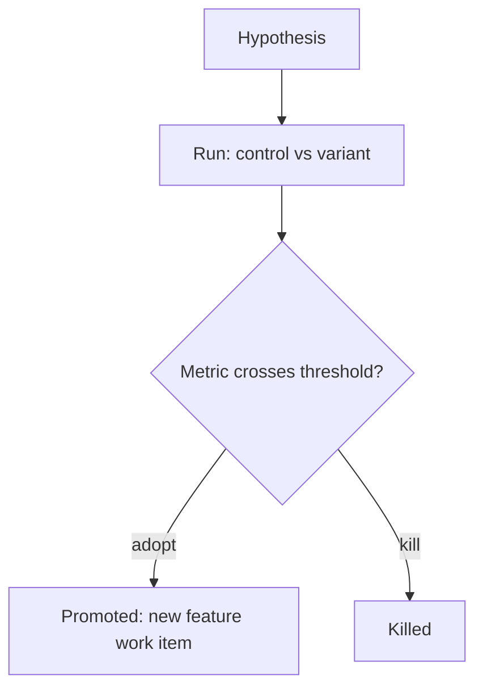

# <Title: the question this experiment answers>

## Purpose
<...>

## Non-goals
- <...>

## Hypothesis
<If we change X, metric Y moves by at least Z.>

## Metric
<What is measured, from which source, how often.>

## Control vs variant
| Arm | Description |
|---|---|
| Control | <...> |
| Variant | <...> |

## Kill/adopt threshold
<Numbers: adopt when ..., kill when ...>

## Timebox
<Calendar or sample bound, whichever comes first.>

## Result
<pending>

## Gate plan
| Risk | Kind (deterministic / qualitative) | Check | Blocking / advisory |
|---|---|---|---|
| <risk> | qualitative | <check> | advisory |

<!-- On adopt: set status `promoted`, add `## Promoted to` with the new feature item id in backticks. Experiments keep every layer `none`; the real change is a new feature item. -->
