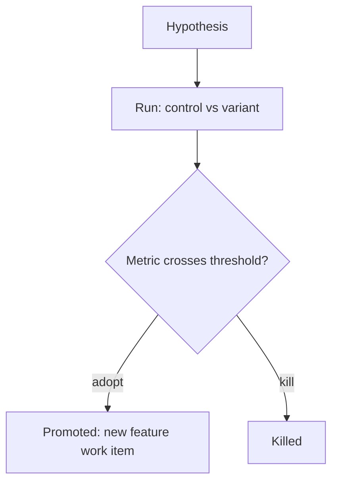

# <Title: the question this experiment answers>

## References

### Local

| Source (file:line) | Status (working / partial / broken) | What it shows | Decision (extract / wrap / replace / ignore) + reason |
|---|---|---|---|
| EXAMPLE D:/repo/<theme>/<repo>/src/<file>.js:<line> | working | EXAMPLE: the working code for the same role | extract: EXAMPLE lift it instead of rebuilding |

### Web

| Source (URL) | Date checked | What it shows | Decision |
|---|---|---|---|
| EXAMPLE https://<convention or tool docs> | YYYY-MM-DD | EXAMPLE: the current convention | wrap: EXAMPLE adopt it |

## Operating envelope

Optional for experiments: delete this section when the experiment relies on no assumption worth stating.

| Assumption | How it is observed (not hoped) | If violated |
|---|---|---|
| EXAMPLE one machine, one orchestrator | EXAMPLE AC-<n> | refuse: EXAMPLE reject and report a named reason |

## Purpose
<...>

## Non-goals
- <...>

## Hypothesis
<If we change X, metric Y moves by at least Z.>

## Metric
<What is measured, from which source, how often.>

## Control vs variant
| Arm | Description |
|---|---|
| Control | <...> |
| Variant | <...> |

## Kill/adopt threshold
<Numbers: adopt when ..., kill when ...>

## Timebox
<Calendar or sample bound, whichever comes first.>

## Result
<pending>

## Gate plan
| Risk | Kind (deterministic / qualitative) | Check | Blocking / advisory |
|---|---|---|---|
| <risk> | qualitative | <check> | advisory |

<!-- On adopt: set status `promoted`, add `## Promoted to` with the new feature item id in backticks. Experiments keep every layer `none`; the real change is a new feature item. -->
