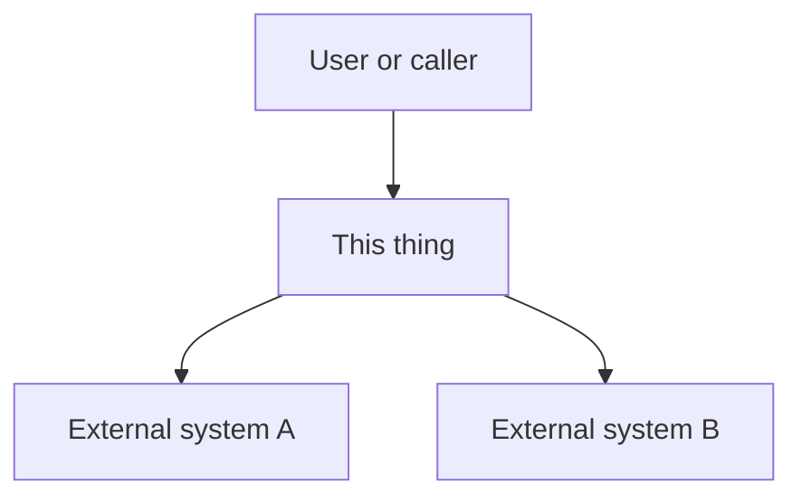
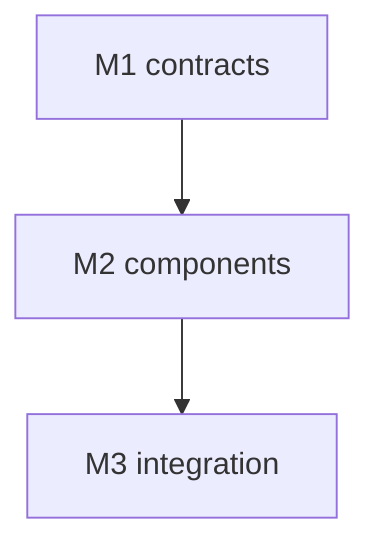

# <Title: what this change is>

## Overview
<!-- Multi-package items only; delete otherwise. At most 300 words excluding the diagram: purpose, every CAP-n id, the package flowchart, every milestone M<n>. This is the only holistic text a package agent receives. -->
EXAMPLE (replace): <one paragraph naming CAP-1..CAP-5 and milestones M1..M3.>

## Purpose
<One paragraph for the owner: the problem and the outcome.>

## Non-goals
- <What this will not do.>

## Capabilities
| CAP | Statement |
|---|---|
| CAP-1 | The user can <...> |
| CAP-2 | The service must <...> |
| CAP-3 | The service must not <...> |
| CAP-4 | EXAMPLE (replace): The service must reject malformed input with a named error |
| CAP-5 | EXAMPLE (replace): The service must not lose a job on restart |

## Non-functional requirements
| NFR | Target | Method | Evidence |
|---|---|---|---|
| NFR-1 | EXAMPLE (replace): p95 latency <= 200 ms at 10 req/s | latency-bench: <what is timed> | AC-<n> |
| NFR-2 | EXAMPLE (replace): cost <= $0.05 per job | cost-budget: recorded tokens/$ | AC-<n> |
| NFR-3 | EXAMPLE (replace): a new plug-in needs 0 core file edits | extensibility: add a stub plug-in in a test | AC-<n> |
| NFR-4 | EXAMPLE (replace): no import of another package's internals (import-boundary rule) | fitness: dependency-cruiser / import-linter rule | AC-<n> + config:.dependency-cruiser.cjs |

Evidence format: `AC-<n>` and/or `config:<path>` and/or `decision:<R-id>` joined by ` + `. Method kinds: fault-injection, latency-bench, cost-budget, extensibility, fitness, observability, clock-kill, spike (evidence = DECISIONS.md row, status confirmed).

## Trade-offs
| Option | Latency | Cost | Maintenance | Extensibility | Refactorability | Verdict |
|---|---|---|---|---|---|---|
| <Option A> | <...> | <...> | <...> | <...> | <...> | chosen |
| <Option B> | <...> | <...> | <...> | <...> | <...> | rejected: <why> |

## Patterns applied
| Pattern | Where | Why |
|---|---|---|
| <e.g. outbox, adapter, state machine> | <component> | <reason> |

## Components chosen
| Need | Chosen (off the shelf) | Rejected | Why rejected |
|---|---|---|---|
| <need> | <library or service> | <alternative> | <reason> |

## Gate plan
| Risk | Kind (deterministic / qualitative) | Check | Blocking / advisory |
|---|---|---|---|
| <risk> | deterministic | <check> | blocking |
| package isolation (multi-package only) | deterministic | isolation: <gate command: sparse checkout from spec_check --sparse, then build and test> | blocking |

<!-- Integration adds `## External contract`; type-specific sections go here (see the profile table): bugfix root cause, experiment hypothesis/metric/result, etc. -->
