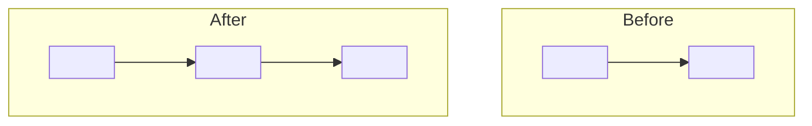
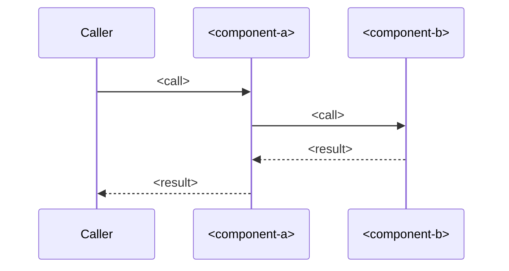

# <id>: L1 architecture



Before: <"n/a: new" when added.> After: <one sentence on the new edges.>

## Components
| Component | Role (one line) | Spec |
|---|---|---|
| <component-a> | <role> | components.md `## <component-a>` |
| <component-b> | <role> | nested: docs/work/<child-id>/ |

## Lifecycle
<!-- Keep this section only when README has `lifecycle: true`. When `lifecycle: false`, delete the whole section (heading and diagram): the checker requires it iff true. -->


## Call chains
### <Main call chain>


## Work breakdown
<!-- Multi-package items (components.md has >= 2 non-stub components): keep this section. Single-package items: delete it (layers.architecture may then be `none`). Every row below is an EXAMPLE (CK-19 rejects it until replaced). -->

```mermaid
flowchart TD
  P1[PKG-1 contracts<br/>provides result@1] -->|result@1| P2[PKG-2 component-a]
  P1 -->|result@1| P3[PKG-3 component-b]
  P2 --> P4[PKG-4 integration]
  P3 --> P4
```

| Package | Component | Owns | Provides | Consumes | Depends on | Milestone | ACs | Test seam |
|---|---|---|---|---|---|---|---|---|
| PKG-1 | EXAMPLE contracts | src/contracts/**, fixtures/** | result@1 | - | - | M1 | AC-1 | none |
| PKG-2 | EXAMPLE component-a | src/a/** | - | result@1 | PKG-1 | M2 | AC-2 | fixtures:result@1 |
| PKG-3 | EXAMPLE component-b | src/b/** | - | result@1 | PKG-1 | M2 | AC-3 | fixtures:result@1 + stub:fixtures/result.v1/stub.ts |
| PKG-4 | EXAMPLE integration | tests/e2e/** | - | result@1 | PKG-2, PKG-3 | M3 | AC-4 | fixtures:result@1 |
| SHARED | - | package.json, tsconfig.json, pnpm-lock.yaml | - | - | - | M1 | - | none |

Owns use the Foreman glob dialect (charset `A-Za-z0-9._-/*?`, `**` any depth, trailing `/` = `/**`, case-insensitive) and are pairwise disjoint. Stubs sit inside the contract provider's owns. Milestone exit: the listed ACs green, the contract tests for every contract provided or consumed, and the isolation run (sparse checkout of owns + consumed contract files + stubs + SHARED) passing for each package. Packages depend only on earlier milestones.
