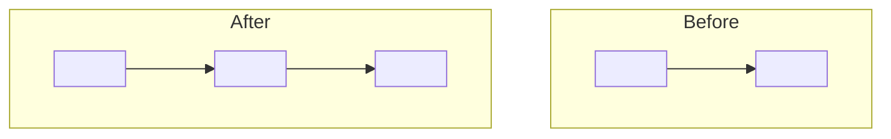
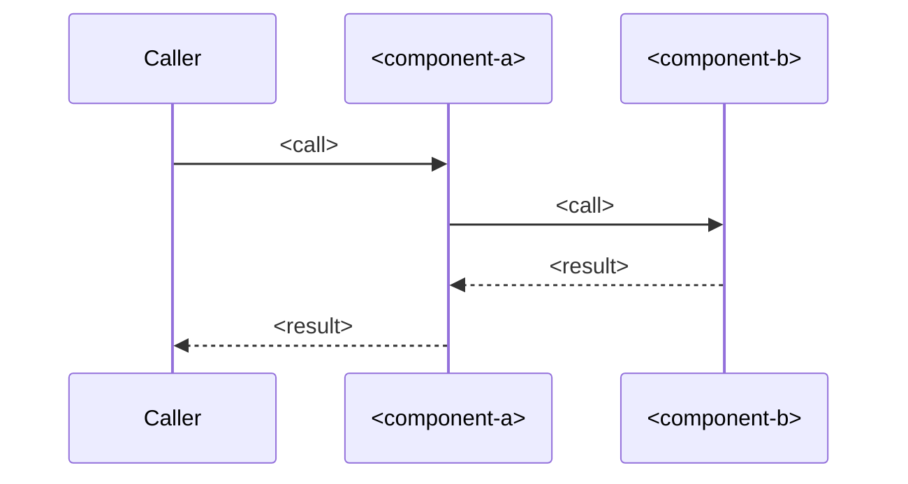

# <id>: L1 architecture

Before: <"n/a: new" when added.> After: <one sentence on the new edges.>

## Components
| Component | Role (one line) | Spec |
|---|---|---|
| <component-a> | <role> | components.md `## <component-a>` |
| <component-b> | <role> | nested: docs/work/<child-id>/ |

## Lifecycle

```mermaid
stateDiagram-v2
  [*] --> <State1>
  <State1> --> <State2>: <event>
  <State2> --> [*]
```

<!-- Keep this section only when README has `lifecycle: true`. When `lifecycle: false`, delete the whole section (heading and diagram): the checker requires it iff true. -->

## Call chains
### <Main call chain>

