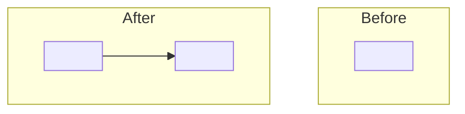

# <id>: L2 component specs

| Component | Owned files | Public interface |
|---|---|---|
| <component-a> | `src/<a>/**` | `<signature or endpoint>` |
| <component-b> | `src/<b>/**` | `<signature or endpoint>` |

## <component-a>

### Interface
<Signatures, input/output schema names (link data.md), error contract.>

### Functional requirements
| FR | Requirement |
|---|---|
| FR-1 | <testable statement> |

### Data
<What it reads and writes; link data.md sections, do not duplicate them.>

### Failure modes
| Failure | Detection | Handling |
|---|---|---|
| <failure> | <how noticed> | <retry / degrade / fail with named class> |

### Budget
| Dimension | Budget |
|---|---|
| Latency | <n> ms p95 |
| Cost | $<n> per <unit> |

## <component-b>

### Interface
<...>

### Functional requirements
| FR | Requirement |
|---|---|
| FR-2 | <testable statement> |

### Data
<...>

### Failure modes
| Failure | Detection | Handling |
|---|---|---|
| <failure> | <how noticed> | <handling> |

### Budget
| Dimension | Budget |
|---|---|
| Latency | <n> ms p95 |
| Cost | $<n> per <unit> |

## <component-c, nested>
Nested spec: `docs/work/<child-id>/`. Trigger: <contract | boundary | team | size>.
<!-- A nested stub has no H3s and its first line is exactly `Nested spec: <path>`. Delete this section if there are no children. -->
