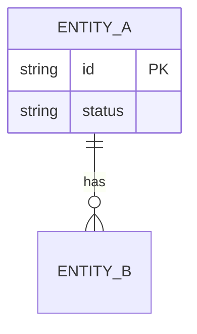

# <id>: L2 data and contracts

Before: <"n/a: new" or the prior diagram, same style.> After: above.

## Schema
<Pointer to the schema source of truth, `path/to/schema.ts:1`. Types are derived from it; do not restate fields here beyond what the diagram shows.>

## Contracts
<!-- Contracts register for the Work breakdown. Schema file is `<contract-id>.v<version>.<ext>`, owned by the provider package. Fixture globs have a `valid` / `invalid` directory segment. Digest stays blank until the contract package merges (`spec_check.py --digest <id>@<n>`). Status: current | retired. Delete the table if nothing provides or consumes a contract. The row below is an EXAMPLE. -->
| Contract | Version | Schema file | Provider | Valid fixtures | Invalid fixtures | Digest | Status |
|---|---|---|---|---|---|---|---|
| EXAMPLE result | 1 | src/contracts/result.v1.ts | PKG-1 | fixtures/result.v1/valid/*.json | fixtures/result.v1/invalid/*.json |  | current |

A breaking change adds `result.v2.ts` and a new row; the v1 row becomes `retired` and stays while any package consumes it. Producer and consumer tests both run against these fixtures. Stubs live next to the fixtures, owned by the provider.

## Migration and back-compat
<Steps, reversibility, compat views. "None" if nothing migrates.>
